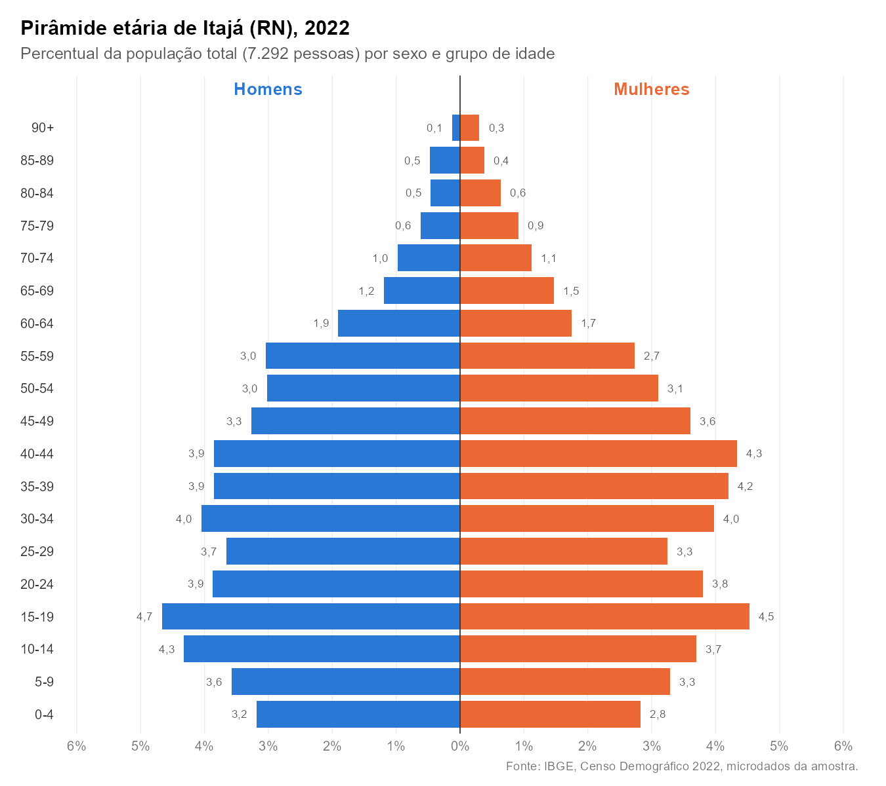

# Itajá (RN)

Resultados do Censo Demográfico 2022 (microdados da amostra). Gerado por `R/05_readmes.R`; veja a [página dos municípios](../README.md) e o [README principal](../../../../README.md).

População: **7.292** pessoas (2.290 registros na amostra).

## Estrutura etária

| Indicador | Itajá | RN |
|---|--:|--:|
| Razão de dependência jovem | 29,7 | 28,5 |
| Razão de dependência idosa | 12,3 | 15,1 |
| Razão de dependência total | 42,0 | 43,6 |
| Índice de envelhecimento | 41,5 | 52,9 |

Valores por 100 pessoas.

## Migração

Chegadas e saídas: mudanças de município nos últimos 10 anos.

| Indicador | Valor |
|---|--:|
| Nascidos no próprio município | 59,0% |
| Nascidos em outro município do Rio Grande do Norte | 38,1% |
| Nascidos em outra UF | 2,8% |
| Nascidos no exterior | 0,0% |
| Chegaram de outro município do Rio Grande do Norte | 943 |
| Chegaram de outra UF | 84 |
| Saíram para outro município da UF | 753 |
| Saíram para outra UF | 111 |
| Saldo migratório | +164 |
| Saldo por 1.000 habitantes | +22,5 |
| Chegaram do exterior | 3 |

Principais origens de quem chegou e destinos de quem saiu:

| Origem | Chegaram | Destino | Saíram |
|---|--:|---|--:|
| Açu (RN) | 272 | Açu (RN) | 214 |
| Mossoró (RN) | 88 | Ipanguaçu (RN) | 103 |
| Ipanguaçu (RN) | 86 | Natal (RN) | 61 |
| Natal (RN) | 73 | Mossoró (RN) | 51 |
| São Rafael (RN) | 64 | São José de Mipibu (RN) | 37 |

## Mortalidade

Óbitos de agosto de 2021 a julho de 2022 informados no Censo.

| Indicador | Itajá | RN |
|---|--:|--:|
| Óbitos no período | 29 | 22.488 |
| Registros de óbito na amostra | 9 |  |
| Taxa bruta de mortalidade (por mil) | 4,0 | 6,8 |
| Taxa padronizada por idade (por mil) | 3,9 | 6,8 |

Com poucos óbitos na amostra, as taxas deste município variam muito por acaso; por isso não há tábua de vida. Sem correção do sub-registro de óbitos do Censo.
