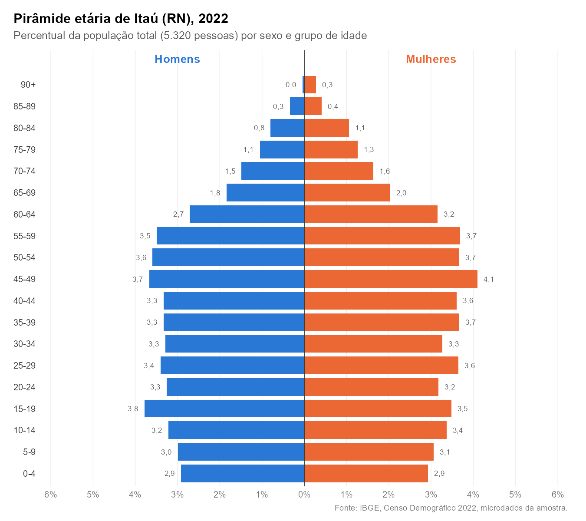

# Itaú (RN)

Resultados do Censo Demográfico 2022 (microdados da amostra). Gerado por `R/05_readmes.R`; veja a [página dos municípios](../README.md) e o [README principal](../../../../README.md).

População: **5.320** pessoas (1.801 registros na amostra).

## Estrutura etária

| Indicador | Itaú | RN |
|---|--:|--:|
| Razão de dependência jovem | 26,7 | 28,5 |
| Razão de dependência idosa | 17,7 | 15,1 |
| Razão de dependência total | 44,3 | 43,6 |
| Índice de envelhecimento | 66,2 | 52,9 |

Valores por 100 pessoas.

## Migração

Chegadas e saídas: mudanças de município nos últimos 10 anos.

| Indicador | Valor |
|---|--:|
| Nascidos no próprio município | 69,1% |
| Nascidos em outro município do Rio Grande do Norte | 25,9% |
| Nascidos em outra UF | 5,0% |
| Nascidos no exterior | 0,0% |
| Chegaram de outro município do Rio Grande do Norte | 417 |
| Chegaram de outra UF | 93 |
| Saíram para outro município da UF | 580 |
| Saíram para outra UF | 240 |
| Saldo migratório | -309 |
| Saldo por 1.000 habitantes | -58,2 |
| Chegaram do exterior | 2 |

Principais origens de quem chegou e destinos de quem saiu:

| Origem | Chegaram | Destino | Saíram |
|---|--:|---|--:|
| Mossoró (RN) | 91 | Mossoró (RN) | 114 |
| Severiano Melo (RN) | 59 | Pau dos Ferros (RN) | 94 |
| Apodi (RN) | 59 | Taboleiro Grande (RN) | 75 |
| Natal (RN) | 30 | São Paulo (SP) | 70 |
| Pau dos Ferros (RN) | 27 | Severiano Melo (RN) | 51 |

## Mortalidade

Óbitos de agosto de 2021 a julho de 2022 informados no Censo.

| Indicador | Itaú | RN |
|---|--:|--:|
| Óbitos no período | 32 | 22.488 |
| Registros de óbito na amostra | 13 |  |
| Taxa bruta de mortalidade (por mil) | 6,0 | 6,8 |
| Taxa padronizada por idade (por mil) | 5,9 | 6,8 |

Com poucos óbitos na amostra, as taxas deste município variam muito por acaso; por isso não há tábua de vida. Sem correção do sub-registro de óbitos do Censo.
