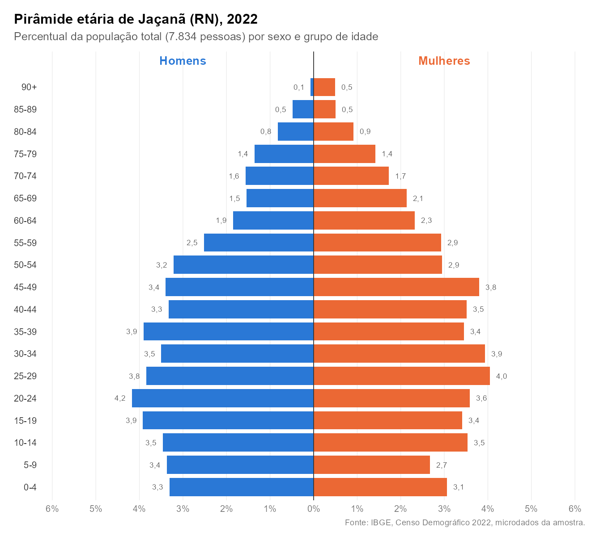

# Jaçanã (RN)

Resultados do Censo Demográfico 2022 (microdados da amostra). Gerado por `R/05_readmes.R`; veja a [página dos municípios](../README.md) e o [README principal](../../../../README.md).

População: **7.834** pessoas (1.611 registros na amostra).

## Estrutura etária

| Indicador | Jaçanã | RN |
|---|--:|--:|
| Razão de dependência jovem | 28,7 | 28,5 |
| Razão de dependência idosa | 19,3 | 15,1 |
| Razão de dependência total | 48,0 | 43,6 |
| Índice de envelhecimento | 67,1 | 52,9 |

Valores por 100 pessoas.

## Migração

Chegadas e saídas: mudanças de município nos últimos 10 anos.

| Indicador | Valor |
|---|--:|
| Nascidos no próprio município | 64,3% |
| Nascidos em outro município do Rio Grande do Norte | 15,4% |
| Nascidos em outra UF | 20,2% |
| Nascidos no exterior | 0,0% |
| Chegaram de outro município do Rio Grande do Norte | 363 |
| Chegaram de outra UF | 513 |
| Saíram para outro município da UF | 332 |
| Saíram para outra UF | 924 |
| Saldo migratório | -380 |
| Saldo por 1.000 habitantes | -48,5 |
| Chegaram do exterior | 0 |

Principais origens de quem chegou e destinos de quem saiu:

| Origem | Chegaram | Destino | Saíram |
|---|--:|---|--:|
| Coronel Ezequiel (RN) | 118 | Cuité (PB) | 155 |
| Nova Floresta (PB) | 98 | Natal (RN) | 137 |
| Cuité (PB) | 93 | Nova Floresta (PB) | 135 |
| Natal (RN) | 86 | Porto Velho (RO) | 94 |
| Santa Cruz (RN) | 54 | Picuí (PB) | 82 |

## Mortalidade

Óbitos de agosto de 2021 a julho de 2022 informados no Censo.

| Indicador | Jaçanã | RN |
|---|--:|--:|
| Óbitos no período | 46 | 22.488 |
| Registros de óbito na amostra | 10 |  |
| Taxa bruta de mortalidade (por mil) | 5,8 | 6,8 |
| Taxa padronizada por idade (por mil) | 4,8 | 6,8 |

Com poucos óbitos na amostra, as taxas deste município variam muito por acaso; por isso não há tábua de vida. Sem correção do sub-registro de óbitos do Censo.
