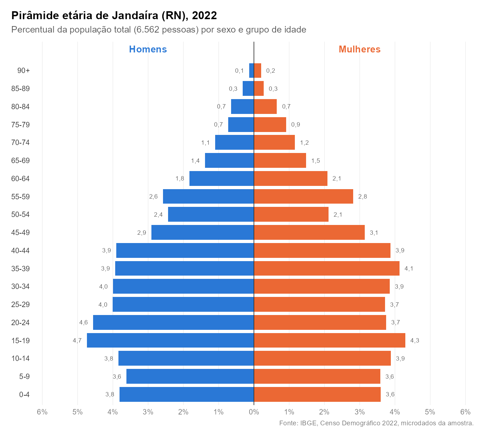

# Jandaíra (RN)

Resultados do Censo Demográfico 2022 (microdados da amostra). Gerado por `R/05_readmes.R`; veja a [página dos municípios](../README.md) e o [README principal](../../../../README.md).

População: **6.562** pessoas (2.091 registros na amostra).

## Estrutura etária

| Indicador | Jandaíra | RN |
|---|--:|--:|
| Razão de dependência jovem | 32,5 | 28,5 |
| Razão de dependência idosa | 13,1 | 15,1 |
| Razão de dependência total | 45,6 | 43,6 |
| Índice de envelhecimento | 40,3 | 52,9 |

Valores por 100 pessoas.

## Migração

Chegadas e saídas: mudanças de município nos últimos 10 anos.

| Indicador | Valor |
|---|--:|
| Nascidos no próprio município | 65,2% |
| Nascidos em outro município do Rio Grande do Norte | 32,1% |
| Nascidos em outra UF | 2,6% |
| Nascidos no exterior | 0,0% |
| Chegaram de outro município do Rio Grande do Norte | 813 |
| Chegaram de outra UF | 59 |
| Saíram para outro município da UF | 678 |
| Saíram para outra UF | 80 |
| Saldo migratório | +114 |
| Saldo por 1.000 habitantes | +17,4 |
| Chegaram do exterior | 0 |

Principais origens de quem chegou e destinos de quem saiu:

| Origem | Chegaram | Destino | Saíram |
|---|--:|---|--:|
| Natal (RN) | 235 | João Câmara (RN) | 122 |
| João Câmara (RN) | 66 | Parnamirim (RN) | 121 |
| Guamaré (RN) | 64 | Natal (RN) | 79 |
| Parazinho (RN) | 55 | Guamaré (RN) | 76 |
| Pedra Preta (RN) | 28 | São Bento do Norte (RN) | 48 |

## Mortalidade

Óbitos de agosto de 2021 a julho de 2022 informados no Censo.

| Indicador | Jandaíra | RN |
|---|--:|--:|
| Óbitos no período | 39 | 22.488 |
| Registros de óbito na amostra | 13 |  |
| Taxa bruta de mortalidade (por mil) | 6,0 | 6,8 |
| Taxa padronizada por idade (por mil) | 6,8 | 6,8 |

Com poucos óbitos na amostra, as taxas deste município variam muito por acaso; por isso não há tábua de vida. Sem correção do sub-registro de óbitos do Censo.
