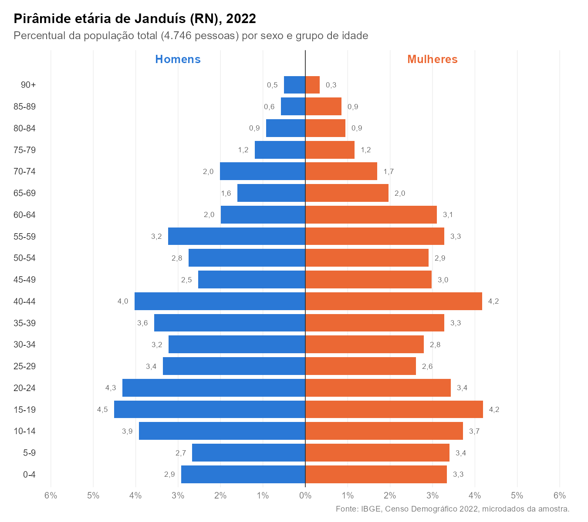

# Janduís (RN)

Resultados do Censo Demográfico 2022 (microdados da amostra). Gerado por `R/05_readmes.R`; veja a [página dos municípios](../README.md) e o [README principal](../../../../README.md).

População: **4.746** pessoas (1.581 registros na amostra).

## Estrutura etária

| Indicador | Janduís | RN |
|---|--:|--:|
| Razão de dependência jovem | 30,2 | 28,5 |
| Razão de dependência idosa | 20,8 | 15,1 |
| Razão de dependência total | 50,9 | 43,6 |
| Índice de envelhecimento | 68,9 | 52,9 |

Valores por 100 pessoas.

## Migração

Chegadas e saídas: mudanças de município nos últimos 10 anos.

| Indicador | Valor |
|---|--:|
| Nascidos no próprio município | 82,1% |
| Nascidos em outro município do Rio Grande do Norte | 11,7% |
| Nascidos em outra UF | 6,1% |
| Nascidos no exterior | 0,0% |
| Chegaram de outro município do Rio Grande do Norte | 392 |
| Chegaram de outra UF | 95 |
| Saíram para outro município da UF | 691 |
| Saíram para outra UF | 82 |
| Saldo migratório | -286 |
| Saldo por 1.000 habitantes | -60,3 |
| Chegaram do exterior | 0 |

Principais origens de quem chegou e destinos de quem saiu:

| Origem | Chegaram | Destino | Saíram |
|---|--:|---|--:|
| Mossoró (RN) | 83 | Mossoró (RN) | 124 |
| Natal (RN) | 53 | Caraúbas (RN) | 69 |
| Messias Targino (RN) | 52 | Natal (RN) | 64 |
| Campo Grande (RN) | 46 | Upanema (RN) | 54 |
| Caicó (RN) | 28 | Pau dos Ferros (RN) | 39 |

## Mortalidade

Óbitos de agosto de 2021 a julho de 2022 informados no Censo.

| Indicador | Janduís | RN |
|---|--:|--:|
| Óbitos no período | 15 | 22.488 |
| Registros de óbito na amostra | 5 |  |
| Taxa bruta de mortalidade (por mil) | 3,2 | 6,8 |
| Taxa padronizada por idade (por mil) | 2,7 | 6,8 |

Com poucos óbitos na amostra, as taxas deste município variam muito por acaso; por isso não há tábua de vida. Sem correção do sub-registro de óbitos do Censo.
