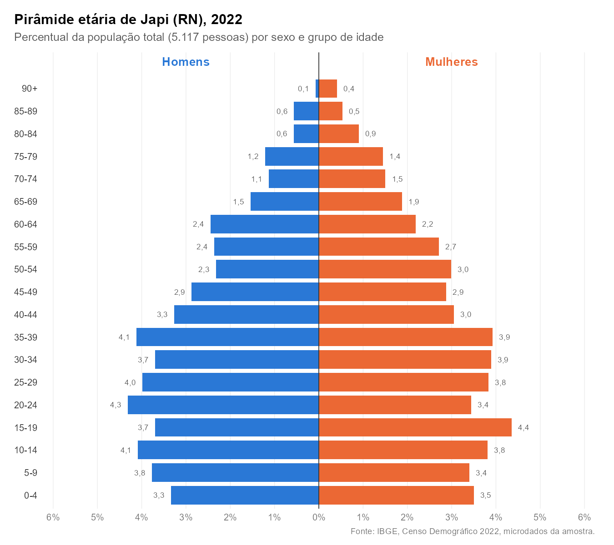

# Japi (RN)

Resultados do Censo Demográfico 2022 (microdados da amostra). Gerado por `R/05_readmes.R`; veja a [página dos municípios](../README.md) e o [README principal](../../../../README.md).

População: **5.117** pessoas (1.628 registros na amostra).

## Estrutura etária

| Indicador | Japi | RN |
|---|--:|--:|
| Razão de dependência jovem | 33,0 | 28,5 |
| Razão de dependência idosa | 17,7 | 15,1 |
| Razão de dependência total | 50,7 | 43,6 |
| Índice de envelhecimento | 53,6 | 52,9 |

Valores por 100 pessoas.

## Migração

Chegadas e saídas: mudanças de município nos últimos 10 anos.

| Indicador | Valor |
|---|--:|
| Nascidos no próprio município | 71,8% |
| Nascidos em outro município do Rio Grande do Norte | 18,1% |
| Nascidos em outra UF | 10,1% |
| Nascidos no exterior | 0,0% |
| Chegaram de outro município do Rio Grande do Norte | 125 |
| Chegaram de outra UF | 195 |
| Saíram para outro município da UF | 447 |
| Saíram para outra UF | 116 |
| Saldo migratório | -243 |
| Saldo por 1.000 habitantes | -47,5 |
| Chegaram do exterior | 0 |

Principais origens de quem chegou e destinos de quem saiu:

| Origem | Chegaram | Destino | Saíram |
|---|--:|---|--:|
| Natal (RN) | 42 | Santa Cruz (RN) | 163 |
| São Paulo (SP) | 39 | Parnamirim (RN) | 73 |
| Araruna (PB) | 38 | Macaíba (RN) | 38 |
| Cuité (PB) | 33 | São Bento do Trairí (RN) | 28 |
| Santa Cruz (RN) | 28 | Tangará (RN) | 24 |

## Mortalidade

Óbitos de agosto de 2021 a julho de 2022 informados no Censo.

| Indicador | Japi | RN |
|---|--:|--:|
| Óbitos no período | 32 | 22.488 |
| Registros de óbito na amostra | 11 |  |
| Taxa bruta de mortalidade (por mil) | 6,3 | 6,8 |
| Taxa padronizada por idade (por mil) | 6,4 | 6,8 |

Com poucos óbitos na amostra, as taxas deste município variam muito por acaso; por isso não há tábua de vida. Sem correção do sub-registro de óbitos do Censo.
