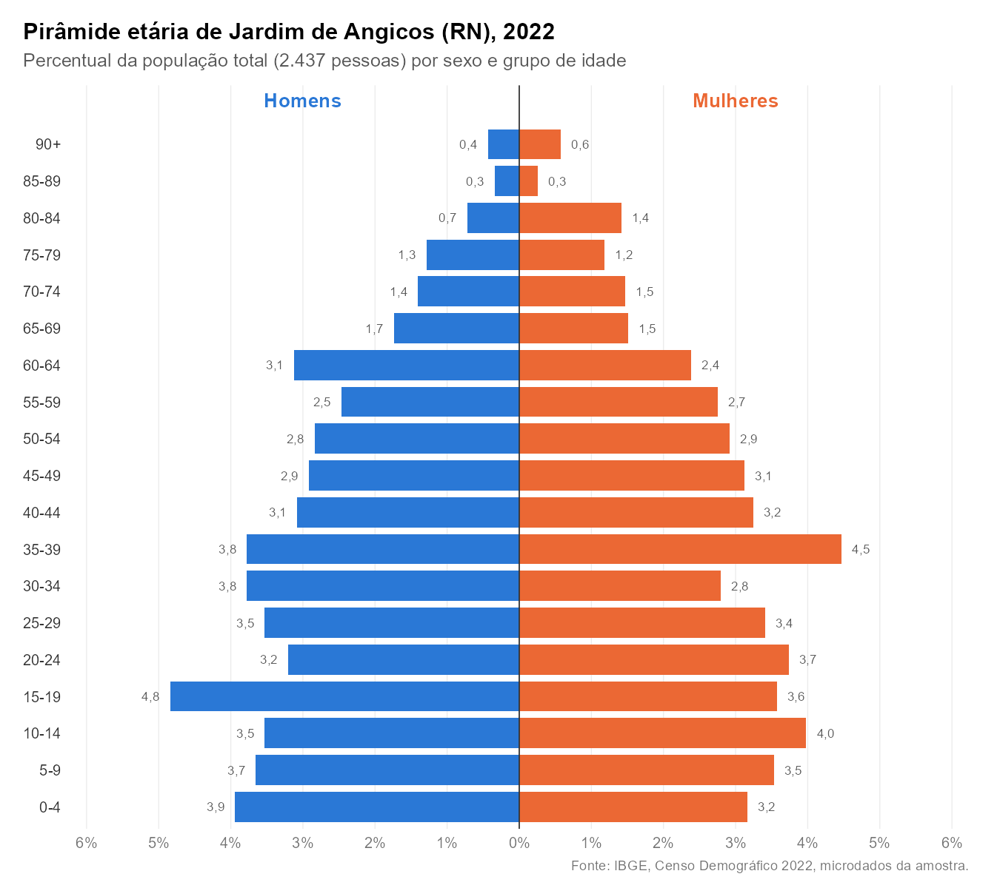

# Jardim de Angicos (RN)

Resultados do Censo Demográfico 2022 (microdados da amostra). Gerado por `R/05_readmes.R`; veja a [página dos municípios](../README.md) e o [README principal](../../../../README.md).

População: **2.437** pessoas (807 registros na amostra).

## Estrutura etária

| Indicador | Jardim de Angicos | RN |
|---|--:|--:|
| Razão de dependência jovem | 33,1 | 28,5 |
| Razão de dependência idosa | 18,7 | 15,1 |
| Razão de dependência total | 51,7 | 43,6 |
| Índice de envelhecimento | 56,5 | 52,9 |

Valores por 100 pessoas.

## Migração

Chegadas e saídas: mudanças de município nos últimos 10 anos.

| Indicador | Valor |
|---|--:|
| Nascidos no próprio município | 46,3% |
| Nascidos em outro município do Rio Grande do Norte | 52,1% |
| Nascidos em outra UF | 1,6% |
| Nascidos no exterior | 0,0% |
| Chegaram de outro município do Rio Grande do Norte | 383 |
| Chegaram de outra UF | 18 |
| Saíram para outro município da UF | 176 |
| Saíram para outra UF | 20 |
| Saldo migratório | +204 |
| Saldo por 1.000 habitantes | +83,9 |
| Chegaram do exterior | 0 |

Principais origens de quem chegou e destinos de quem saiu:

| Origem | Chegaram | Destino | Saíram |
|---|--:|---|--:|
| Natal (RN) | 135 | João Câmara (RN) | 88 |
| João Câmara (RN) | 62 | Parnamirim (RN) | 49 |
| Caiçara do Rio do Vento (RN) | 24 | São Gonçalo do Amarante (RN) | 19 |
| Pedra Preta (RN) | 22 | Boa Vista (RR) | 13 |
| Jandaíra (RN) | 19 | Riachuelo (RN) | 8 |

## Mortalidade

Óbitos de agosto de 2021 a julho de 2022 informados no Censo.

| Indicador | Jardim de Angicos | RN |
|---|--:|--:|
| Óbitos no período | 5 | 22.488 |
| Registros de óbito na amostra | 1 |  |
| Taxa bruta de mortalidade (por mil) | 1,9 | 6,8 |
| Taxa padronizada por idade (por mil) | 1,8 | 6,8 |

Com poucos óbitos na amostra, as taxas deste município variam muito por acaso; por isso não há tábua de vida. Sem correção do sub-registro de óbitos do Censo.
