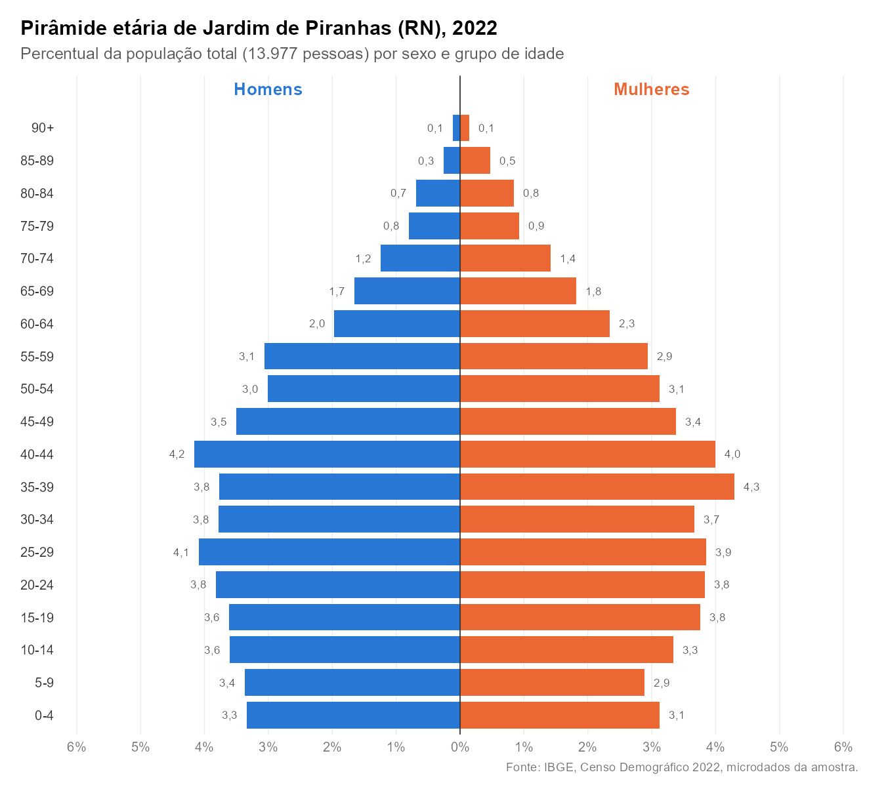

# Jardim de Piranhas (RN)

Resultados do Censo Demográfico 2022 (microdados da amostra). Gerado por `R/05_readmes.R`; veja a [página dos municípios](../README.md) e o [README principal](../../../../README.md).

População: **13.977** pessoas (2.668 registros na amostra).

## Estrutura etária

| Indicador | Jardim de Piranhas | RN |
|---|--:|--:|
| Razão de dependência jovem | 28,1 | 28,5 |
| Razão de dependência idosa | 14,8 | 15,1 |
| Razão de dependência total | 42,9 | 43,6 |
| Índice de envelhecimento | 52,8 | 52,9 |

Valores por 100 pessoas.

## Migração

Chegadas e saídas: mudanças de município nos últimos 10 anos.

| Indicador | Valor |
|---|--:|
| Nascidos no próprio município | 64,5% |
| Nascidos em outro município do Rio Grande do Norte | 18,2% |
| Nascidos em outra UF | 17,2% |
| Nascidos no exterior | 0,0% |
| Chegaram de outro município do Rio Grande do Norte | 925 |
| Chegaram de outra UF | 814 |
| Saíram para outro município da UF | 831 |
| Saíram para outra UF | 340 |
| Saldo migratório | +568 |
| Saldo por 1.000 habitantes | +40,6 |
| Chegaram do exterior | 5 |

Principais origens de quem chegou e destinos de quem saiu:

| Origem | Chegaram | Destino | Saíram |
|---|--:|---|--:|
| Caicó (RN) | 386 | Caicó (RN) | 225 |
| Brejo do Cruz (PB) | 199 | Natal (RN) | 174 |
| Natal (RN) | 100 | Brejo do Cruz (PB) | 92 |
| Mossoró (RN) | 75 | São Bento (PB) | 58 |
| São José do Brejo do Cruz (PB) | 49 | São Fernando (RN) | 50 |

## Mortalidade

Óbitos de agosto de 2021 a julho de 2022 informados no Censo.

| Indicador | Jardim de Piranhas | RN |
|---|--:|--:|
| Óbitos no período | 119 | 22.488 |
| Registros de óbito na amostra | 23 |  |
| Taxa bruta de mortalidade (por mil) | 8,5 | 6,8 |
| Taxa padronizada por idade (por mil) | 9,4 | 6,8 |

Com poucos óbitos na amostra, as taxas deste município variam muito por acaso; por isso não há tábua de vida. Sem correção do sub-registro de óbitos do Censo.
