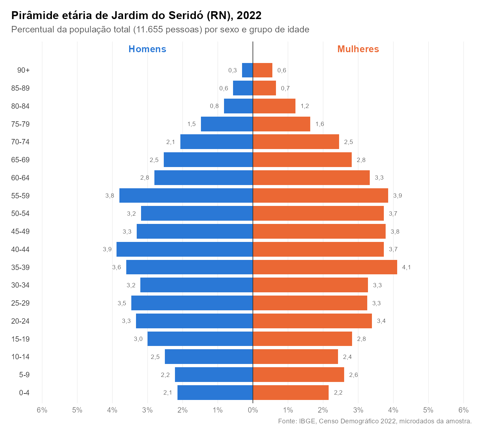

# Jardim do Seridó (RN)

Resultados do Censo Demográfico 2022 (microdados da amostra). Gerado por `R/05_readmes.R`; veja a [página dos municípios](../README.md) e o [README principal](../../../../README.md).

População: **11.655** pessoas (2.294 registros na amostra).

## Estrutura etária

| Indicador | Jardim do Seridó | RN |
|---|--:|--:|
| Razão de dependência jovem | 20,4 | 28,5 |
| Razão de dependência idosa | 24,8 | 15,1 |
| Razão de dependência total | 45,3 | 43,6 |
| Índice de envelhecimento | 121,6 | 52,9 |

Valores por 100 pessoas.

## Migração

Chegadas e saídas: mudanças de município nos últimos 10 anos.

| Indicador | Valor |
|---|--:|
| Nascidos no próprio município | 76,2% |
| Nascidos em outro município do Rio Grande do Norte | 18,2% |
| Nascidos em outra UF | 5,5% |
| Nascidos no exterior | 0,1% |
| Chegaram de outro município do Rio Grande do Norte | 963 |
| Chegaram de outra UF | 284 |
| Saíram para outro município da UF | 1.110 |
| Saíram para outra UF | 223 |
| Saldo migratório | -86 |
| Saldo por 1.000 habitantes | -7,3 |
| Chegaram do exterior | 8 |

Principais origens de quem chegou e destinos de quem saiu:

| Origem | Chegaram | Destino | Saíram |
|---|--:|---|--:|
| Natal (RN) | 245 | Natal (RN) | 326 |
| Caicó (RN) | 192 | Caicó (RN) | 183 |
| Parelhas (RN) | 103 | São José do Seridó (RN) | 119 |
| São Vicente (RN) | 51 | Parelhas (RN) | 72 |
| Ouro Branco (RN) | 42 | Parnamirim (RN) | 61 |

## Mortalidade

Óbitos de agosto de 2021 a julho de 2022 informados no Censo.

| Indicador | Jardim do Seridó | RN |
|---|--:|--:|
| Óbitos no período | 104 | 22.488 |
| Registros de óbito na amostra | 19 |  |
| Taxa bruta de mortalidade (por mil) | 8,9 | 6,8 |
| Taxa padronizada por idade (por mil) | 5,8 | 6,8 |

Com poucos óbitos na amostra, as taxas deste município variam muito por acaso; por isso não há tábua de vida. Sem correção do sub-registro de óbitos do Censo.
