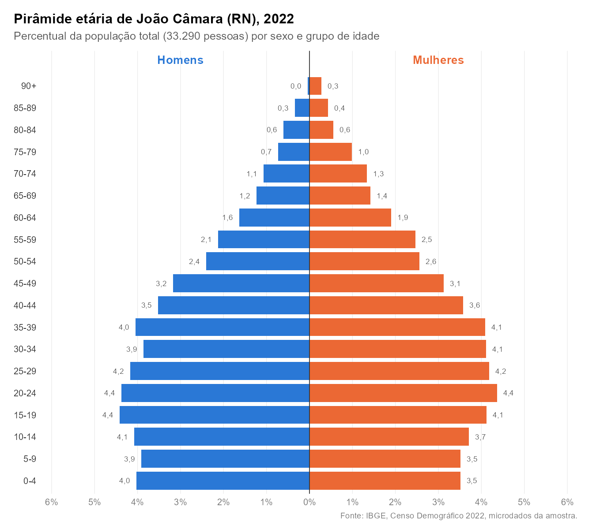

# João Câmara (RN)

Resultados do Censo Demográfico 2022 (microdados da amostra). Gerado por `R/05_readmes.R`; veja a [página dos municípios](../README.md) e o [README principal](../../../../README.md).

População: **33.290** pessoas (3.288 registros na amostra).

## Estrutura etária

| Indicador | João Câmara | RN |
|---|--:|--:|
| Razão de dependência jovem | 33,4 | 28,5 |
| Razão de dependência idosa | 13,2 | 15,1 |
| Razão de dependência total | 46,6 | 43,6 |
| Índice de envelhecimento | 39,7 | 52,9 |

Valores por 100 pessoas.

## Migração

Chegadas e saídas: mudanças de município nos últimos 10 anos.

| Indicador | Valor |
|---|--:|
| Nascidos no próprio município | 74,3% |
| Nascidos em outro município do Rio Grande do Norte | 21,5% |
| Nascidos em outra UF | 4,2% |
| Nascidos no exterior | 0,0% |
| Chegaram de outro município do Rio Grande do Norte | 3.184 |
| Chegaram de outra UF | 587 |
| Saíram para outro município da UF | 4.437 |
| Saíram para outra UF | 550 |
| Saldo migratório | -1.216 |
| Saldo por 1.000 habitantes | -36,5 |
| Chegaram do exterior | 10 |

Principais origens de quem chegou e destinos de quem saiu:

| Origem | Chegaram | Destino | Saíram |
|---|--:|---|--:|
| Natal (RN) | 1.005 | Natal (RN) | 776 |
| Touros (RN) | 169 | Ceará-Mirim (RN) | 426 |
| São Bento do Norte (RN) | 165 | Touros (RN) | 381 |
| Ceará-Mirim (RN) | 155 | Parnamirim (RN) | 368 |
| Poço Branco (RN) | 128 | São Gonçalo do Amarante (RN) | 280 |

## Mortalidade

Óbitos de agosto de 2021 a julho de 2022 informados no Censo.

| Indicador | João Câmara | RN |
|---|--:|--:|
| Óbitos no período | 150 | 22.488 |
| Registros de óbito na amostra | 13 |  |
| Taxa bruta de mortalidade (por mil) | 4,5 | 6,8 |
| Taxa padronizada por idade (por mil) | 5,1 | 6,8 |

Com poucos óbitos na amostra, as taxas deste município variam muito por acaso; por isso não há tábua de vida. Sem correção do sub-registro de óbitos do Censo.
