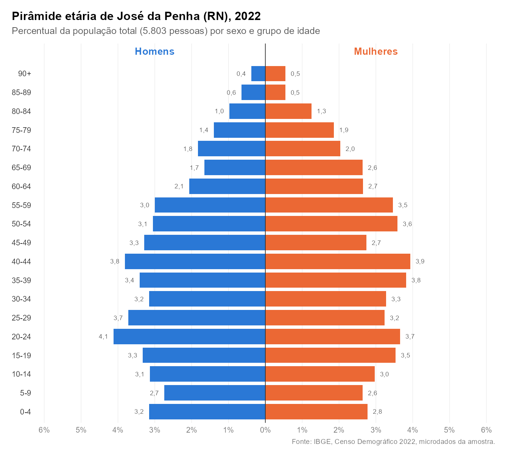

# José da Penha (RN)

Resultados do Censo Demográfico 2022 (microdados da amostra). Gerado por `R/05_readmes.R`; veja a [página dos municípios](../README.md) e o [README principal](../../../../README.md).

População: **5.803** pessoas (1.953 registros na amostra).

## Estrutura etária

| Indicador | José da Penha | RN |
|---|--:|--:|
| Razão de dependência jovem | 26,0 | 28,5 |
| Razão de dependência idosa | 23,6 | 15,1 |
| Razão de dependência total | 49,6 | 43,6 |
| Índice de envelhecimento | 90,5 | 52,9 |

Valores por 100 pessoas.

## Migração

Chegadas e saídas: mudanças de município nos últimos 10 anos.

| Indicador | Valor |
|---|--:|
| Nascidos no próprio município | 72,2% |
| Nascidos em outro município do Rio Grande do Norte | 20,2% |
| Nascidos em outra UF | 7,5% |
| Nascidos no exterior | 0,1% |
| Chegaram de outro município do Rio Grande do Norte | 361 |
| Chegaram de outra UF | 304 |
| Saíram para outro município da UF | 448 |
| Saíram para outra UF | 219 |
| Saldo migratório | -2 |
| Saldo por 1.000 habitantes | -0,4 |
| Chegaram do exterior | 0 |

Principais origens de quem chegou e destinos de quem saiu:

| Origem | Chegaram | Destino | Saíram |
|---|--:|---|--:|
| São Paulo (SP) | 92 | Major Sales (RN) | 123 |
| Pau dos Ferros (RN) | 48 | Pau dos Ferros (RN) | 68 |
| Riacho de Santana (RN) | 44 | Belo Horizonte (MG) | 59 |
| Marcelino Vieira (RN) | 37 | Riacho de Santana (RN) | 47 |
| Major Sales (RN) | 32 | Luís Gomes (RN) | 42 |

## Mortalidade

Óbitos de agosto de 2021 a julho de 2022 informados no Censo.

| Indicador | José da Penha | RN |
|---|--:|--:|
| Óbitos no período | 58 | 22.488 |
| Registros de óbito na amostra | 19 |  |
| Taxa bruta de mortalidade (por mil) | 9,9 | 6,8 |
| Taxa padronizada por idade (por mil) | 7,5 | 6,8 |

Com poucos óbitos na amostra, as taxas deste município variam muito por acaso; por isso não há tábua de vida. Sem correção do sub-registro de óbitos do Censo.
