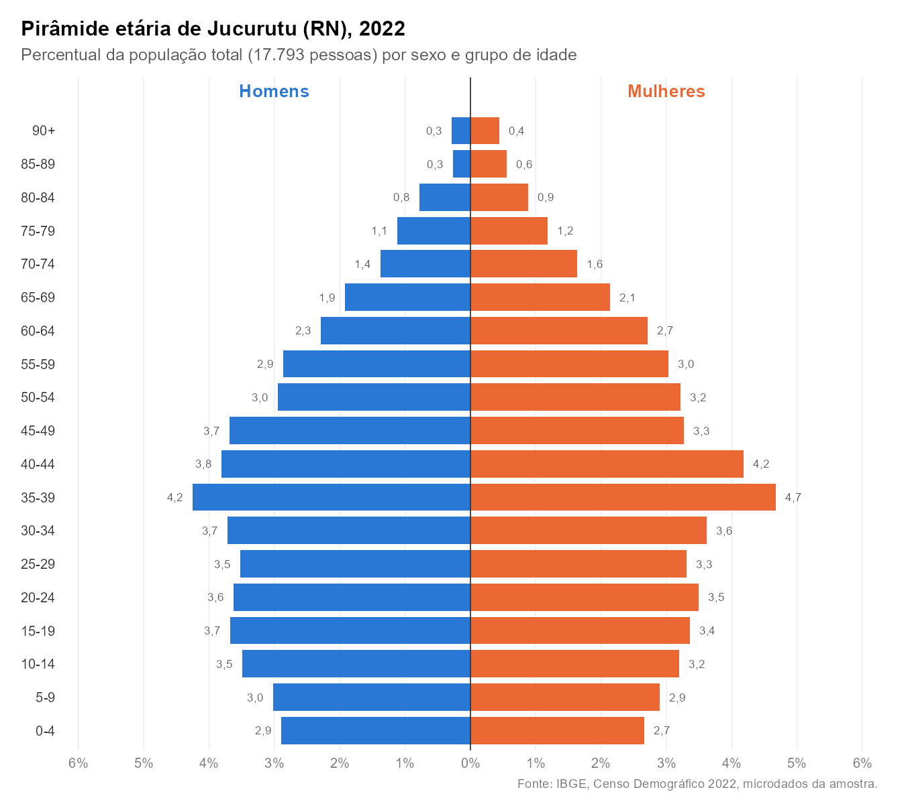

# Jucurutu (RN)

Resultados do Censo Demográfico 2022 (microdados da amostra). Gerado por `R/05_readmes.R`; veja a [página dos municípios](../README.md) e o [README principal](../../../../README.md).

População: **17.793** pessoas (3.494 registros na amostra).

## Estrutura etária

| Indicador | Jucurutu | RN |
|---|--:|--:|
| Razão de dependência jovem | 26,2 | 28,5 |
| Razão de dependência idosa | 18,2 | 15,1 |
| Razão de dependência total | 44,4 | 43,6 |
| Índice de envelhecimento | 69,4 | 52,9 |

Valores por 100 pessoas.

## Migração

Chegadas e saídas: mudanças de município nos últimos 10 anos.

| Indicador | Valor |
|---|--:|
| Nascidos no próprio município | 78,1% |
| Nascidos em outro município do Rio Grande do Norte | 17,0% |
| Nascidos em outra UF | 4,9% |
| Nascidos no exterior | 0,0% |
| Chegaram de outro município do Rio Grande do Norte | 1.739 |
| Chegaram de outra UF | 632 |
| Saíram para outro município da UF | 1.245 |
| Saíram para outra UF | 488 |
| Saldo migratório | +639 |
| Saldo por 1.000 habitantes | +35,9 |
| Chegaram do exterior | 0 |

Principais origens de quem chegou e destinos de quem saiu:

| Origem | Chegaram | Destino | Saíram |
|---|--:|---|--:|
| Natal (RN) | 427 | Caicó (RN) | 330 |
| Caicó (RN) | 238 | Natal (RN) | 77 |
| Mossoró (RN) | 116 | Triunfo Potiguar (RN) | 74 |
| Santana do Matos (RN) | 99 | Parnamirim (RN) | 70 |
| Triunfo Potiguar (RN) | 88 | Florânia (RN) | 65 |

## Mortalidade

Óbitos de agosto de 2021 a julho de 2022 informados no Censo.

| Indicador | Jucurutu | RN |
|---|--:|--:|
| Óbitos no período | 154 | 22.488 |
| Registros de óbito na amostra | 31 |  |
| Taxa bruta de mortalidade (por mil) | 8,7 | 6,8 |
| Taxa padronizada por idade (por mil) | 7,8 | 6,8 |

Com poucos óbitos na amostra, as taxas deste município variam muito por acaso; por isso não há tábua de vida. Sem correção do sub-registro de óbitos do Censo.
