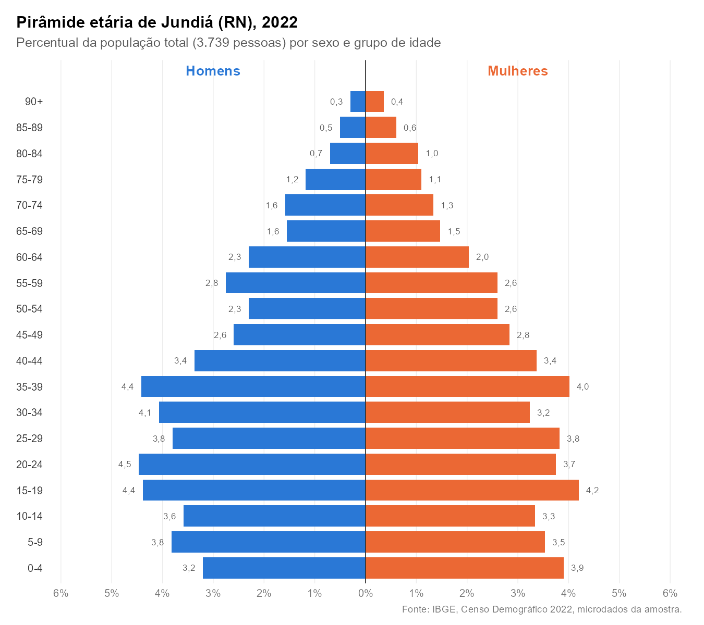

# Jundiá (RN)

Resultados do Censo Demográfico 2022 (microdados da amostra). Gerado por `R/05_readmes.R`; veja a [página dos municípios](../README.md) e o [README principal](../../../../README.md).

População: **3.739** pessoas (1.259 registros na amostra).

## Estrutura etária

| Indicador | Jundiá | RN |
|---|--:|--:|
| Razão de dependência jovem | 32,0 | 28,5 |
| Razão de dependência idosa | 17,5 | 15,1 |
| Razão de dependência total | 49,5 | 43,6 |
| Índice de envelhecimento | 54,7 | 52,9 |

Valores por 100 pessoas.

## Migração

Chegadas e saídas: mudanças de município nos últimos 10 anos.

| Indicador | Valor |
|---|--:|
| Nascidos no próprio município | 84,8% |
| Nascidos em outro município do Rio Grande do Norte | 12,9% |
| Nascidos em outra UF | 2,3% |
| Nascidos no exterior | 0,0% |
| Chegaram de outro município do Rio Grande do Norte | 320 |
| Chegaram de outra UF | 101 |
| Saíram para outro município da UF | 441 |
| Saíram para outra UF | 108 |
| Saldo migratório | -128 |
| Saldo por 1.000 habitantes | -34,3 |
| Chegaram do exterior | 0 |

Principais origens de quem chegou e destinos de quem saiu:

| Origem | Chegaram | Destino | Saíram |
|---|--:|---|--:|
| Natal (RN) | 64 | Natal (RN) | 109 |
| Brejinho (RN) | 58 | Brejinho (RN) | 74 |
| Parnamirim (RN) | 33 | Espírito Santo (RN) | 65 |
| Várzea (RN) | 28 | Macaíba (RN) | 43 |
| Goianinha (RN) | 22 | Parnamirim (RN) | 38 |

## Mortalidade

Óbitos de agosto de 2021 a julho de 2022 informados no Censo.

| Indicador | Jundiá | RN |
|---|--:|--:|
| Óbitos no período | 25 | 22.488 |
| Registros de óbito na amostra | 8 |  |
| Taxa bruta de mortalidade (por mil) | 6,7 | 6,8 |
| Taxa padronizada por idade (por mil) | 6,0 | 6,8 |

Com poucos óbitos na amostra, as taxas deste município variam muito por acaso; por isso não há tábua de vida. Sem correção do sub-registro de óbitos do Censo.
