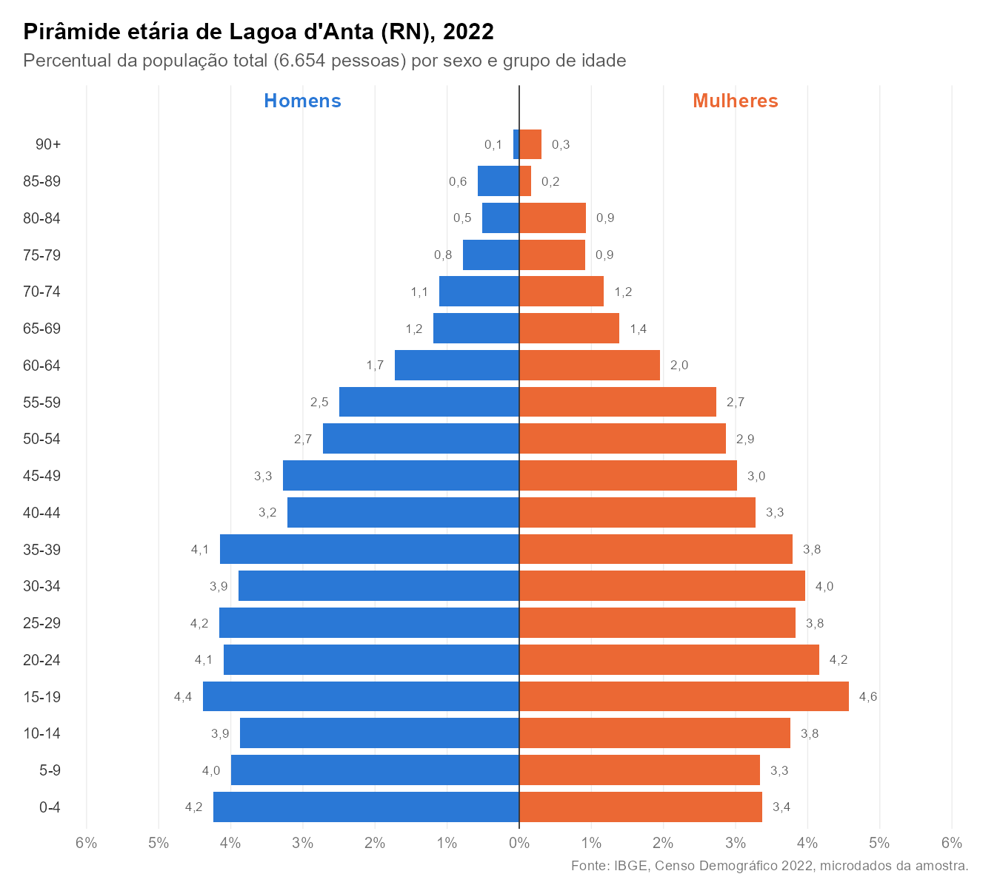

# Lagoa d'Anta (RN)

Resultados do Censo Demográfico 2022 (microdados da amostra). Gerado por `R/05_readmes.R`; veja a [página dos municípios](../README.md) e o [README principal](../../../../README.md).

População: **6.654** pessoas (2.198 registros na amostra).

## Estrutura etária

| Indicador | Lagoa d'Anta | RN |
|---|--:|--:|
| Razão de dependência jovem | 33,0 | 28,5 |
| Razão de dependência idosa | 13,4 | 15,1 |
| Razão de dependência total | 46,4 | 43,6 |
| Índice de envelhecimento | 40,4 | 52,9 |

Valores por 100 pessoas.

## Migração

Chegadas e saídas: mudanças de município nos últimos 10 anos.

| Indicador | Valor |
|---|--:|
| Nascidos no próprio município | 65,3% |
| Nascidos em outro município do Rio Grande do Norte | 26,2% |
| Nascidos em outra UF | 8,5% |
| Nascidos no exterior | 0,0% |
| Chegaram de outro município do Rio Grande do Norte | 708 |
| Chegaram de outra UF | 331 |
| Saíram para outro município da UF | 291 |
| Saíram para outra UF | 95 |
| Saldo migratório | +653 |
| Saldo por 1.000 habitantes | +98,1 |
| Chegaram do exterior | 0 |

Principais origens de quem chegou e destinos de quem saiu:

| Origem | Chegaram | Destino | Saíram |
|---|--:|---|--:|
| Natal (RN) | 144 | Parnamirim (RN) | 164 |
| Santo Antônio (RN) | 122 | Rio de Janeiro (RJ) | 62 |
| Nova Cruz (RN) | 90 | Passa e Fica (RN) | 36 |
| São José do Campestre (RN) | 71 | Florânia (RN) | 27 |
| Rio de Janeiro (RJ) | 68 | Natal (RN) | 21 |

## Mortalidade

Óbitos de agosto de 2021 a julho de 2022 informados no Censo.

| Indicador | Lagoa d'Anta | RN |
|---|--:|--:|
| Óbitos no período | 60 | 22.488 |
| Registros de óbito na amostra | 20 |  |
| Taxa bruta de mortalidade (por mil) | 9,1 | 6,8 |
| Taxa padronizada por idade (por mil) | 9,7 | 6,8 |

Com poucos óbitos na amostra, as taxas deste município variam muito por acaso; por isso não há tábua de vida. Sem correção do sub-registro de óbitos do Censo.
