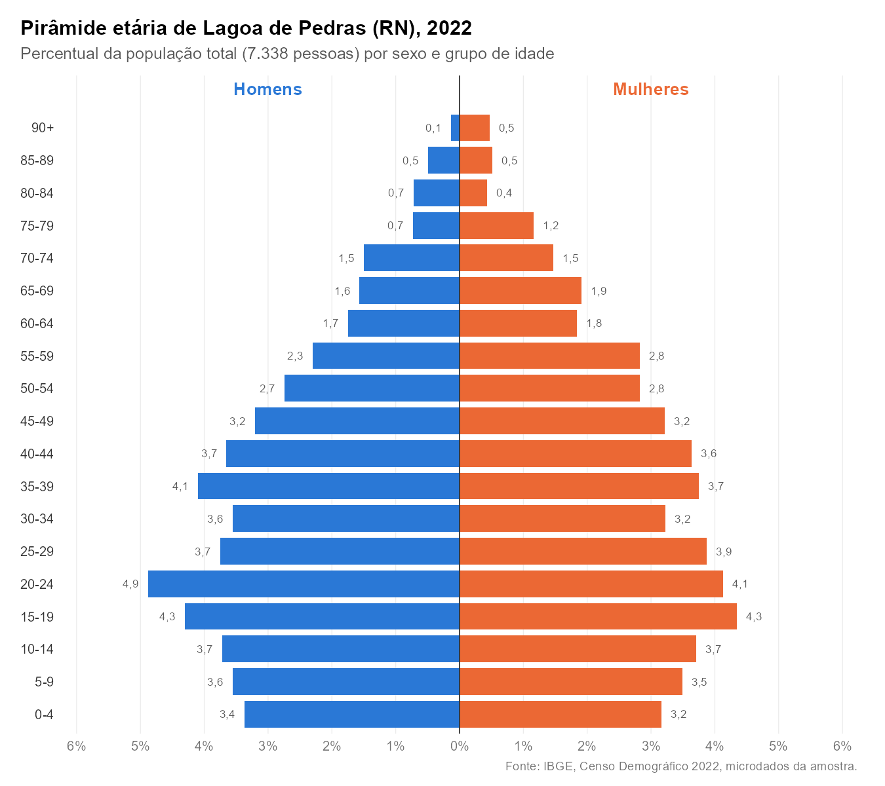

# Lagoa de Pedras (RN)

Resultados do Censo Demográfico 2022 (microdados da amostra). Gerado por `R/05_readmes.R`; veja a [página dos municípios](../README.md) e o [README principal](../../../../README.md).

População: **7.338** pessoas (2.460 registros na amostra).

## Estrutura etária

| Indicador | Lagoa de Pedras | RN |
|---|--:|--:|
| Razão de dependência jovem | 30,9 | 28,5 |
| Razão de dependência idosa | 16,4 | 15,1 |
| Razão de dependência total | 47,3 | 43,6 |
| Índice de envelhecimento | 52,9 | 52,9 |

Valores por 100 pessoas.

## Migração

Chegadas e saídas: mudanças de município nos últimos 10 anos.

| Indicador | Valor |
|---|--:|
| Nascidos no próprio município | 79,2% |
| Nascidos em outro município do Rio Grande do Norte | 17,5% |
| Nascidos em outra UF | 3,2% |
| Nascidos no exterior | 0,0% |
| Chegaram de outro município do Rio Grande do Norte | 717 |
| Chegaram de outra UF | 128 |
| Saíram para outro município da UF | 558 |
| Saíram para outra UF | 231 |
| Saldo migratório | +57 |
| Saldo por 1.000 habitantes | +7,8 |
| Chegaram do exterior | 4 |

Principais origens de quem chegou e destinos de quem saiu:

| Origem | Chegaram | Destino | Saíram |
|---|--:|---|--:|
| Natal (RN) | 176 | Rio de Janeiro (RJ) | 124 |
| Parnamirim (RN) | 109 | Parnamirim (RN) | 86 |
| Lagoa Salgada (RN) | 93 | Serrinha (RN) | 85 |
| Santo Antônio (RN) | 60 | São Paulo (SP) | 69 |
| Serrinha (RN) | 50 | Macaíba (RN) | 66 |

## Mortalidade

Óbitos de agosto de 2021 a julho de 2022 informados no Censo.

| Indicador | Lagoa de Pedras | RN |
|---|--:|--:|
| Óbitos no período | 45 | 22.488 |
| Registros de óbito na amostra | 14 |  |
| Taxa bruta de mortalidade (por mil) | 6,1 | 6,8 |
| Taxa padronizada por idade (por mil) | 6,1 | 6,8 |

Com poucos óbitos na amostra, as taxas deste município variam muito por acaso; por isso não há tábua de vida. Sem correção do sub-registro de óbitos do Censo.
