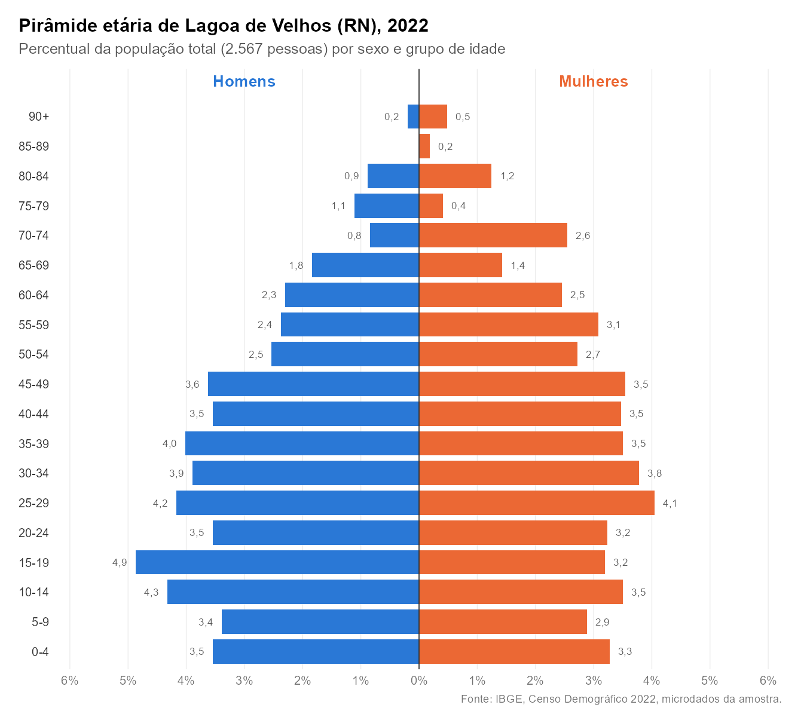

# Lagoa de Velhos (RN)

Resultados do Censo Demográfico 2022 (microdados da amostra). Gerado por `R/05_readmes.R`; veja a [página dos municípios](../README.md) e o [README principal](../../../../README.md).

População: **2.567** pessoas (852 registros na amostra).

## Estrutura etária

| Indicador | Lagoa de Velhos | RN |
|---|--:|--:|
| Razão de dependência jovem | 30,8 | 28,5 |
| Razão de dependência idosa | 16,5 | 15,1 |
| Razão de dependência total | 47,3 | 43,6 |
| Índice de envelhecimento | 53,4 | 52,9 |

Valores por 100 pessoas.

## Migração

Chegadas e saídas: mudanças de município nos últimos 10 anos.

| Indicador | Valor |
|---|--:|
| Nascidos no próprio município | 66,2% |
| Nascidos em outro município do Rio Grande do Norte | 31,7% |
| Nascidos em outra UF | 1,9% |
| Nascidos no exterior | 0,0% |
| Chegaram de outro município do Rio Grande do Norte | 395 |
| Chegaram de outra UF | 33 |
| Saíram para outro município da UF | 498 |
| Saíram para outra UF | 15 |
| Saldo migratório | -85 |
| Saldo por 1.000 habitantes | -33,0 |
| Chegaram do exterior | 0 |

Principais origens de quem chegou e destinos de quem saiu:

| Origem | Chegaram | Destino | Saíram |
|---|--:|---|--:|
| Natal (RN) | 90 | Natal (RN) | 146 |
| Parnamirim (RN) | 48 | São Paulo do Potengi (RN) | 77 |
| Barcelona (RN) | 45 | Parnamirim (RN) | 58 |
| Sítio Novo (RN) | 35 | Sítio Novo (RN) | 34 |
| São Paulo do Potengi (RN) | 33 | Barcelona (RN) | 21 |

## Mortalidade

Óbitos de agosto de 2021 a julho de 2022 informados no Censo.

| Indicador | Lagoa de Velhos | RN |
|---|--:|--:|
| Óbitos no período | 15 | 22.488 |
| Registros de óbito na amostra | 5 |  |
| Taxa bruta de mortalidade (por mil) | 5,9 | 6,8 |
| Taxa padronizada por idade (por mil) | 5,9 | 6,8 |

Com poucos óbitos na amostra, as taxas deste município variam muito por acaso; por isso não há tábua de vida. Sem correção do sub-registro de óbitos do Censo.
