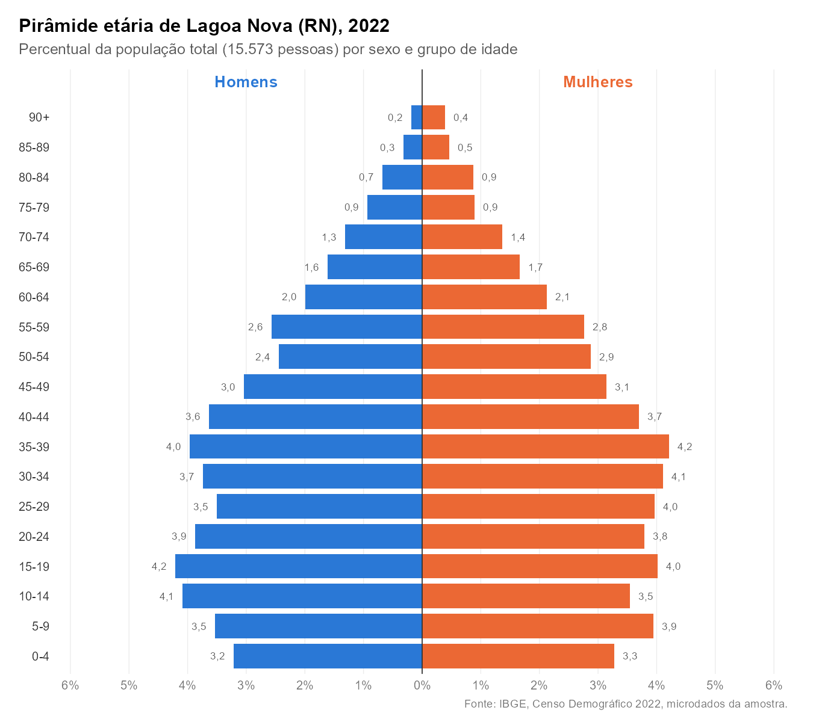

# Lagoa Nova (RN)

Resultados do Censo Demográfico 2022 (microdados da amostra). Gerado por `R/05_readmes.R`; veja a [página dos municípios](../README.md) e o [README principal](../../../../README.md).

População: **15.573** pessoas (3.380 registros na amostra).

## Estrutura etária

| Indicador | Lagoa Nova | RN |
|---|--:|--:|
| Razão de dependência jovem | 31,9 | 28,5 |
| Razão de dependência idosa | 15,8 | 15,1 |
| Razão de dependência total | 47,7 | 43,6 |
| Índice de envelhecimento | 49,5 | 52,9 |

Valores por 100 pessoas.

## Migração

Chegadas e saídas: mudanças de município nos últimos 10 anos.

| Indicador | Valor |
|---|--:|
| Nascidos no próprio município | 67,7% |
| Nascidos em outro município do Rio Grande do Norte | 28,0% |
| Nascidos em outra UF | 4,2% |
| Nascidos no exterior | 0,0% |
| Chegaram de outro município do Rio Grande do Norte | 1.543 |
| Chegaram de outra UF | 671 |
| Saíram para outro município da UF | 986 |
| Saíram para outra UF | 378 |
| Saldo migratório | +850 |
| Saldo por 1.000 habitantes | +54,6 |
| Chegaram do exterior | 0 |

Principais origens de quem chegou e destinos de quem saiu:

| Origem | Chegaram | Destino | Saíram |
|---|--:|---|--:|
| Currais Novos (RN) | 382 | Currais Novos (RN) | 315 |
| Natal (RN) | 327 | Cerro Corá (RN) | 119 |
| Cerro Corá (RN) | 133 | Parnamirim (RN) | 100 |
| São Paulo (SP) | 123 | Natal (RN) | 62 |
| Bodó (RN) | 110 | Bodó (RN) | 51 |

## Mortalidade

Óbitos de agosto de 2021 a julho de 2022 informados no Censo.

| Indicador | Lagoa Nova | RN |
|---|--:|--:|
| Óbitos no período | 147 | 22.488 |
| Registros de óbito na amostra | 30 |  |
| Taxa bruta de mortalidade (por mil) | 9,4 | 6,8 |
| Taxa padronizada por idade (por mil) | 9,1 | 6,8 |

Com poucos óbitos na amostra, as taxas deste município variam muito por acaso; por isso não há tábua de vida. Sem correção do sub-registro de óbitos do Censo.
