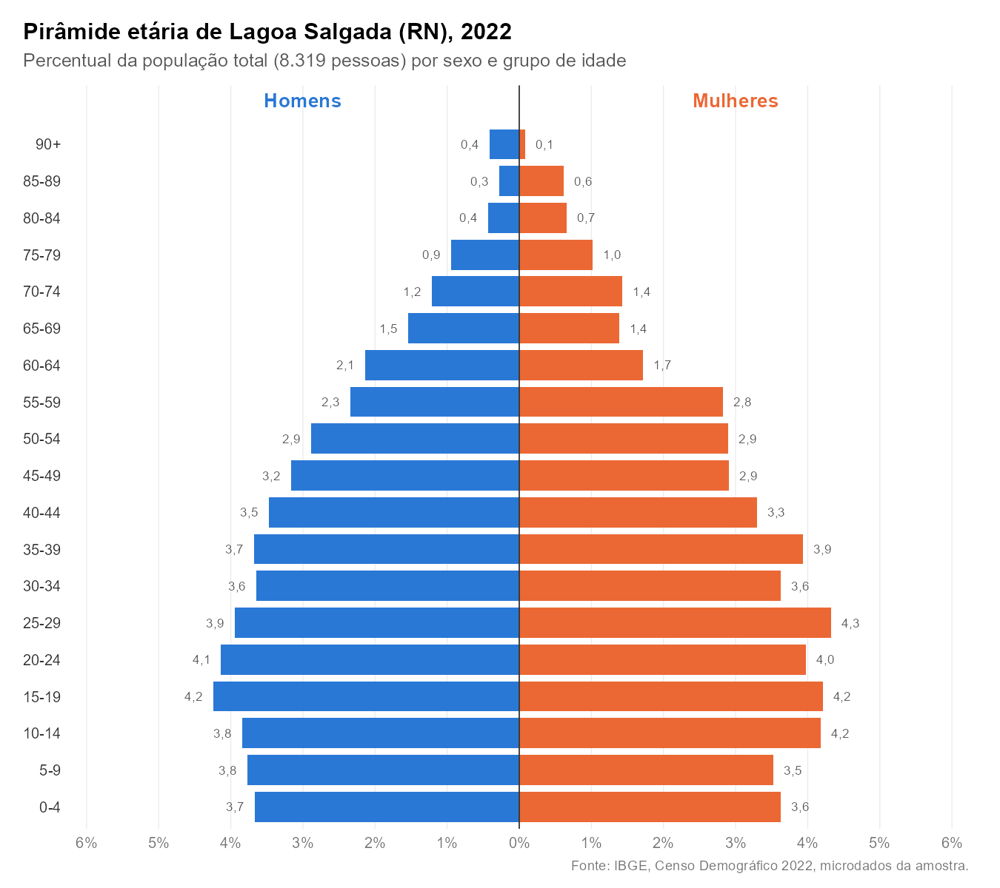

# Lagoa Salgada (RN)

Resultados do Censo Demográfico 2022 (microdados da amostra). Gerado por `R/05_readmes.R`; veja a [página dos municípios](../README.md) e o [README principal](../../../../README.md).

População: **8.319** pessoas (1.651 registros na amostra).

## Estrutura etária

| Indicador | Lagoa Salgada | RN |
|---|--:|--:|
| Razão de dependência jovem | 33,6 | 28,5 |
| Razão de dependência idosa | 14,9 | 15,1 |
| Razão de dependência total | 48,4 | 43,6 |
| Índice de envelhecimento | 44,3 | 52,9 |

Valores por 100 pessoas.

## Migração

Chegadas e saídas: mudanças de município nos últimos 10 anos.

| Indicador | Valor |
|---|--:|
| Nascidos no próprio município | 68,8% |
| Nascidos em outro município do Rio Grande do Norte | 27,0% |
| Nascidos em outra UF | 4,1% |
| Nascidos no exterior | 0,0% |
| Chegaram de outro município do Rio Grande do Norte | 800 |
| Chegaram de outra UF | 133 |
| Saíram para outro município da UF | 1.217 |
| Saíram para outra UF | 96 |
| Saldo migratório | -380 |
| Saldo por 1.000 habitantes | -45,7 |
| Chegaram do exterior | 0 |

Principais origens de quem chegou e destinos de quem saiu:

| Origem | Chegaram | Destino | Saíram |
|---|--:|---|--:|
| Natal (RN) | 307 | Natal (RN) | 406 |
| Parnamirim (RN) | 117 | Parnamirim (RN) | 282 |
| Lagoa de Pedras (RN) | 61 | Monte Alegre (RN) | 130 |
| Monte Alegre (RN) | 49 | Lagoa de Pedras (RN) | 93 |
| Macaíba (RN) | 47 | Vera Cruz (RN) | 81 |

## Mortalidade

Óbitos de agosto de 2021 a julho de 2022 informados no Censo.

| Indicador | Lagoa Salgada | RN |
|---|--:|--:|
| Óbitos no período | 58 | 22.488 |
| Registros de óbito na amostra | 11 |  |
| Taxa bruta de mortalidade (por mil) | 6,9 | 6,8 |
| Taxa padronizada por idade (por mil) | 6,9 | 6,8 |

Com poucos óbitos na amostra, as taxas deste município variam muito por acaso; por isso não há tábua de vida. Sem correção do sub-registro de óbitos do Censo.
