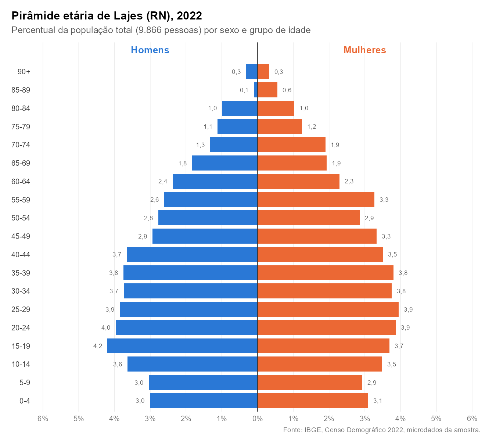

# Lajes (RN)

Resultados do Censo Demográfico 2022 (microdados da amostra). Gerado por `R/05_readmes.R`; veja a [página dos municípios](../README.md) e o [README principal](../../../../README.md).

População: **9.866** pessoas (1.973 registros na amostra).

## Estrutura etária

| Indicador | Lajes | RN |
|---|--:|--:|
| Razão de dependência jovem | 28,2 | 28,5 |
| Razão de dependência idosa | 18,6 | 15,1 |
| Razão de dependência total | 46,7 | 43,6 |
| Índice de envelhecimento | 65,9 | 52,9 |

Valores por 100 pessoas.

## Migração

Chegadas e saídas: mudanças de município nos últimos 10 anos.

| Indicador | Valor |
|---|--:|
| Nascidos no próprio município | 71,0% |
| Nascidos em outro município do Rio Grande do Norte | 26,1% |
| Nascidos em outra UF | 2,8% |
| Nascidos no exterior | 0,1% |
| Chegaram de outro município do Rio Grande do Norte | 1.157 |
| Chegaram de outra UF | 174 |
| Saíram para outro município da UF | 1.243 |
| Saíram para outra UF | 172 |
| Saldo migratório | -84 |
| Saldo por 1.000 habitantes | -8,5 |
| Chegaram do exterior | 0 |

Principais origens de quem chegou e destinos de quem saiu:

| Origem | Chegaram | Destino | Saíram |
|---|--:|---|--:|
| Natal (RN) | 415 | Natal (RN) | 357 |
| Parnamirim (RN) | 88 | Parnamirim (RN) | 154 |
| Caiçara do Rio do Vento (RN) | 57 | Mossoró (RN) | 83 |
| Açu (RN) | 43 | Caiçara do Rio do Vento (RN) | 64 |
| Pedra Preta (RN) | 41 | Macaíba (RN) | 62 |

## Mortalidade

Óbitos de agosto de 2021 a julho de 2022 informados no Censo.

| Indicador | Lajes | RN |
|---|--:|--:|
| Óbitos no período | 44 | 22.488 |
| Registros de óbito na amostra | 9 |  |
| Taxa bruta de mortalidade (por mil) | 4,4 | 6,8 |
| Taxa padronizada por idade (por mil) | 4,5 | 6,8 |

Com poucos óbitos na amostra, as taxas deste município variam muito por acaso; por isso não há tábua de vida. Sem correção do sub-registro de óbitos do Censo.
