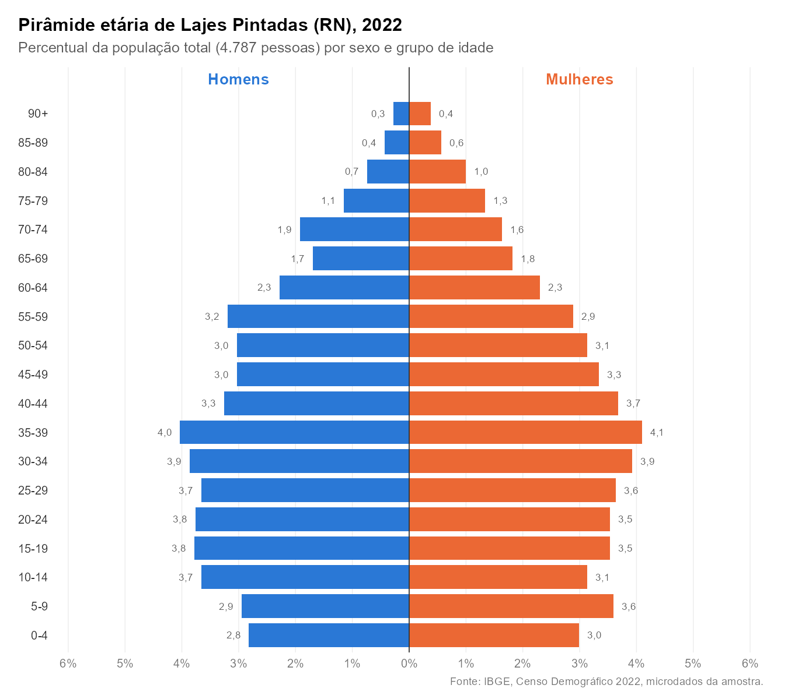

# Lajes Pintadas (RN)

Resultados do Censo Demográfico 2022 (microdados da amostra). Gerado por `R/05_readmes.R`; veja a [página dos municípios](../README.md) e o [README principal](../../../../README.md).

População: **4.787** pessoas (1.633 registros na amostra).

## Estrutura etária

| Indicador | Lajes Pintadas | RN |
|---|--:|--:|
| Razão de dependência jovem | 28,2 | 28,5 |
| Razão de dependência idosa | 19,0 | 15,1 |
| Razão de dependência total | 47,2 | 43,6 |
| Índice de envelhecimento | 67,6 | 52,9 |

Valores por 100 pessoas.

## Migração

Chegadas e saídas: mudanças de município nos últimos 10 anos.

| Indicador | Valor |
|---|--:|
| Nascidos no próprio município | 84,2% |
| Nascidos em outro município do Rio Grande do Norte | 13,1% |
| Nascidos em outra UF | 2,7% |
| Nascidos no exterior | 0,0% |
| Chegaram de outro município do Rio Grande do Norte | 449 |
| Chegaram de outra UF | 81 |
| Saíram para outro município da UF | 626 |
| Saíram para outra UF | 53 |
| Saldo migratório | -148 |
| Saldo por 1.000 habitantes | -31,0 |
| Chegaram do exterior | 0 |

Principais origens de quem chegou e destinos de quem saiu:

| Origem | Chegaram | Destino | Saíram |
|---|--:|---|--:|
| Natal (RN) | 119 | Natal (RN) | 203 |
| Santa Cruz (RN) | 103 | Santa Cruz (RN) | 138 |
| Campo Redondo (RN) | 40 | Parnamirim (RN) | 63 |
| Currais Novos (RN) | 30 | Campo Redondo (RN) | 51 |
| Promissão (SP) | 17 | Maxaranguape (RN) | 33 |

## Mortalidade

Óbitos de agosto de 2021 a julho de 2022 informados no Censo.

| Indicador | Lajes Pintadas | RN |
|---|--:|--:|
| Óbitos no período | 25 | 22.488 |
| Registros de óbito na amostra | 9 |  |
| Taxa bruta de mortalidade (por mil) | 5,2 | 6,8 |
| Taxa padronizada por idade (por mil) | 4,1 | 6,8 |

Com poucos óbitos na amostra, as taxas deste município variam muito por acaso; por isso não há tábua de vida. Sem correção do sub-registro de óbitos do Censo.
