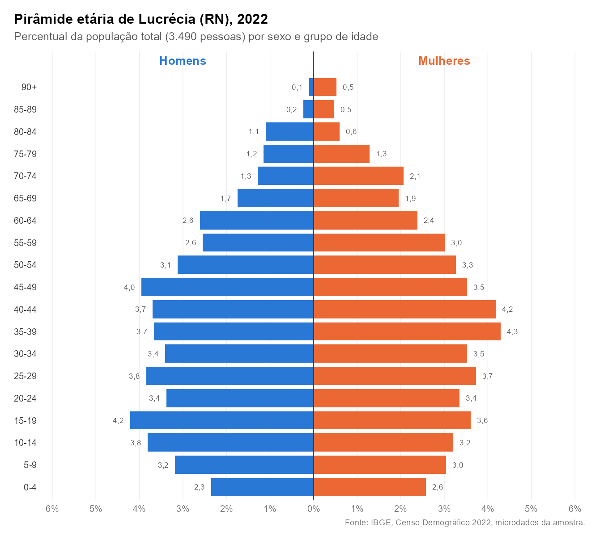

# Lucrécia (RN)

Resultados do Censo Demográfico 2022 (microdados da amostra). Gerado por `R/05_readmes.R`; veja a [página dos municípios](../README.md) e o [README principal](../../../../README.md).

População: **3.490** pessoas (1.154 registros na amostra).

## Estrutura etária

| Indicador | Lucrécia | RN |
|---|--:|--:|
| Razão de dependência jovem | 26,2 | 28,5 |
| Razão de dependência idosa | 18,1 | 15,1 |
| Razão de dependência total | 44,3 | 43,6 |
| Índice de envelhecimento | 68,9 | 52,9 |

Valores por 100 pessoas.

## Migração

Chegadas e saídas: mudanças de município nos últimos 10 anos.

| Indicador | Valor |
|---|--:|
| Nascidos no próprio município | 55,5% |
| Nascidos em outro município do Rio Grande do Norte | 36,5% |
| Nascidos em outra UF | 7,9% |
| Nascidos no exterior | 0,1% |
| Chegaram de outro município do Rio Grande do Norte | 313 |
| Chegaram de outra UF | 72 |
| Saíram para outro município da UF | 310 |
| Saíram para outra UF | 74 |
| Saldo migratório | +1 |
| Saldo por 1.000 habitantes | +0,4 |
| Chegaram do exterior | 4 |

Principais origens de quem chegou e destinos de quem saiu:

| Origem | Chegaram | Destino | Saíram |
|---|--:|---|--:|
| Natal (RN) | 67 | Natal (RN) | 61 |
| Mossoró (RN) | 40 | Almino Afonso (RN) | 51 |
| Almino Afonso (RN) | 38 | Frutuoso Gomes (RN) | 47 |
| Umarizal (RN) | 30 | Parnamirim (RN) | 35 |
| São Bernardo do Campo (SP) | 28 | Brasília (DF) | 24 |

## Mortalidade

Óbitos de agosto de 2021 a julho de 2022 informados no Censo.

| Indicador | Lucrécia | RN |
|---|--:|--:|
| Óbitos no período | 14 | 22.488 |
| Registros de óbito na amostra | 6 |  |
| Taxa bruta de mortalidade (por mil) | 4,1 | 6,8 |
| Taxa padronizada por idade (por mil) | 3,7 | 6,8 |

Com poucos óbitos na amostra, as taxas deste município variam muito por acaso; por isso não há tábua de vida. Sem correção do sub-registro de óbitos do Censo.
