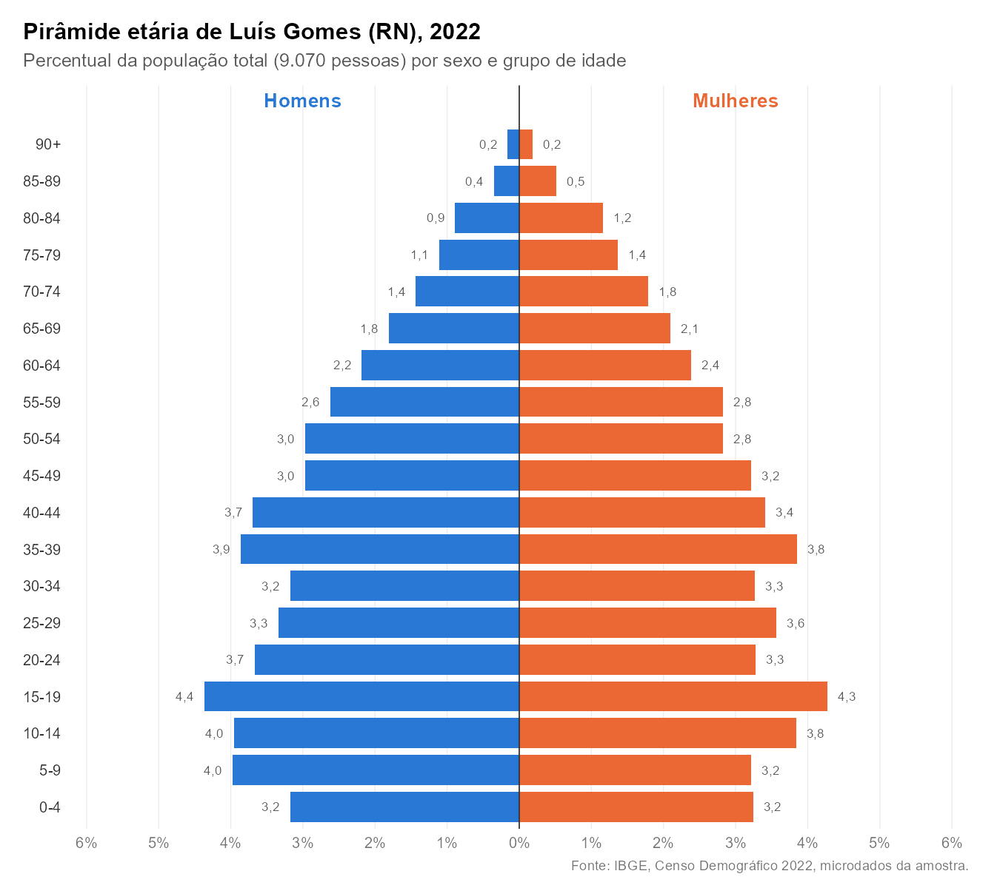

# Luís Gomes (RN)

Resultados do Censo Demográfico 2022 (microdados da amostra). Gerado por `R/05_readmes.R`; veja a [página dos municípios](../README.md) e o [README principal](../../../../README.md).

População: **9.070** pessoas (1.811 registros na amostra).

## Estrutura etária

| Indicador | Luís Gomes | RN |
|---|--:|--:|
| Razão de dependência jovem | 32,6 | 28,5 |
| Razão de dependência idosa | 19,6 | 15,1 |
| Razão de dependência total | 52,2 | 43,6 |
| Índice de envelhecimento | 60,1 | 52,9 |

Valores por 100 pessoas.

## Migração

Chegadas e saídas: mudanças de município nos últimos 10 anos.

| Indicador | Valor |
|---|--:|
| Nascidos no próprio município | 79,2% |
| Nascidos em outro município do Rio Grande do Norte | 7,0% |
| Nascidos em outra UF | 13,8% |
| Nascidos no exterior | 0,0% |
| Chegaram de outro município do Rio Grande do Norte | 362 |
| Chegaram de outra UF | 848 |
| Saíram para outro município da UF | 334 |
| Saíram para outra UF | 670 |
| Saldo migratório | +206 |
| Saldo por 1.000 habitantes | +22,7 |
| Chegaram do exterior | 4 |

Principais origens de quem chegou e destinos de quem saiu:

| Origem | Chegaram | Destino | Saíram |
|---|--:|---|--:|
| São Paulo (SP) | 229 | Blumenau (SC) | 142 |
| Uiraúna (PB) | 116 | Uiraúna (PB) | 62 |
| Pau dos Ferros (RN) | 84 | São Paulo (SP) | 54 |
| Brasília (DF) | 64 | Pau dos Ferros (RN) | 46 |
| Blumenau (SC) | 60 | João Pessoa (PB) | 44 |

## Mortalidade

Óbitos de agosto de 2021 a julho de 2022 informados no Censo.

| Indicador | Luís Gomes | RN |
|---|--:|--:|
| Óbitos no período | 89 | 22.488 |
| Registros de óbito na amostra | 18 |  |
| Taxa bruta de mortalidade (por mil) | 9,8 | 6,8 |
| Taxa padronizada por idade (por mil) | 9,8 | 6,8 |

Com poucos óbitos na amostra, as taxas deste município variam muito por acaso; por isso não há tábua de vida. Sem correção do sub-registro de óbitos do Censo.
