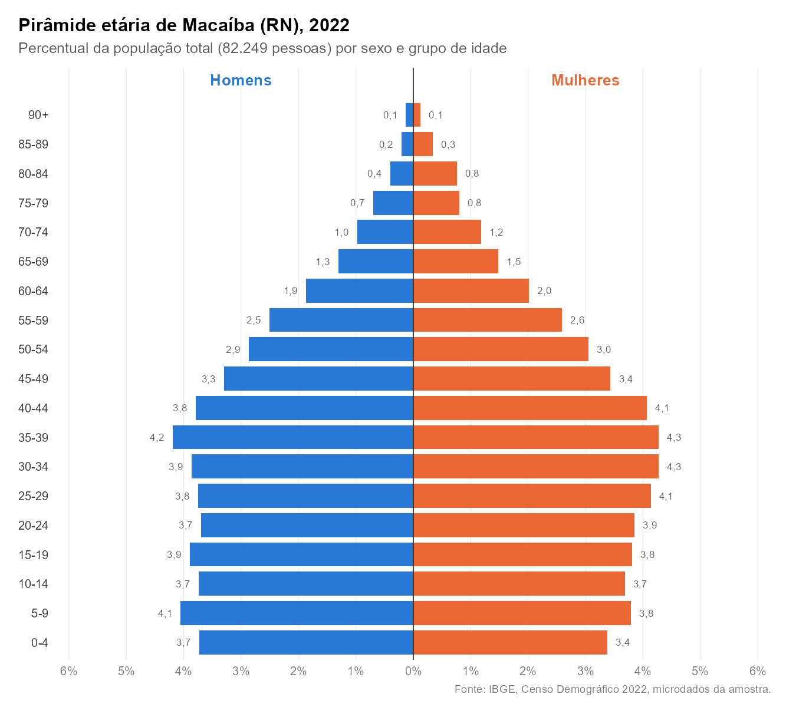

# Macaíba (RN)

Resultados do Censo Demográfico 2022 (microdados da amostra). Gerado por `R/05_readmes.R`; veja a [página dos municípios](../README.md) e o [README principal](../../../../README.md).

População: **82.249** pessoas (8.611 registros na amostra).

## Estrutura etária

| Indicador | Macaíba | RN |
|---|--:|--:|
| Razão de dependência jovem | 32,3 | 28,5 |
| Razão de dependência idosa | 12,1 | 15,1 |
| Razão de dependência total | 44,4 | 43,6 |
| Índice de envelhecimento | 37,5 | 52,9 |

Valores por 100 pessoas.

## Migração

Chegadas e saídas: mudanças de município nos últimos 10 anos.

| Indicador | Valor |
|---|--:|
| Nascidos no próprio município | 58,3% |
| Nascidos em outro município do Rio Grande do Norte | 35,3% |
| Nascidos em outra UF | 6,3% |
| Nascidos no exterior | 0,0% |
| Chegaram de outro município do Rio Grande do Norte | 10.893 |
| Chegaram de outra UF | 2.126 |
| Saíram para outro município da UF | 6.813 |
| Saíram para outra UF | 800 |
| Saldo migratório | +5.406 |
| Saldo por 1.000 habitantes | +65,7 |
| Chegaram do exterior | 0 |

Principais origens de quem chegou e destinos de quem saiu:

| Origem | Chegaram | Destino | Saíram |
|---|--:|---|--:|
| Natal (RN) | 4.323 | Parnamirim (RN) | 1.573 |
| Parnamirim (RN) | 2.035 | Natal (RN) | 1.296 |
| São Gonçalo do Amarante (RN) | 605 | São Gonçalo do Amarante (RN) | 884 |
| São Paulo (SP) | 311 | Nísia Floresta (RN) | 319 |
| São José de Mipibu (RN) | 276 | São José de Mipibu (RN) | 240 |

## Mortalidade

Óbitos de agosto de 2021 a julho de 2022 informados no Censo.

| Indicador | Macaíba | RN |
|---|--:|--:|
| Óbitos no período | 449 | 22.488 |
| Registros de óbito na amostra | 48 |  |
| Taxa bruta de mortalidade (por mil) | 5,5 | 6,8 |
| Taxa padronizada por idade (por mil) | 6,2 | 6,8 |

Com poucos óbitos na amostra, as taxas deste município variam muito por acaso; por isso não há tábua de vida. Sem correção do sub-registro de óbitos do Censo.
