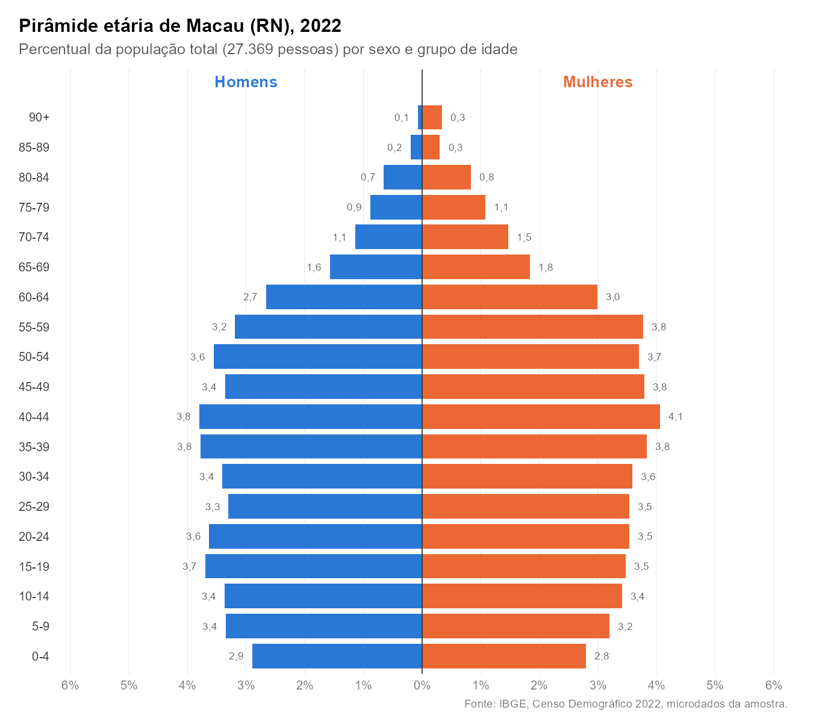

# Macau (RN)

Resultados do Censo Demográfico 2022 (microdados da amostra). Gerado por `R/05_readmes.R`; veja a [página dos municípios](../README.md) e o [README principal](../../../../README.md).

População: **27.369** pessoas (2.724 registros na amostra).

## Estrutura etária

| Indicador | Macau | RN |
|---|--:|--:|
| Razão de dependência jovem | 26,9 | 28,5 |
| Razão de dependência idosa | 14,7 | 15,1 |
| Razão de dependência total | 41,6 | 43,6 |
| Índice de envelhecimento | 54,6 | 52,9 |

Valores por 100 pessoas.

## Migração

Chegadas e saídas: mudanças de município nos últimos 10 anos.

| Indicador | Valor |
|---|--:|
| Nascidos no próprio município | 73,4% |
| Nascidos em outro município do Rio Grande do Norte | 22,5% |
| Nascidos em outra UF | 4,1% |
| Nascidos no exterior | 0,0% |
| Chegaram de outro município do Rio Grande do Norte | 2.772 |
| Chegaram de outra UF | 981 |
| Saíram para outro município da UF | 3.616 |
| Saíram para outra UF | 998 |
| Saldo migratório | -861 |
| Saldo por 1.000 habitantes | -31,5 |
| Chegaram do exterior | 9 |

Principais origens de quem chegou e destinos de quem saiu:

| Origem | Chegaram | Destino | Saíram |
|---|--:|---|--:|
| Natal (RN) | 1.195 | Natal (RN) | 1.377 |
| Alto do Rodrigues (RN) | 227 | Mossoró (RN) | 384 |
| Mossoró (RN) | 153 | Guamaré (RN) | 270 |
| Guamaré (RN) | 150 | Parnamirim (RN) | 247 |
| Pendências (RN) | 131 | Recife (PE) | 192 |

## Mortalidade

Óbitos de agosto de 2021 a julho de 2022 informados no Censo.

| Indicador | Macau | RN |
|---|--:|--:|
| Óbitos no período | 242 | 22.488 |
| Registros de óbito na amostra | 25 |  |
| Taxa bruta de mortalidade (por mil) | 8,9 | 6,8 |
| Taxa padronizada por idade (por mil) | 9,5 | 6,8 |

Com poucos óbitos na amostra, as taxas deste município variam muito por acaso; por isso não há tábua de vida. Sem correção do sub-registro de óbitos do Censo.
