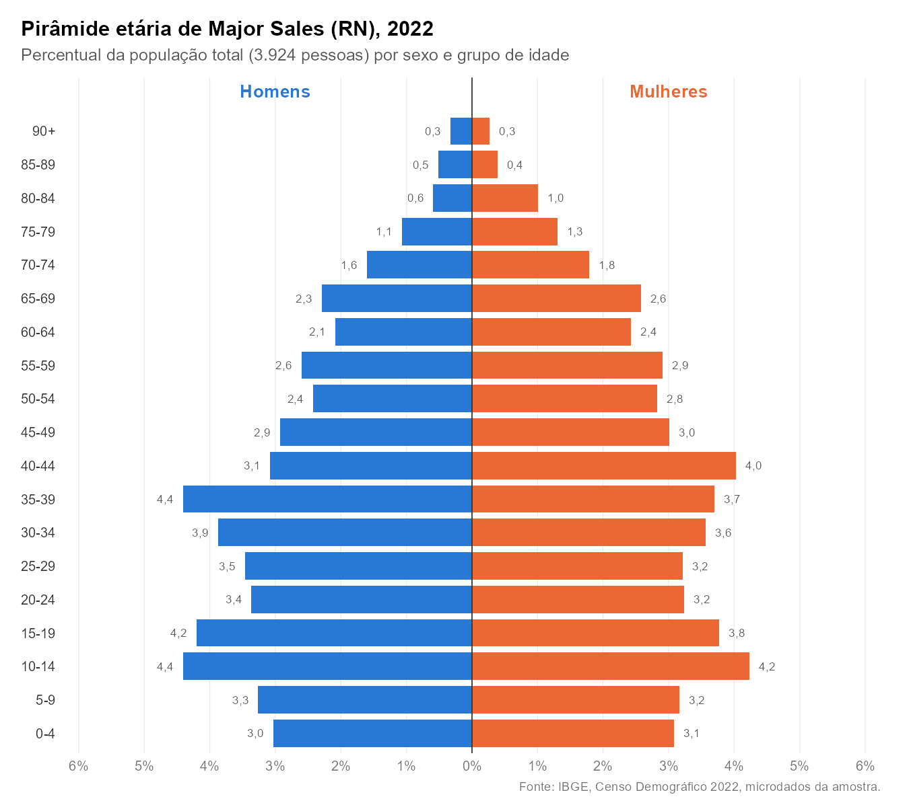

# Major Sales (RN)

Resultados do Censo Demográfico 2022 (microdados da amostra). Gerado por `R/05_readmes.R`; veja a [página dos municípios](../README.md) e o [README principal](../../../../README.md).

População: **3.924** pessoas (1.350 registros na amostra).

## Estrutura etária

| Indicador | Major Sales | RN |
|---|--:|--:|
| Razão de dependência jovem | 32,5 | 28,5 |
| Razão de dependência idosa | 21,1 | 15,1 |
| Razão de dependência total | 53,6 | 43,6 |
| Índice de envelhecimento | 64,7 | 52,9 |

Valores por 100 pessoas.

## Migração

Chegadas e saídas: mudanças de município nos últimos 10 anos.

| Indicador | Valor |
|---|--:|
| Nascidos no próprio município | 65,8% |
| Nascidos em outro município do Rio Grande do Norte | 22,9% |
| Nascidos em outra UF | 11,2% |
| Nascidos no exterior | 0,1% |
| Chegaram de outro município do Rio Grande do Norte | 379 |
| Chegaram de outra UF | 394 |
| Saíram para outro município da UF | 199 |
| Saíram para outra UF | 262 |
| Saldo migratório | +311 |
| Saldo por 1.000 habitantes | +79,4 |
| Chegaram do exterior | 3 |

Principais origens de quem chegou e destinos de quem saiu:

| Origem | Chegaram | Destino | Saíram |
|---|--:|---|--:|
| José da Penha (RN) | 123 | Cabrobó (PE) | 50 |
| São Paulo (SP) | 111 | Pau dos Ferros (RN) | 47 |
| Luís Gomes (RN) | 40 | Paraná (RN) | 44 |
| Paraná (RN) | 38 | Cajazeiras (PB) | 35 |
| Tenente Ananias (RN) | 36 | Porto Velho (RO) | 34 |

## Mortalidade

Óbitos de agosto de 2021 a julho de 2022 informados no Censo.

| Indicador | Major Sales | RN |
|---|--:|--:|
| Óbitos no período | 36 | 22.488 |
| Registros de óbito na amostra | 11 |  |
| Taxa bruta de mortalidade (por mil) | 9,1 | 6,8 |
| Taxa padronizada por idade (por mil) | 7,9 | 6,8 |

Com poucos óbitos na amostra, as taxas deste município variam muito por acaso; por isso não há tábua de vida. Sem correção do sub-registro de óbitos do Censo.
