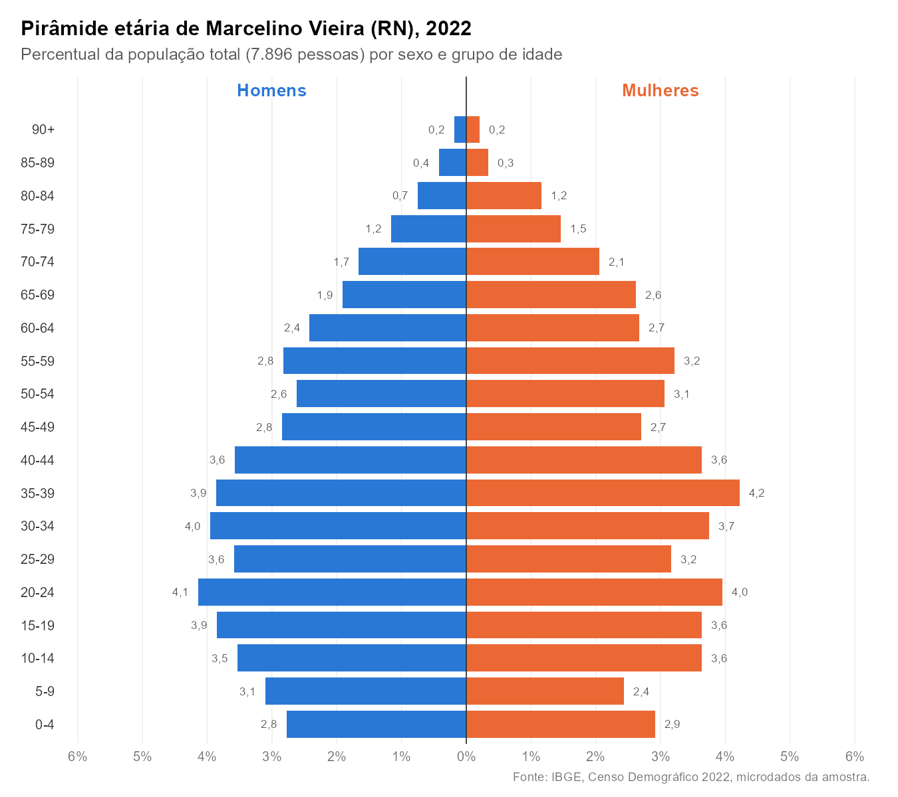

# Marcelino Vieira (RN)

Resultados do Censo Demográfico 2022 (microdados da amostra). Gerado por `R/05_readmes.R`; veja a [página dos municípios](../README.md) e o [README principal](../../../../README.md).

População: **7.896** pessoas (1.596 registros na amostra).

## Estrutura etária

| Indicador | Marcelino Vieira | RN |
|---|--:|--:|
| Razão de dependência jovem | 27,2 | 28,5 |
| Razão de dependência idosa | 20,6 | 15,1 |
| Razão de dependência total | 47,8 | 43,6 |
| Índice de envelhecimento | 75,8 | 52,9 |

Valores por 100 pessoas.

## Migração

Chegadas e saídas: mudanças de município nos últimos 10 anos.

| Indicador | Valor |
|---|--:|
| Nascidos no próprio município | 81,3% |
| Nascidos em outro município do Rio Grande do Norte | 12,8% |
| Nascidos em outra UF | 5,9% |
| Nascidos no exterior | 0,0% |
| Chegaram de outro município do Rio Grande do Norte | 557 |
| Chegaram de outra UF | 272 |
| Saíram para outro município da UF | 668 |
| Saíram para outra UF | 297 |
| Saldo migratório | -136 |
| Saldo por 1.000 habitantes | -17,3 |
| Chegaram do exterior | 0 |

Principais origens de quem chegou e destinos de quem saiu:

| Origem | Chegaram | Destino | Saíram |
|---|--:|---|--:|
| Pau dos Ferros (RN) | 107 | Pau dos Ferros (RN) | 233 |
| São Paulo (SP) | 100 | Rafael Fernandes (RN) | 86 |
| Natal (RN) | 81 | Natal (RN) | 73 |
| Mossoró (RN) | 69 | Tenente Ananias (RN) | 53 |
| Alexandria (RN) | 37 | Patos (PB) | 50 |

## Mortalidade

Óbitos de agosto de 2021 a julho de 2022 informados no Censo.

| Indicador | Marcelino Vieira | RN |
|---|--:|--:|
| Óbitos no período | 63 | 22.488 |
| Registros de óbito na amostra | 13 |  |
| Taxa bruta de mortalidade (por mil) | 7,9 | 6,8 |
| Taxa padronizada por idade (por mil) | 6,9 | 6,8 |

Com poucos óbitos na amostra, as taxas deste município variam muito por acaso; por isso não há tábua de vida. Sem correção do sub-registro de óbitos do Censo.
