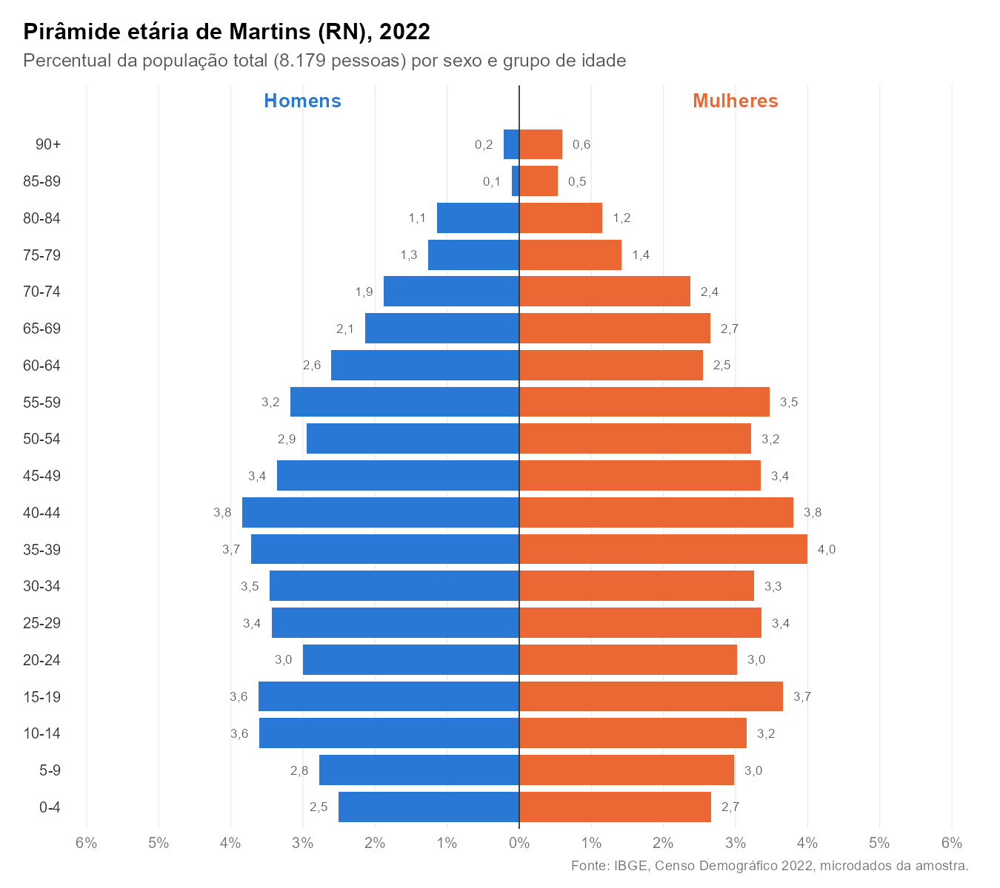

# Martins (RN)

Resultados do Censo Demográfico 2022 (microdados da amostra). Gerado por `R/05_readmes.R`; veja a [página dos municípios](../README.md) e o [README principal](../../../../README.md).

População: **8.179** pessoas (1.661 registros na amostra).

## Estrutura etária

| Indicador | Martins | RN |
|---|--:|--:|
| Razão de dependência jovem | 26,5 | 28,5 |
| Razão de dependência idosa | 23,2 | 15,1 |
| Razão de dependência total | 49,6 | 43,6 |
| Índice de envelhecimento | 87,5 | 52,9 |

Valores por 100 pessoas.

## Migração

Chegadas e saídas: mudanças de município nos últimos 10 anos.

| Indicador | Valor |
|---|--:|
| Nascidos no próprio município | 74,5% |
| Nascidos em outro município do Rio Grande do Norte | 18,9% |
| Nascidos em outra UF | 6,6% |
| Nascidos no exterior | 0,0% |
| Chegaram de outro município do Rio Grande do Norte | 856 |
| Chegaram de outra UF | 547 |
| Saíram para outro município da UF | 874 |
| Saíram para outra UF | 517 |
| Saldo migratório | +12 |
| Saldo por 1.000 habitantes | +1,4 |
| Chegaram do exterior | 5 |

Principais origens de quem chegou e destinos de quem saiu:

| Origem | Chegaram | Destino | Saíram |
|---|--:|---|--:|
| São Paulo (SP) | 221 | Natal (RN) | 339 |
| Natal (RN) | 188 | São Paulo (SP) | 248 |
| Mossoró (RN) | 123 | Mossoró (RN) | 117 |
| Antônio Martins (RN) | 76 | Pau dos Ferros (RN) | 90 |
| Umarizal (RN) | 72 | Serrinha dos Pintos (RN) | 80 |

## Mortalidade

Óbitos de agosto de 2021 a julho de 2022 informados no Censo.

| Indicador | Martins | RN |
|---|--:|--:|
| Óbitos no período | 89 | 22.488 |
| Registros de óbito na amostra | 19 |  |
| Taxa bruta de mortalidade (por mil) | 10,8 | 6,8 |
| Taxa padronizada por idade (por mil) | 7,9 | 6,8 |

Com poucos óbitos na amostra, as taxas deste município variam muito por acaso; por isso não há tábua de vida. Sem correção do sub-registro de óbitos do Censo.
