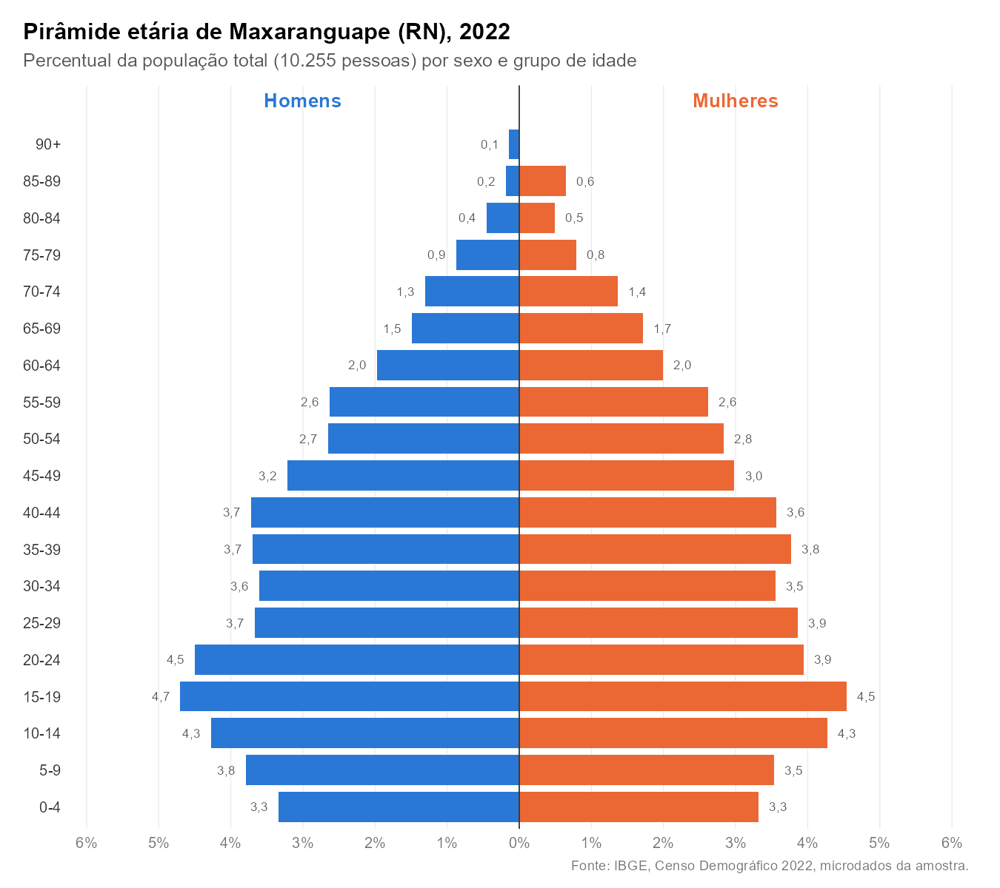

# Maxaranguape (RN)

Resultados do Censo Demográfico 2022 (microdados da amostra). Gerado por `R/05_readmes.R`; veja a [página dos municípios](../README.md) e o [README principal](../../../../README.md).

População: **10.255** pessoas (2.084 registros na amostra).

## Estrutura etária

| Indicador | Maxaranguape | RN |
|---|--:|--:|
| Razão de dependência jovem | 33,1 | 28,5 |
| Razão de dependência idosa | 13,9 | 15,1 |
| Razão de dependência total | 47,0 | 43,6 |
| Índice de envelhecimento | 42,0 | 52,9 |

Valores por 100 pessoas.

## Migração

Chegadas e saídas: mudanças de município nos últimos 10 anos.

| Indicador | Valor |
|---|--:|
| Nascidos no próprio município | 58,4% |
| Nascidos em outro município do Rio Grande do Norte | 36,3% |
| Nascidos em outra UF | 5,1% |
| Nascidos no exterior | 0,2% |
| Chegaram de outro município do Rio Grande do Norte | 1.501 |
| Chegaram de outra UF | 225 |
| Saíram para outro município da UF | 1.088 |
| Saíram para outra UF | 187 |
| Saldo migratório | +451 |
| Saldo por 1.000 habitantes | +43,9 |
| Chegaram do exterior | 19 |

Principais origens de quem chegou e destinos de quem saiu:

| Origem | Chegaram | Destino | Saíram |
|---|--:|---|--:|
| Natal (RN) | 624 | Ceará-Mirim (RN) | 206 |
| Ceará-Mirim (RN) | 303 | Natal (RN) | 189 |
| Parnamirim (RN) | 90 | São Gonçalo do Amarante (RN) | 147 |
| Rio do Fogo (RN) | 75 | Rio do Fogo (RN) | 107 |
| Extremoz (RN) | 62 | Pureza (RN) | 94 |

## Mortalidade

Óbitos de agosto de 2021 a julho de 2022 informados no Censo.

| Indicador | Maxaranguape | RN |
|---|--:|--:|
| Óbitos no período | 125 | 22.488 |
| Registros de óbito na amostra | 24 |  |
| Taxa bruta de mortalidade (por mil) | 12,2 | 6,8 |
| Taxa padronizada por idade (por mil) | 18,5 | 6,8 |

Com poucos óbitos na amostra, as taxas deste município variam muito por acaso; por isso não há tábua de vida. Sem correção do sub-registro de óbitos do Censo.
