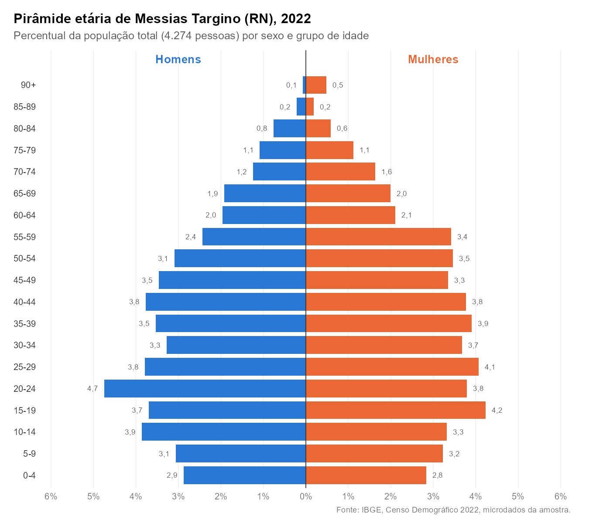

# Messias Targino (RN)

Resultados do Censo Demográfico 2022 (microdados da amostra). Gerado por `R/05_readmes.R`; veja a [página dos municípios](../README.md) e o [README principal](../../../../README.md).

População: **4.274** pessoas (1.413 registros na amostra).

## Estrutura etária

| Indicador | Messias Targino | RN |
|---|--:|--:|
| Razão de dependência jovem | 27,6 | 28,5 |
| Razão de dependência idosa | 16,2 | 15,1 |
| Razão de dependência total | 43,8 | 43,6 |
| Índice de envelhecimento | 58,8 | 52,9 |

Valores por 100 pessoas.

## Migração

Chegadas e saídas: mudanças de município nos últimos 10 anos.

| Indicador | Valor |
|---|--:|
| Nascidos no próprio município | 70,8% |
| Nascidos em outro município do Rio Grande do Norte | 20,4% |
| Nascidos em outra UF | 8,8% |
| Nascidos no exterior | 0,0% |
| Chegaram de outro município do Rio Grande do Norte | 442 |
| Chegaram de outra UF | 236 |
| Saíram para outro município da UF | 363 |
| Saíram para outra UF | 75 |
| Saldo migratório | +240 |
| Saldo por 1.000 habitantes | +56,2 |
| Chegaram do exterior | 0 |

Principais origens de quem chegou e destinos de quem saiu:

| Origem | Chegaram | Destino | Saíram |
|---|--:|---|--:|
| Mossoró (RN) | 133 | Patu (RN) | 58 |
| Belém do Brejo do Cruz (PB) | 71 | Mossoró (RN) | 55 |
| Patu (RN) | 53 | Janduís (RN) | 52 |
| Natal (RN) | 47 | Parnamirim (RN) | 41 |
| São Bento (PB) | 39 | Belém do Brejo do Cruz (PB) | 35 |

## Mortalidade

Óbitos de agosto de 2021 a julho de 2022 informados no Censo.

| Indicador | Messias Targino | RN |
|---|--:|--:|
| Óbitos no período | 23 | 22.488 |
| Registros de óbito na amostra | 7 |  |
| Taxa bruta de mortalidade (por mil) | 5,4 | 6,8 |
| Taxa padronizada por idade (por mil) | 5,9 | 6,8 |

Com poucos óbitos na amostra, as taxas deste município variam muito por acaso; por isso não há tábua de vida. Sem correção do sub-registro de óbitos do Censo.
