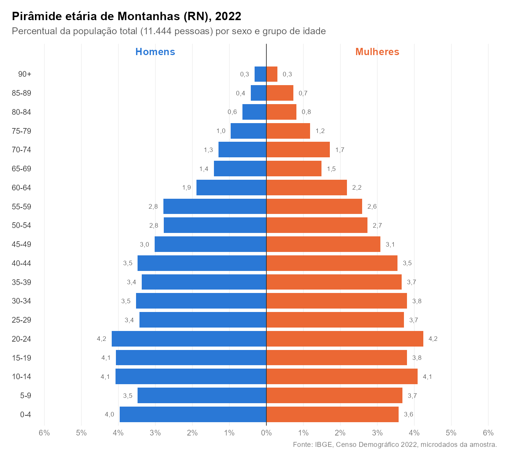

# Montanhas (RN)

Resultados do Censo Demográfico 2022 (microdados da amostra). Gerado por `R/05_readmes.R`; veja a [página dos municípios](../README.md) e o [README principal](../../../../README.md).

População: **11.444** pessoas (2.214 registros na amostra).

## Estrutura etária

| Indicador | Montanhas | RN |
|---|--:|--:|
| Razão de dependência jovem | 34,7 | 28,5 |
| Razão de dependência idosa | 17,1 | 15,1 |
| Razão de dependência total | 51,8 | 43,6 |
| Índice de envelhecimento | 49,3 | 52,9 |

Valores por 100 pessoas.

## Migração

Chegadas e saídas: mudanças de município nos últimos 10 anos.

| Indicador | Valor |
|---|--:|
| Nascidos no próprio município | 54,0% |
| Nascidos em outro município do Rio Grande do Norte | 34,8% |
| Nascidos em outra UF | 11,2% |
| Nascidos no exterior | 0,0% |
| Chegaram de outro município do Rio Grande do Norte | 861 |
| Chegaram de outra UF | 878 |
| Saíram para outro município da UF | 1.100 |
| Saíram para outra UF | 396 |
| Saldo migratório | +244 |
| Saldo por 1.000 habitantes | +21,3 |
| Chegaram do exterior | 0 |

Principais origens de quem chegou e destinos de quem saiu:

| Origem | Chegaram | Destino | Saíram |
|---|--:|---|--:|
| Natal (RN) | 332 | Natal (RN) | 382 |
| Rio de Janeiro (RJ) | 272 | Parnamirim (RN) | 244 |
| Nova Cruz (RN) | 171 | Pedro Velho (RN) | 146 |
| São Paulo (SP) | 162 | Nova Cruz (RN) | 104 |
| Pedro Velho (RN) | 96 | São Paulo (SP) | 58 |

## Mortalidade

Óbitos de agosto de 2021 a julho de 2022 informados no Censo.

| Indicador | Montanhas | RN |
|---|--:|--:|
| Óbitos no período | 105 | 22.488 |
| Registros de óbito na amostra | 22 |  |
| Taxa bruta de mortalidade (por mil) | 9,2 | 6,8 |
| Taxa padronizada por idade (por mil) | 7,9 | 6,8 |

Com poucos óbitos na amostra, as taxas deste município variam muito por acaso; por isso não há tábua de vida. Sem correção do sub-registro de óbitos do Censo.
