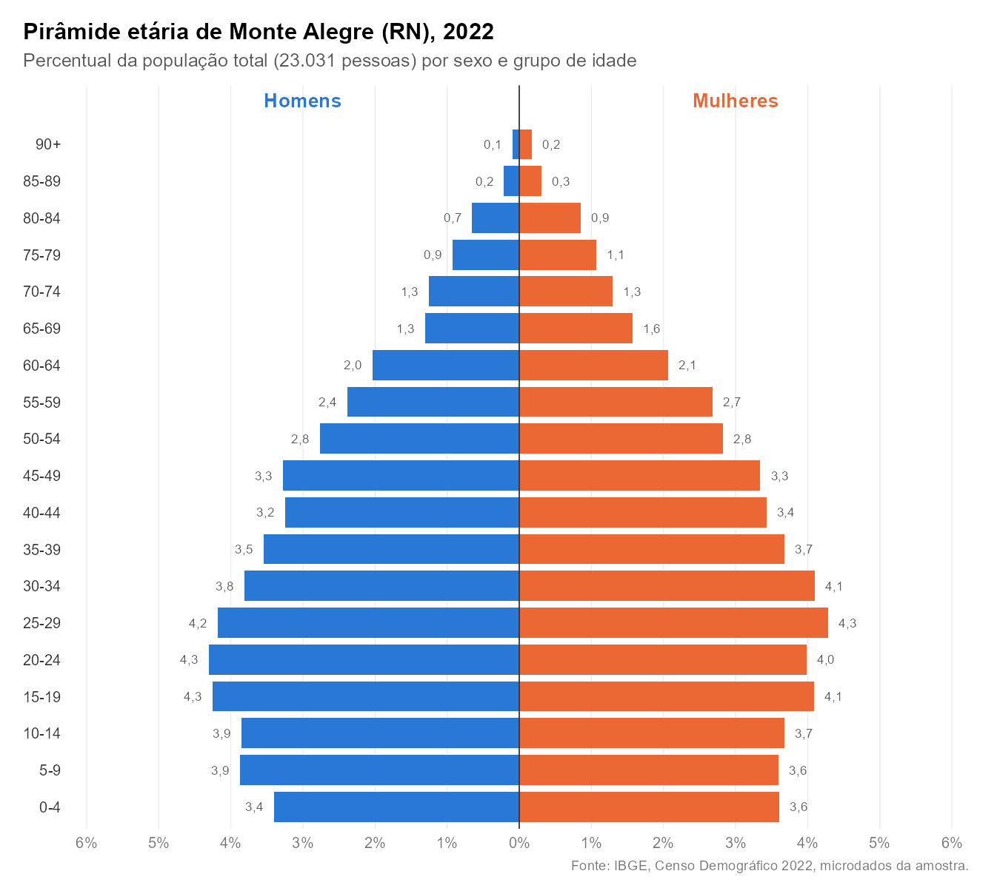

# Monte Alegre (RN)

Resultados do Censo Demográfico 2022 (microdados da amostra). Gerado por `R/05_readmes.R`; veja a [página dos municípios](../README.md) e o [README principal](../../../../README.md).

População: **23.031** pessoas (2.063 registros na amostra).

## Estrutura etária

| Indicador | Monte Alegre | RN |
|---|--:|--:|
| Razão de dependência jovem | 32,3 | 28,5 |
| Razão de dependência idosa | 14,2 | 15,1 |
| Razão de dependência total | 46,5 | 43,6 |
| Índice de envelhecimento | 44,1 | 52,9 |

Valores por 100 pessoas.

## Migração

Chegadas e saídas: mudanças de município nos últimos 10 anos.

| Indicador | Valor |
|---|--:|
| Nascidos no próprio município | 67,2% |
| Nascidos em outro município do Rio Grande do Norte | 27,0% |
| Nascidos em outra UF | 5,7% |
| Nascidos no exterior | 0,0% |
| Chegaram de outro município do Rio Grande do Norte | 3.497 |
| Chegaram de outra UF | 574 |
| Saíram para outro município da UF | 1.638 |
| Saíram para outra UF | 234 |
| Saldo migratório | +2.199 |
| Saldo por 1.000 habitantes | +95,5 |
| Chegaram do exterior | 0 |

Principais origens de quem chegou e destinos de quem saiu:

| Origem | Chegaram | Destino | Saíram |
|---|--:|---|--:|
| Natal (RN) | 972 | Parnamirim (RN) | 340 |
| Parnamirim (RN) | 665 | São José de Mipibu (RN) | 228 |
| São José de Mipibu (RN) | 384 | Macaíba (RN) | 151 |
| Vera Cruz (RN) | 191 | Natal (RN) | 148 |
| Brejinho (RN) | 184 | Brejinho (RN) | 128 |

## Mortalidade

Óbitos de agosto de 2021 a julho de 2022 informados no Censo.

| Indicador | Monte Alegre | RN |
|---|--:|--:|
| Óbitos no período | 212 | 22.488 |
| Registros de óbito na amostra | 19 |  |
| Taxa bruta de mortalidade (por mil) | 9,2 | 6,8 |
| Taxa padronizada por idade (por mil) | 11,2 | 6,8 |

Com poucos óbitos na amostra, as taxas deste município variam muito por acaso; por isso não há tábua de vida. Sem correção do sub-registro de óbitos do Censo.
