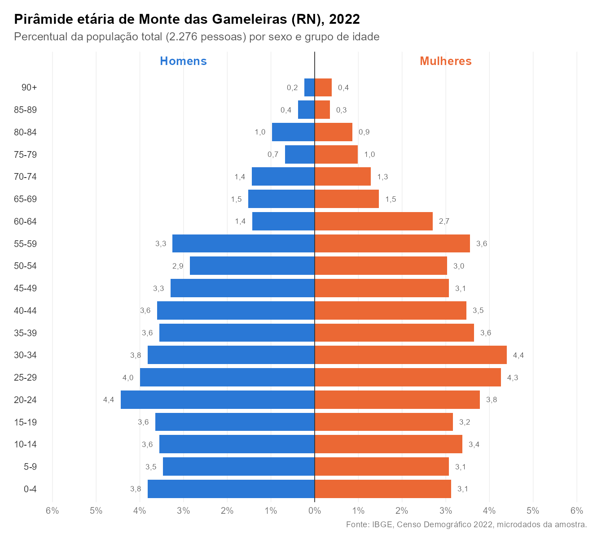

# Monte das Gameleiras (RN)

Resultados do Censo Demográfico 2022 (microdados da amostra). Gerado por `R/05_readmes.R`; veja a [página dos municípios](../README.md) e o [README principal](../../../../README.md).

População: **2.276** pessoas (1.133 registros na amostra).

## Estrutura etária

| Indicador | Monte das Gameleiras | RN |
|---|--:|--:|
| Razão de dependência jovem | 29,6 | 28,5 |
| Razão de dependência idosa | 15,4 | 15,1 |
| Razão de dependência total | 45,0 | 43,6 |
| Índice de envelhecimento | 51,8 | 52,9 |

Valores por 100 pessoas.

## Migração

Chegadas e saídas: mudanças de município nos últimos 10 anos.

| Indicador | Valor |
|---|--:|
| Nascidos no próprio município | 66,8% |
| Nascidos em outro município do Rio Grande do Norte | 20,7% |
| Nascidos em outra UF | 12,5% |
| Nascidos no exterior | 0,0% |
| Chegaram de outro município do Rio Grande do Norte | 144 |
| Chegaram de outra UF | 64 |
| Saíram para outro município da UF | 184 |
| Saíram para outra UF | 25 |
| Saldo migratório | 0 |
| Saldo por 1.000 habitantes | -0,1 |
| Chegaram do exterior | 0 |

Principais origens de quem chegou e destinos de quem saiu:

| Origem | Chegaram | Destino | Saíram |
|---|--:|---|--:|
| Natal (RN) | 46 | Parnamirim (RN) | 79 |
| Guarujá (SP) | 23 | Gaspar (SC) | 25 |
| Serra de São Bento (RN) | 21 | São Gonçalo do Amarante (RN) | 18 |
| São José do Campestre (RN) | 16 | São José do Campestre (RN) | 16 |
| Passa e Fica (RN) | 14 | Passa e Fica (RN) | 15 |

## Mortalidade

Óbitos de agosto de 2021 a julho de 2022 informados no Censo.

| Indicador | Monte das Gameleiras | RN |
|---|--:|--:|
| Óbitos no período | 24 | 22.488 |
| Registros de óbito na amostra | 12 |  |
| Taxa bruta de mortalidade (por mil) | 10,4 | 6,8 |
| Taxa padronizada por idade (por mil) | 9,6 | 6,8 |

Com poucos óbitos na amostra, as taxas deste município variam muito por acaso; por isso não há tábua de vida. Sem correção do sub-registro de óbitos do Censo.
