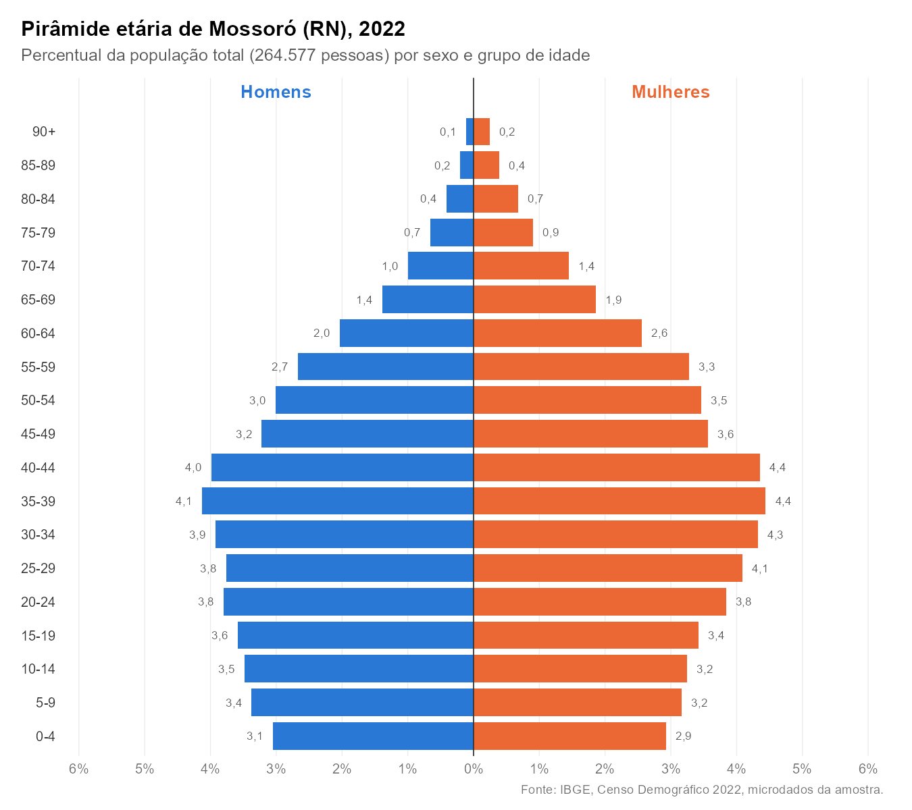
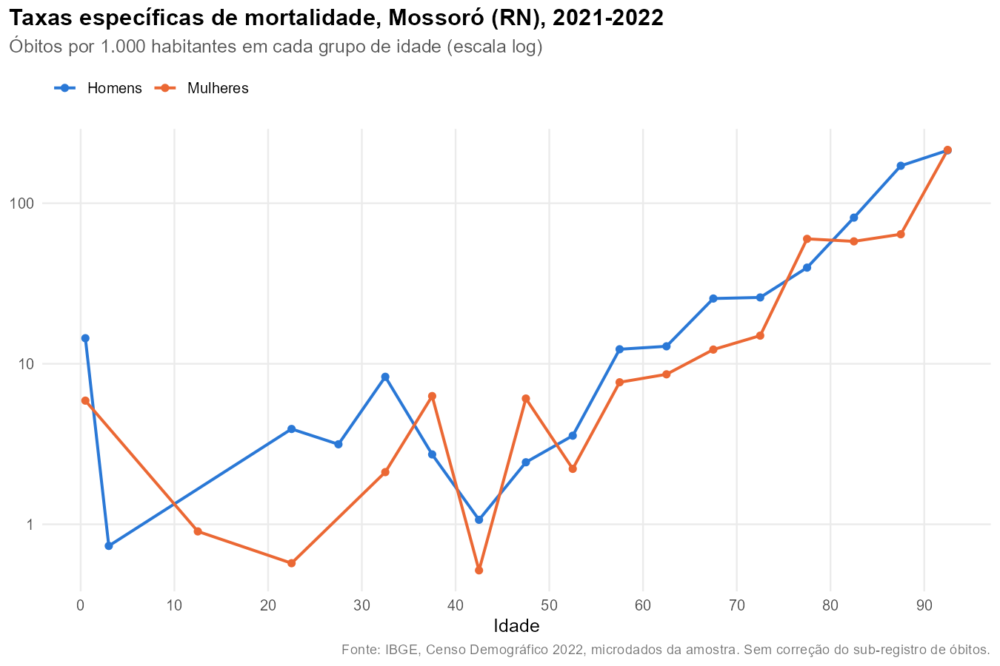

# Mossoró (RN)

Resultados do Censo Demográfico 2022 (microdados da amostra). Gerado por `R/05_readmes.R`; veja a [página dos municípios](../README.md) e o [README principal](../../../../README.md).

População: **264.577** pessoas (25.493 registros na amostra).

## Estrutura etária

| Indicador | Mossoró | RN |
|---|--:|--:|
| Razão de dependência jovem | 26,9 | 28,5 |
| Razão de dependência idosa | 13,0 | 15,1 |
| Razão de dependência total | 39,9 | 43,6 |
| Índice de envelhecimento | 48,2 | 52,9 |

Valores por 100 pessoas.

## Migração

Chegadas e saídas: mudanças de município nos últimos 10 anos.

| Indicador | Valor |
|---|--:|
| Nascidos no próprio município | 69,8% |
| Nascidos em outro município do Rio Grande do Norte | 19,9% |
| Nascidos em outra UF | 10,2% |
| Nascidos no exterior | 0,1% |
| Chegaram de outro município do Rio Grande do Norte | 14.371 |
| Chegaram de outra UF | 10.904 |
| Saíram para outro município da UF | 16.921 |
| Saíram para outra UF | 13.514 |
| Saldo migratório | -5.159 |
| Saldo por 1.000 habitantes | -19,5 |
| Chegaram do exterior | 617 |

Principais origens de quem chegou e destinos de quem saiu:

| Origem | Chegaram | Destino | Saíram |
|---|--:|---|--:|
| Natal (RN) | 2.996 | Natal (RN) | 2.227 |
| Fortaleza (CE) | 1.469 | Parnamirim (RN) | 1.342 |
| Açu (RN) | 951 | Fortaleza (CE) | 1.256 |
| São Paulo (SP) | 703 | Açu (RN) | 1.006 |
| Apodi (RN) | 678 | Apodi (RN) | 938 |

## Mortalidade

Óbitos de agosto de 2021 a julho de 2022 informados no Censo.

| Indicador | Mossoró | RN |
|---|--:|--:|
| Óbitos no período | 1.809 | 22.488 |
| Registros de óbito na amostra | 177 |  |
| Taxa bruta de mortalidade (por mil) | 6,8 | 6,8 |
| Taxa padronizada por idade (por mil) | 7,5 | 6,8 |
| Esperança de vida ao nascer, total | 76,0 | 77,2 |
| Esperança de vida ao nascer, homens | 73,1 | 74,5 |
| Esperança de vida ao nascer, mulheres | 78,5 | 79,7 |
| Esperança de vida aos 60 anos, total | 22,6 | 23,4 |

A tábua de vida usa poucos registros de óbito da amostra e deve ser lida como aproximada. Sem correção do sub-registro de óbitos do Censo.

