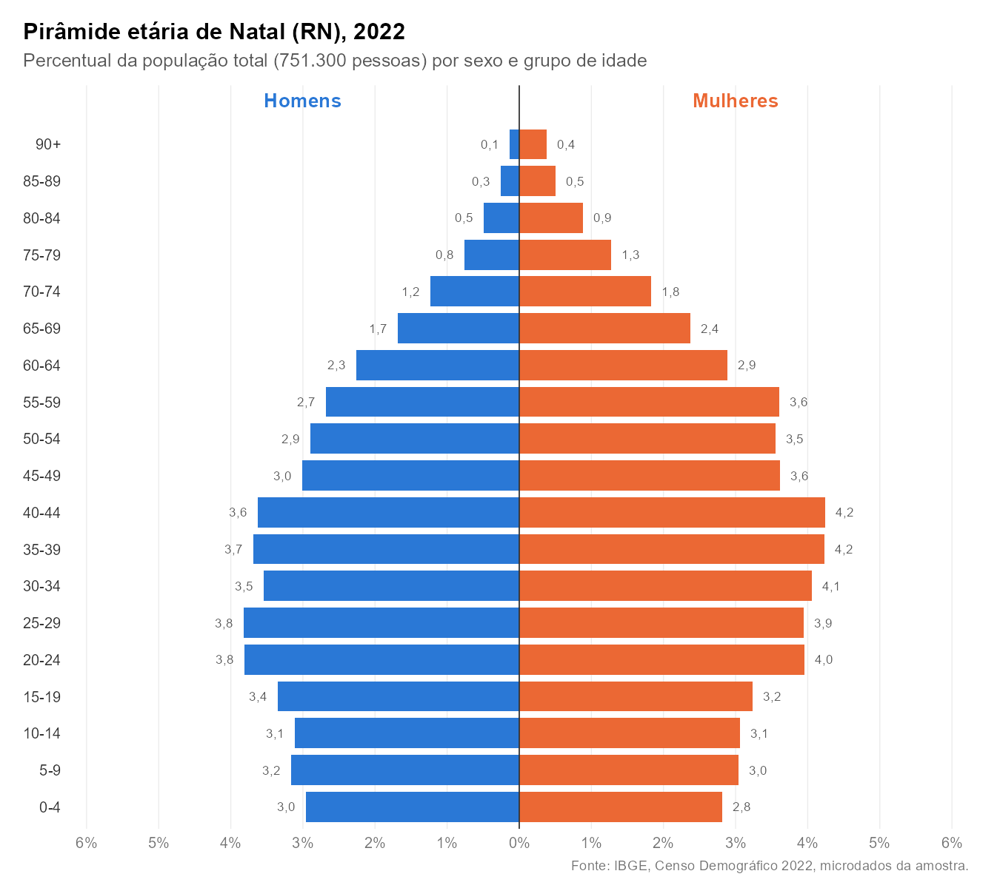
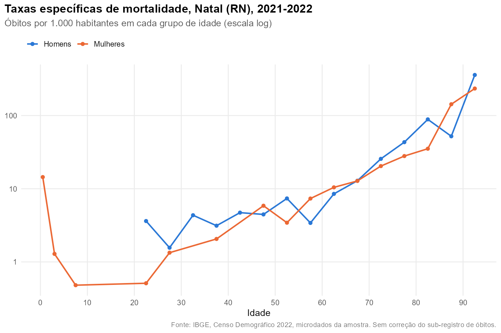

# Natal (RN)

Resultados do Censo Demográfico 2022 (microdados da amostra). Gerado por `R/05_readmes.R`; veja a [página dos municípios](../README.md) e o [README principal](../../../../README.md).

População: **751.300** pessoas (35.763 registros na amostra).

## Estrutura etária

| Indicador | Natal | RN |
|---|--:|--:|
| Razão de dependência jovem | 25,9 | 28,5 |
| Razão de dependência idosa | 16,9 | 15,1 |
| Razão de dependência total | 42,8 | 43,6 |
| Índice de envelhecimento | 65,1 | 52,9 |

Valores por 100 pessoas.

## Migração

Chegadas e saídas: mudanças de município nos últimos 10 anos.

| Indicador | Valor |
|---|--:|
| Nascidos no próprio município | 65,5% |
| Nascidos em outro município do Rio Grande do Norte | 22,2% |
| Nascidos em outra UF | 12,1% |
| Nascidos no exterior | 0,2% |
| Chegaram de outro município do Rio Grande do Norte | 41.519 |
| Chegaram de outra UF | 37.924 |
| Saíram para outro município da UF | 135.808 |
| Saíram para outra UF | 57.692 |
| Saldo migratório | -114.057 |
| Saldo por 1.000 habitantes | -151,8 |
| Chegaram do exterior | 3.093 |

Principais origens de quem chegou e destinos de quem saiu:

| Origem | Chegaram | Destino | Saíram |
|---|--:|---|--:|
| Parnamirim (RN) | 4.674 | Parnamirim (RN) | 35.878 |
| São Paulo (SP) | 4.109 | São Gonçalo do Amarante (RN) | 23.352 |
| Rio de Janeiro (RJ) | 3.128 | Extremoz (RN) | 20.029 |
| Recife (PE) | 3.085 | Ceará-Mirim (RN) | 5.157 |
| Mossoró (RN) | 2.227 | Macaíba (RN) | 4.323 |

## Mortalidade

Óbitos de agosto de 2021 a julho de 2022 informados no Censo.

| Indicador | Natal | RN |
|---|--:|--:|
| Óbitos no período | 5.490 | 22.488 |
| Registros de óbito na amostra | 259 |  |
| Taxa bruta de mortalidade (por mil) | 7,3 | 6,8 |
| Taxa padronizada por idade (por mil) | 6,8 | 6,8 |
| Esperança de vida ao nascer, total | 77,9 | 77,2 |
| Esperança de vida ao nascer, homens | 76,5 | 74,5 |
| Esperança de vida ao nascer, mulheres | 78,9 | 79,7 |
| Esperança de vida aos 60 anos, total | 23,5 | 23,4 |

A tábua de vida usa poucos registros de óbito da amostra e deve ser lida como aproximada. Sem correção do sub-registro de óbitos do Censo.

