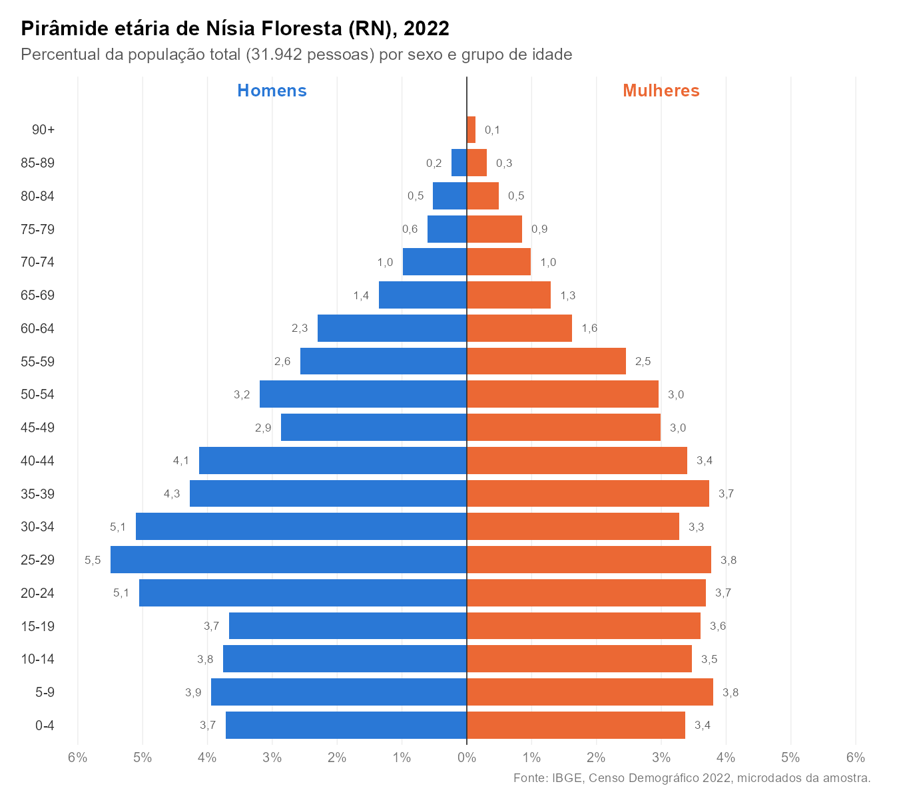

# Nísia Floresta (RN)

Resultados do Censo Demográfico 2022 (microdados da amostra). Gerado por `R/05_readmes.R`; veja a [página dos municípios](../README.md) e o [README principal](../../../../README.md).

População: **31.942** pessoas (2.787 registros na amostra).

## Estrutura etária

| Indicador | Nísia Floresta | RN |
|---|--:|--:|
| Razão de dependência jovem | 31,5 | 28,5 |
| Razão de dependência idosa | 11,1 | 15,1 |
| Razão de dependência total | 42,5 | 43,6 |
| Índice de envelhecimento | 35,2 | 52,9 |

Valores por 100 pessoas.

## Migração

Chegadas e saídas: mudanças de município nos últimos 10 anos.

| Indicador | Valor |
|---|--:|
| Nascidos no próprio município | 48,1% |
| Nascidos em outro município do Rio Grande do Norte | 40,4% |
| Nascidos em outra UF | 10,9% |
| Nascidos no exterior | 0,4% |
| Chegaram de outro município do Rio Grande do Norte | 6.359 |
| Chegaram de outra UF | 1.424 |
| Saíram para outro município da UF | 1.969 |
| Saíram para outra UF | 313 |
| Saldo migratório | +5.502 |
| Saldo por 1.000 habitantes | +172,2 |
| Chegaram do exterior | 64 |

Principais origens de quem chegou e destinos de quem saiu:

| Origem | Chegaram | Destino | Saíram |
|---|--:|---|--:|
| Natal (RN) | 2.641 | Parnamirim (RN) | 519 |
| Parnamirim (RN) | 880 | São José de Mipibu (RN) | 361 |
| São José de Mipibu (RN) | 824 | Natal (RN) | 201 |
| Macaíba (RN) | 319 | Macaíba (RN) | 144 |
| Canguaretama (RN) | 209 | Senador Georgino Avelino (RN) | 102 |

## Mortalidade

Óbitos de agosto de 2021 a julho de 2022 informados no Censo.

| Indicador | Nísia Floresta | RN |
|---|--:|--:|
| Óbitos no período | 203 | 22.488 |
| Registros de óbito na amostra | 19 |  |
| Taxa bruta de mortalidade (por mil) | 6,4 | 6,8 |
| Taxa padronizada por idade (por mil) | 9,3 | 6,8 |

Com poucos óbitos na amostra, as taxas deste município variam muito por acaso; por isso não há tábua de vida. Sem correção do sub-registro de óbitos do Censo.
