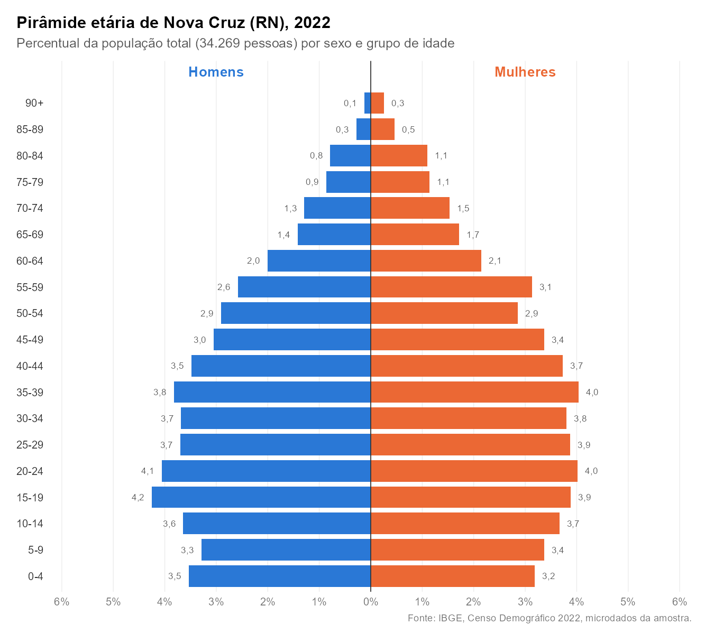

# Nova Cruz (RN)

Resultados do Censo Demográfico 2022 (microdados da amostra). Gerado por `R/05_readmes.R`; veja a [página dos municípios](../README.md) e o [README principal](../../../../README.md).

População: **34.269** pessoas (3.455 registros na amostra).

## Estrutura etária

| Indicador | Nova Cruz | RN |
|---|--:|--:|
| Razão de dependência jovem | 30,2 | 28,5 |
| Razão de dependência idosa | 16,0 | 15,1 |
| Razão de dependência total | 46,3 | 43,6 |
| Índice de envelhecimento | 53,0 | 52,9 |

Valores por 100 pessoas.

## Migração

Chegadas e saídas: mudanças de município nos últimos 10 anos.

| Indicador | Valor |
|---|--:|
| Nascidos no próprio município | 71,6% |
| Nascidos em outro município do Rio Grande do Norte | 14,5% |
| Nascidos em outra UF | 14,0% |
| Nascidos no exterior | 0,0% |
| Chegaram de outro município do Rio Grande do Norte | 1.762 |
| Chegaram de outra UF | 2.056 |
| Saíram para outro município da UF | 2.342 |
| Saíram para outra UF | 1.878 |
| Saldo migratório | -402 |
| Saldo por 1.000 habitantes | -11,7 |
| Chegaram do exterior | 13 |

Principais origens de quem chegou e destinos de quem saiu:

| Origem | Chegaram | Destino | Saíram |
|---|--:|---|--:|
| Natal (RN) | 603 | Parnamirim (RN) | 403 |
| Rio de Janeiro (RJ) | 401 | Logradouro (PB) | 363 |
| São Paulo (SP) | 250 | Natal (RN) | 323 |
| Santo Antônio (RN) | 148 | Rio de Janeiro (RJ) | 283 |
| Canguaretama (RN) | 146 | Passa e Fica (RN) | 194 |

## Mortalidade

Óbitos de agosto de 2021 a julho de 2022 informados no Censo.

| Indicador | Nova Cruz | RN |
|---|--:|--:|
| Óbitos no período | 270 | 22.488 |
| Registros de óbito na amostra | 27 |  |
| Taxa bruta de mortalidade (por mil) | 7,9 | 6,8 |
| Taxa padronizada por idade (por mil) | 7,6 | 6,8 |

Com poucos óbitos na amostra, as taxas deste município variam muito por acaso; por isso não há tábua de vida. Sem correção do sub-registro de óbitos do Censo.
