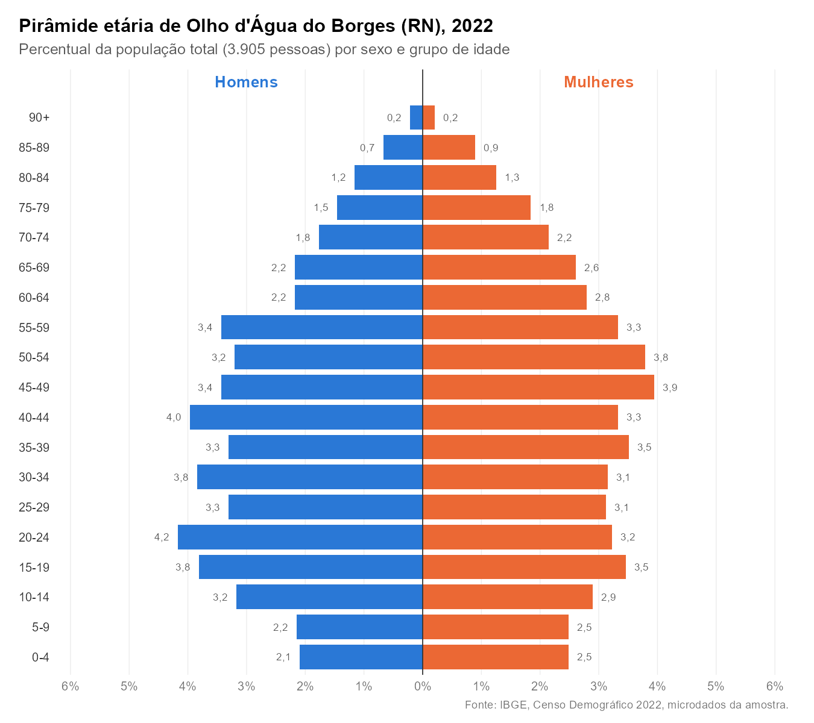

# Olho d'Água do Borges (RN)

Resultados do Censo Demográfico 2022 (microdados da amostra). Gerado por `R/05_readmes.R`; veja a [página dos municípios](../README.md) e o [README principal](../../../../README.md).

População: **3.905** pessoas (1.319 registros na amostra).

## Estrutura etária

| Indicador | Olho d'Água do Borges | RN |
|---|--:|--:|
| Razão de dependência jovem | 22,4 | 28,5 |
| Razão de dependência idosa | 24,0 | 15,1 |
| Razão de dependência total | 46,4 | 43,6 |
| Índice de envelhecimento | 107,4 | 52,9 |

Valores por 100 pessoas.

## Migração

Chegadas e saídas: mudanças de município nos últimos 10 anos.

| Indicador | Valor |
|---|--:|
| Nascidos no próprio município | 69,1% |
| Nascidos em outro município do Rio Grande do Norte | 24,7% |
| Nascidos em outra UF | 6,2% |
| Nascidos no exterior | 0,0% |
| Chegaram de outro município do Rio Grande do Norte | 259 |
| Chegaram de outra UF | 74 |
| Saíram para outro município da UF | 461 |
| Saíram para outra UF | 198 |
| Saldo migratório | -326 |
| Saldo por 1.000 habitantes | -83,5 |
| Chegaram do exterior | 0 |

Principais origens de quem chegou e destinos de quem saiu:

| Origem | Chegaram | Destino | Saíram |
|---|--:|---|--:|
| Caraúbas (RN) | 45 | Mossoró (RN) | 167 |
| Natal (RN) | 37 | Natal (RN) | 73 |
| Umarizal (RN) | 33 | São Paulo (SP) | 68 |
| Mossoró (RN) | 32 | Parnamirim (RN) | 55 |
| Patu (RN) | 23 | Governador Dix-Sept Rosado (RN) | 33 |

## Mortalidade

Óbitos de agosto de 2021 a julho de 2022 informados no Censo.

| Indicador | Olho d'Água do Borges | RN |
|---|--:|--:|
| Óbitos no período | 62 | 22.488 |
| Registros de óbito na amostra | 19 |  |
| Taxa bruta de mortalidade (por mil) | 15,9 | 6,8 |
| Taxa padronizada por idade (por mil) | 13,4 | 6,8 |

Com poucos óbitos na amostra, as taxas deste município variam muito por acaso; por isso não há tábua de vida. Sem correção do sub-registro de óbitos do Censo.
