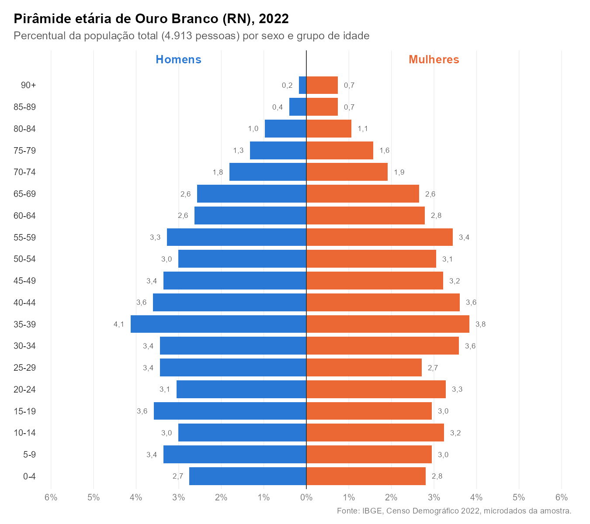

# Ouro Branco (RN)

Resultados do Censo Demográfico 2022 (microdados da amostra). Gerado por `R/05_readmes.R`; veja a [página dos municípios](../README.md) e o [README principal](../../../../README.md).

População: **4.913** pessoas (1.595 registros na amostra).

## Estrutura etária

| Indicador | Ouro Branco | RN |
|---|--:|--:|
| Razão de dependência jovem | 27,5 | 28,5 |
| Razão de dependência idosa | 24,1 | 15,1 |
| Razão de dependência total | 51,6 | 43,6 |
| Índice de envelhecimento | 87,9 | 52,9 |

Valores por 100 pessoas.

## Migração

Chegadas e saídas: mudanças de município nos últimos 10 anos.

| Indicador | Valor |
|---|--:|
| Nascidos no próprio município | 76,2% |
| Nascidos em outro município do Rio Grande do Norte | 12,2% |
| Nascidos em outra UF | 11,6% |
| Nascidos no exterior | 0,0% |
| Chegaram de outro município do Rio Grande do Norte | 276 |
| Chegaram de outra UF | 403 |
| Saíram para outro município da UF | 117 |
| Saíram para outra UF | 229 |
| Saldo migratório | +332 |
| Saldo por 1.000 habitantes | +67,6 |
| Chegaram do exterior | 4 |

Principais origens de quem chegou e destinos de quem saiu:

| Origem | Chegaram | Destino | Saíram |
|---|--:|---|--:|
| Caicó (RN) | 119 | Jardim do Seridó (RN) | 42 |
| Natal (RN) | 64 | Várzea (PB) | 41 |
| São José do Sabugi (PB) | 58 | São José do Sabugi (PB) | 36 |
| Jardim do Seridó (RN) | 46 | Santa Luzia (PB) | 29 |
| Campina Grande (PB) | 31 | Natal (RN) | 20 |

## Mortalidade

Óbitos de agosto de 2021 a julho de 2022 informados no Censo.

| Indicador | Ouro Branco | RN |
|---|--:|--:|
| Óbitos no período | 40 | 22.488 |
| Registros de óbito na amostra | 13 |  |
| Taxa bruta de mortalidade (por mil) | 8,1 | 6,8 |
| Taxa padronizada por idade (por mil) | 5,4 | 6,8 |

Com poucos óbitos na amostra, as taxas deste município variam muito por acaso; por isso não há tábua de vida. Sem correção do sub-registro de óbitos do Censo.
