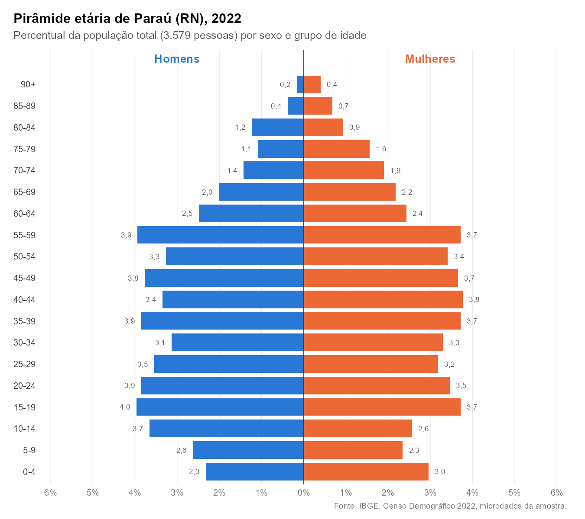

# Paraú (RN)

Resultados do Censo Demográfico 2022 (microdados da amostra). Gerado por `R/05_readmes.R`; veja a [página dos municípios](../README.md) e o [README principal](../../../../README.md).

População: **3.579** pessoas (1.137 registros na amostra).

## Estrutura etária

| Indicador | Paraú | RN |
|---|--:|--:|
| Razão de dependência jovem | 23,7 | 28,5 |
| Razão de dependência idosa | 20,1 | 15,1 |
| Razão de dependência total | 43,8 | 43,6 |
| Índice de envelhecimento | 84,7 | 52,9 |

Valores por 100 pessoas.

## Migração

Chegadas e saídas: mudanças de município nos últimos 10 anos.

| Indicador | Valor |
|---|--:|
| Nascidos no próprio município | 73,1% |
| Nascidos em outro município do Rio Grande do Norte | 25,5% |
| Nascidos em outra UF | 1,4% |
| Nascidos no exterior | 0,0% |
| Chegaram de outro município do Rio Grande do Norte | 297 |
| Chegaram de outra UF | 20 |
| Saíram para outro município da UF | 461 |
| Saíram para outra UF | 38 |
| Saldo migratório | -182 |
| Saldo por 1.000 habitantes | -50,9 |
| Chegaram do exterior | 0 |

Principais origens de quem chegou e destinos de quem saiu:

| Origem | Chegaram | Destino | Saíram |
|---|--:|---|--:|
| Mossoró (RN) | 102 | Mossoró (RN) | 93 |
| Açu (RN) | 55 | Açu (RN) | 78 |
| Triunfo Potiguar (RN) | 39 | Carnaubais (RN) | 57 |
| Natal (RN) | 28 | Triunfo Potiguar (RN) | 39 |
| Jucurutu (RN) | 23 | Caicó (RN) | 23 |

## Mortalidade

Óbitos de agosto de 2021 a julho de 2022 informados no Censo.

| Indicador | Paraú | RN |
|---|--:|--:|
| Óbitos no período | 15 | 22.488 |
| Registros de óbito na amostra | 5 |  |
| Taxa bruta de mortalidade (por mil) | 4,2 | 6,8 |
| Taxa padronizada por idade (por mil) | 3,0 | 6,8 |

Com poucos óbitos na amostra, as taxas deste município variam muito por acaso; por isso não há tábua de vida. Sem correção do sub-registro de óbitos do Censo.
