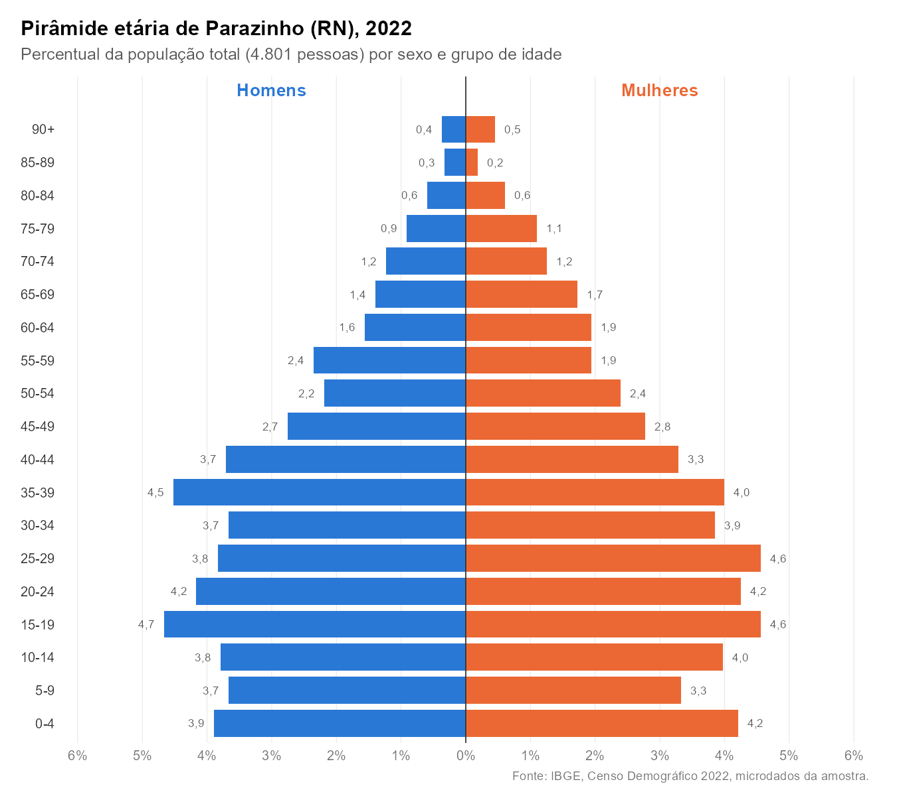

# Parazinho (RN)

Resultados do Censo Demográfico 2022 (microdados da amostra). Gerado por `R/05_readmes.R`; veja a [página dos municípios](../README.md) e o [README principal](../../../../README.md).

População: **4.801** pessoas (1.553 registros na amostra).

## Estrutura etária

| Indicador | Parazinho | RN |
|---|--:|--:|
| Razão de dependência jovem | 34,2 | 28,5 |
| Razão de dependência idosa | 15,2 | 15,1 |
| Razão de dependência total | 49,3 | 43,6 |
| Índice de envelhecimento | 44,4 | 52,9 |

Valores por 100 pessoas.

## Migração

Chegadas e saídas: mudanças de município nos últimos 10 anos.

| Indicador | Valor |
|---|--:|
| Nascidos no próprio município | 72,2% |
| Nascidos em outro município do Rio Grande do Norte | 25,4% |
| Nascidos em outra UF | 2,2% |
| Nascidos no exterior | 0,0% |
| Chegaram de outro município do Rio Grande do Norte | 516 |
| Chegaram de outra UF | 35 |
| Saíram para outro município da UF | 922 |
| Saíram para outra UF | 61 |
| Saldo migratório | -432 |
| Saldo por 1.000 habitantes | -90,0 |
| Chegaram do exterior | 0 |

Principais origens de quem chegou e destinos de quem saiu:

| Origem | Chegaram | Destino | Saíram |
|---|--:|---|--:|
| Natal (RN) | 159 | Natal (RN) | 324 |
| João Câmara (RN) | 66 | João Câmara (RN) | 121 |
| Pedra Grande (RN) | 34 | São Gonçalo do Amarante (RN) | 91 |
| Extremoz (RN) | 27 | Pedra Grande (RN) | 60 |
| Caiçara do Norte (RN) | 26 | Jandaíra (RN) | 55 |

## Mortalidade

Óbitos de agosto de 2021 a julho de 2022 informados no Censo.

| Indicador | Parazinho | RN |
|---|--:|--:|
| Óbitos no período | 47 | 22.488 |
| Registros de óbito na amostra | 17 |  |
| Taxa bruta de mortalidade (por mil) | 9,7 | 6,8 |
| Taxa padronizada por idade (por mil) | 9,5 | 6,8 |

Com poucos óbitos na amostra, as taxas deste município variam muito por acaso; por isso não há tábua de vida. Sem correção do sub-registro de óbitos do Censo.
