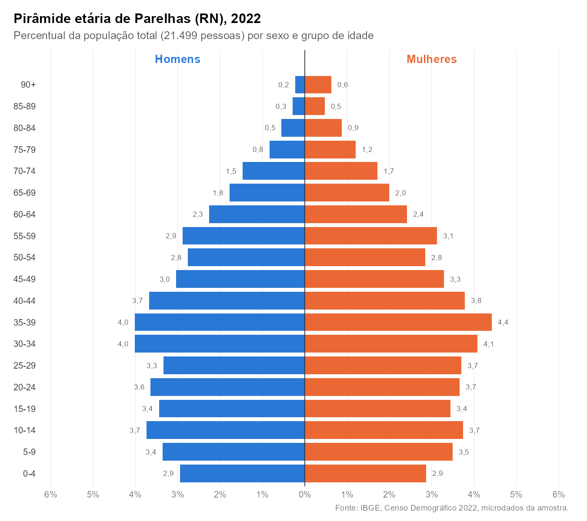

# Parelhas (RN)

Resultados do Censo Demográfico 2022 (microdados da amostra). Gerado por `R/05_readmes.R`; veja a [página dos municípios](../README.md) e o [README principal](../../../../README.md).

População: **21.499** pessoas (2.180 registros na amostra).

## Estrutura etária

| Indicador | Parelhas | RN |
|---|--:|--:|
| Razão de dependência jovem | 29,7 | 28,5 |
| Razão de dependência idosa | 17,7 | 15,1 |
| Razão de dependência total | 47,4 | 43,6 |
| Índice de envelhecimento | 59,7 | 52,9 |

Valores por 100 pessoas.

## Migração

Chegadas e saídas: mudanças de município nos últimos 10 anos.

| Indicador | Valor |
|---|--:|
| Nascidos no próprio município | 79,8% |
| Nascidos em outro município do Rio Grande do Norte | 10,9% |
| Nascidos em outra UF | 9,3% |
| Nascidos no exterior | 0,0% |
| Chegaram de outro município do Rio Grande do Norte | 1.580 |
| Chegaram de outra UF | 1.079 |
| Saíram para outro município da UF | 1.226 |
| Saíram para outra UF | 843 |
| Saldo migratório | +590 |
| Saldo por 1.000 habitantes | +27,4 |
| Chegaram do exterior | 0 |

Principais origens de quem chegou e destinos de quem saiu:

| Origem | Chegaram | Destino | Saíram |
|---|--:|---|--:|
| Natal (RN) | 441 | Natal (RN) | 295 |
| Carnaúba dos Dantas (RN) | 161 | Parnamirim (RN) | 163 |
| Currais Novos (RN) | 138 | Santana do Seridó (RN) | 136 |
| Caicó (RN) | 129 | Campina Grande (PB) | 121 |
| Mossoró (RN) | 122 | Jardim do Seridó (RN) | 103 |

## Mortalidade

Óbitos de agosto de 2021 a julho de 2022 informados no Censo.

| Indicador | Parelhas | RN |
|---|--:|--:|
| Óbitos no período | 217 | 22.488 |
| Registros de óbito na amostra | 21 |  |
| Taxa bruta de mortalidade (por mil) | 10,1 | 6,8 |
| Taxa padronizada por idade (por mil) | 9,2 | 6,8 |

Com poucos óbitos na amostra, as taxas deste município variam muito por acaso; por isso não há tábua de vida. Sem correção do sub-registro de óbitos do Censo.
