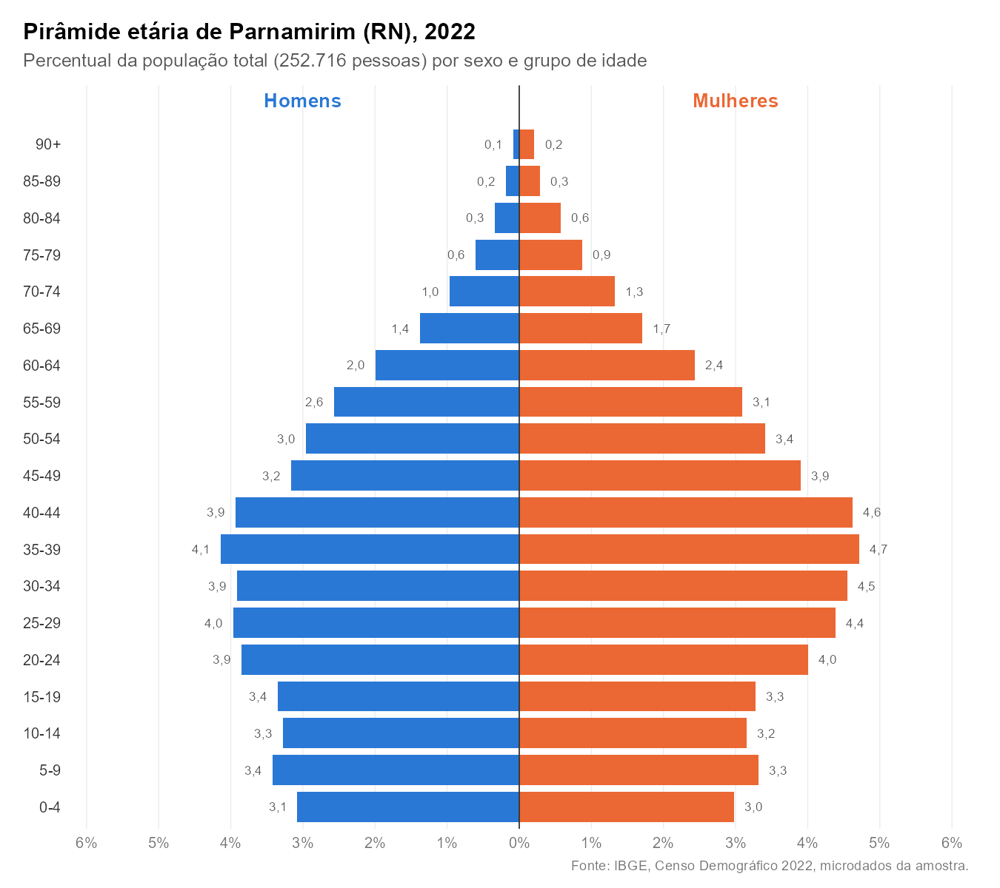
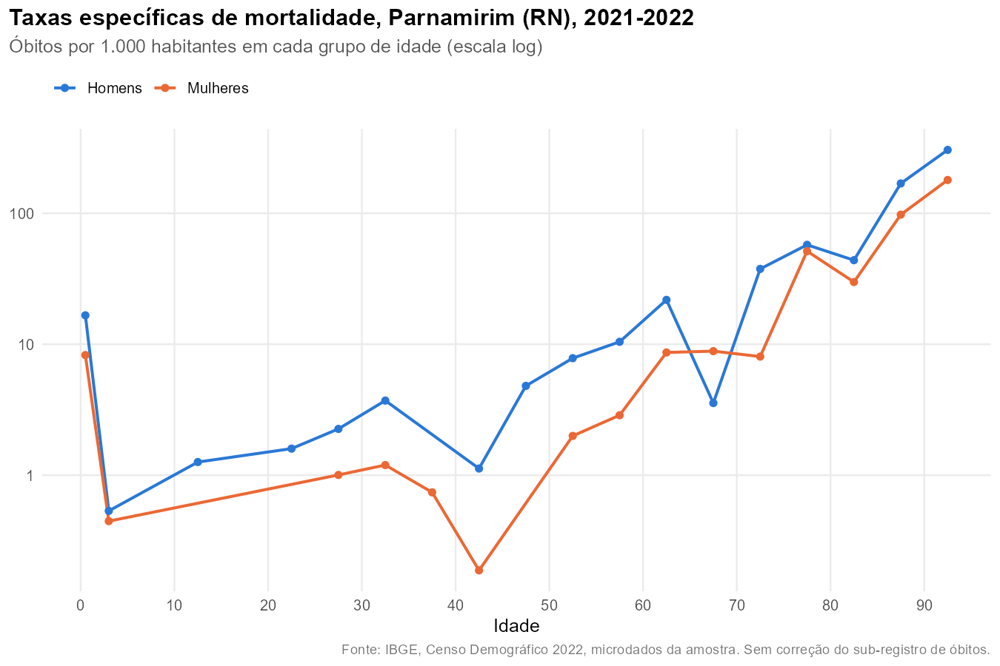

# Parnamirim (RN)

Resultados do Censo Demográfico 2022 (microdados da amostra). Gerado por `R/05_readmes.R`; veja a [página dos municípios](../README.md) e o [README principal](../../../../README.md).

População: **252.716** pessoas (26.029 registros na amostra).

## Estrutura etária

| Indicador | Parnamirim | RN |
|---|--:|--:|
| Razão de dependência jovem | 26,6 | 28,5 |
| Razão de dependência idosa | 11,8 | 15,1 |
| Razão de dependência total | 38,4 | 43,6 |
| Índice de envelhecimento | 44,3 | 52,9 |

Valores por 100 pessoas.

## Migração

Chegadas e saídas: mudanças de município nos últimos 10 anos.

| Indicador | Valor |
|---|--:|
| Nascidos no próprio município | 32,3% |
| Nascidos em outro município do Rio Grande do Norte | 50,8% |
| Nascidos em outra UF | 16,5% |
| Nascidos no exterior | 0,4% |
| Chegaram de outro município do Rio Grande do Norte | 57.144 |
| Chegaram de outra UF | 15.507 |
| Saíram para outro município da UF | 18.805 |
| Saíram para outra UF | 4.578 |
| Saldo migratório | +49.267 |
| Saldo por 1.000 habitantes | +195,0 |
| Chegaram do exterior | 593 |

Principais origens de quem chegou e destinos de quem saiu:

| Origem | Chegaram | Destino | Saíram |
|---|--:|---|--:|
| Natal (RN) | 35.878 | Natal (RN) | 4.674 |
| Macaíba (RN) | 1.573 | São José de Mipibu (RN) | 2.744 |
| Rio de Janeiro (RJ) | 1.554 | Macaíba (RN) | 2.035 |
| São Paulo (SP) | 1.387 | Nísia Floresta (RN) | 880 |
| Mossoró (RN) | 1.342 | São Gonçalo do Amarante (RN) | 719 |

## Mortalidade

Óbitos de agosto de 2021 a julho de 2022 informados no Censo.

| Indicador | Parnamirim | RN |
|---|--:|--:|
| Óbitos no período | 1.311 | 22.488 |
| Registros de óbito na amostra | 134 |  |
| Taxa bruta de mortalidade (por mil) | 5,2 | 6,8 |
| Taxa padronizada por idade (por mil) | 6,2 | 6,8 |
| Esperança de vida ao nascer, total | 78,7 | 77,2 |
| Esperança de vida ao nascer, homens | 74,2 | 74,5 |
| Esperança de vida ao nascer, mulheres | 83,1 | 79,7 |
| Esperança de vida aos 60 anos, total | 23,4 | 23,4 |

A tábua de vida usa poucos registros de óbito da amostra e deve ser lida como aproximada. Sem correção do sub-registro de óbitos do Censo.

