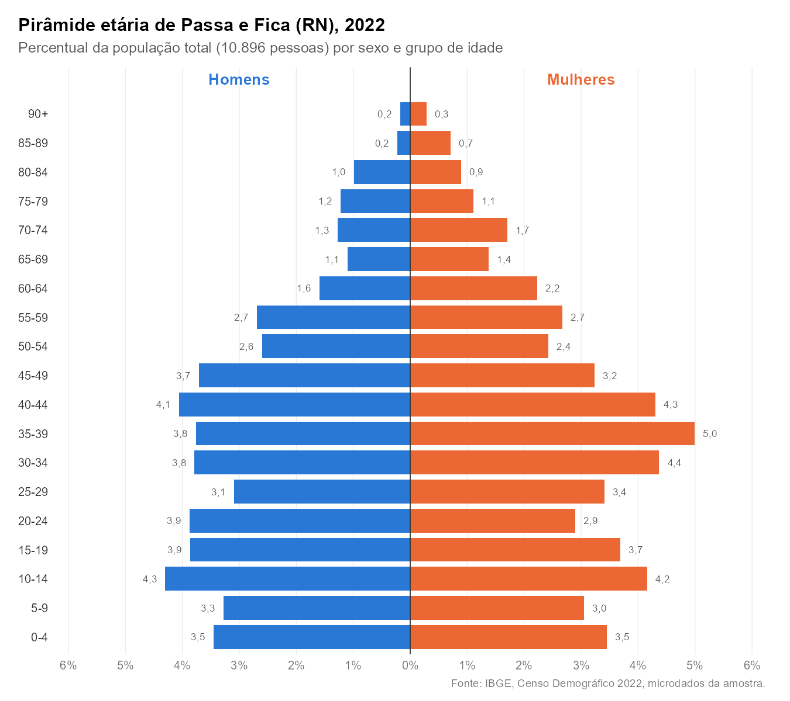

# Passa e Fica (RN)

Resultados do Censo Demográfico 2022 (microdados da amostra). Gerado por `R/05_readmes.R`; veja a [página dos municípios](../README.md) e o [README principal](../../../../README.md).

População: **10.896** pessoas (2.166 registros na amostra).

## Estrutura etária

| Indicador | Passa e Fica | RN |
|---|--:|--:|
| Razão de dependência jovem | 32,2 | 28,5 |
| Razão de dependência idosa | 16,4 | 15,1 |
| Razão de dependência total | 48,7 | 43,6 |
| Índice de envelhecimento | 51,0 | 52,9 |

Valores por 100 pessoas.

## Migração

Chegadas e saídas: mudanças de município nos últimos 10 anos.

| Indicador | Valor |
|---|--:|
| Nascidos no próprio município | 59,0% |
| Nascidos em outro município do Rio Grande do Norte | 21,6% |
| Nascidos em outra UF | 19,4% |
| Nascidos no exterior | 0,0% |
| Chegaram de outro município do Rio Grande do Norte | 937 |
| Chegaram de outra UF | 982 |
| Saíram para outro município da UF | 629 |
| Saíram para outra UF | 542 |
| Saldo migratório | +748 |
| Saldo por 1.000 habitantes | +68,6 |
| Chegaram do exterior | 0 |

Principais origens de quem chegou e destinos de quem saiu:

| Origem | Chegaram | Destino | Saíram |
|---|--:|---|--:|
| Natal (RN) | 288 | Natal (RN) | 147 |
| São Paulo (SP) | 216 | Parnamirim (RN) | 102 |
| Nova Cruz (RN) | 194 | Nova Cruz (RN) | 90 |
| Tacima (PB) | 141 | Araruna (PB) | 88 |
| Rio de Janeiro (RJ) | 93 | Recife (PE) | 68 |

## Mortalidade

Óbitos de agosto de 2021 a julho de 2022 informados no Censo.

| Indicador | Passa e Fica | RN |
|---|--:|--:|
| Óbitos no período | 34 | 22.488 |
| Registros de óbito na amostra | 7 |  |
| Taxa bruta de mortalidade (por mil) | 3,1 | 6,8 |
| Taxa padronizada por idade (por mil) | 3,1 | 6,8 |

Com poucos óbitos na amostra, as taxas deste município variam muito por acaso; por isso não há tábua de vida. Sem correção do sub-registro de óbitos do Censo.
