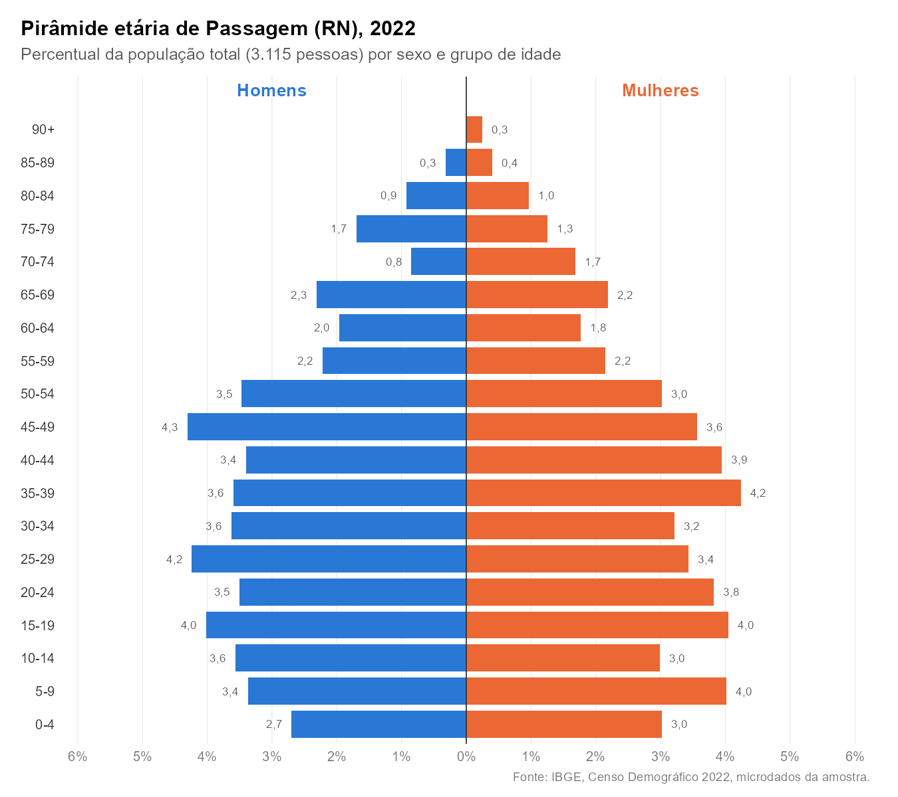

# Passagem (RN)

Resultados do Censo Demográfico 2022 (microdados da amostra). Gerado por `R/05_readmes.R`; veja a [página dos municípios](../README.md) e o [README principal](../../../../README.md).

População: **3.115** pessoas (999 registros na amostra).

## Estrutura etária

| Indicador | Passagem | RN |
|---|--:|--:|
| Razão de dependência jovem | 29,1 | 28,5 |
| Razão de dependência idosa | 19,0 | 15,1 |
| Razão de dependência total | 48,1 | 43,6 |
| Índice de envelhecimento | 65,4 | 52,9 |

Valores por 100 pessoas.

## Migração

Chegadas e saídas: mudanças de município nos últimos 10 anos.

| Indicador | Valor |
|---|--:|
| Nascidos no próprio município | 72,7% |
| Nascidos em outro município do Rio Grande do Norte | 22,4% |
| Nascidos em outra UF | 4,9% |
| Nascidos no exterior | 0,0% |
| Chegaram de outro município do Rio Grande do Norte | 365 |
| Chegaram de outra UF | 58 |
| Saíram para outro município da UF | 296 |
| Saíram para outra UF | 100 |
| Saldo migratório | +27 |
| Saldo por 1.000 habitantes | +8,6 |
| Chegaram do exterior | 0 |

Principais origens de quem chegou e destinos de quem saiu:

| Origem | Chegaram | Destino | Saíram |
|---|--:|---|--:|
| Natal (RN) | 91 | Brejinho (RN) | 62 |
| Várzea (RN) | 48 | Parnamirim (RN) | 52 |
| Santo Antônio (RN) | 43 | Várzea (RN) | 51 |
| Jundiá (RN) | 32 | Itumbiara (GO) | 48 |
| Parnamirim (RN) | 27 | Santo Antônio (RN) | 41 |

## Mortalidade

Óbitos de agosto de 2021 a julho de 2022 informados no Censo.

| Indicador | Passagem | RN |
|---|--:|--:|
| Óbitos no período | 32 | 22.488 |
| Registros de óbito na amostra | 10 |  |
| Taxa bruta de mortalidade (por mil) | 10,2 | 6,8 |
| Taxa padronizada por idade (por mil) | 12,4 | 6,8 |

Com poucos óbitos na amostra, as taxas deste município variam muito por acaso; por isso não há tábua de vida. Sem correção do sub-registro de óbitos do Censo.
