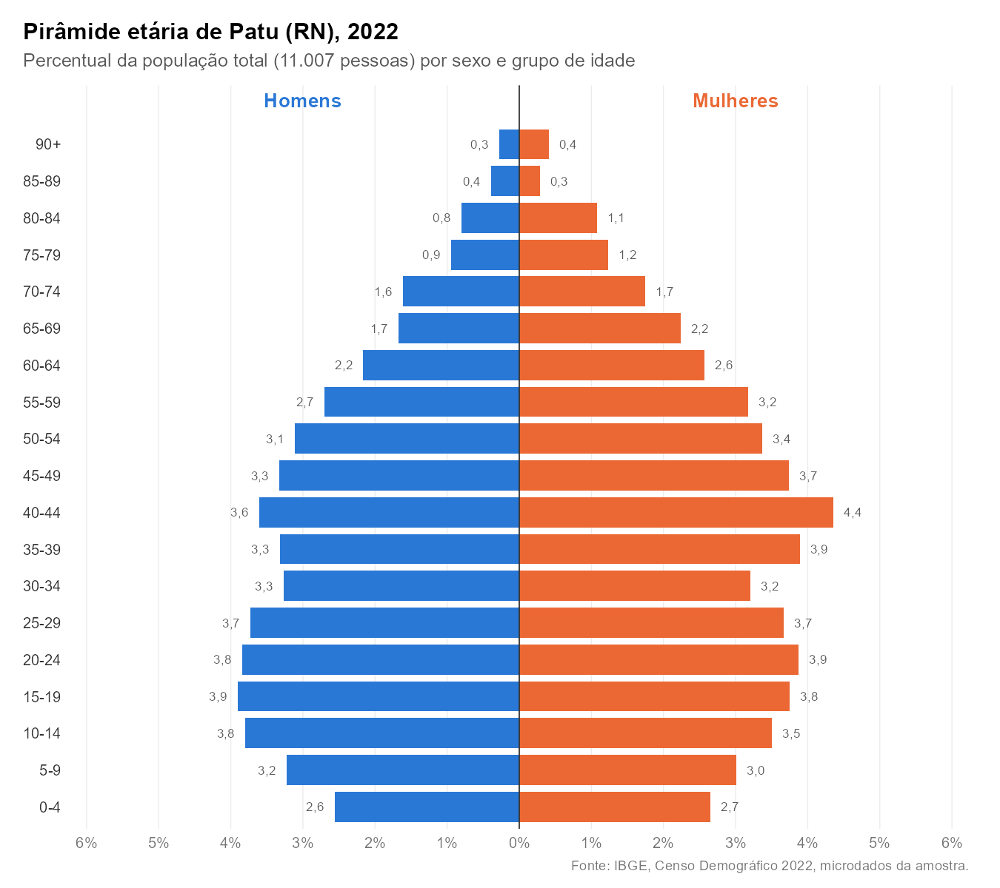

# Patu (RN)

Resultados do Censo Demográfico 2022 (microdados da amostra). Gerado por `R/05_readmes.R`; veja a [página dos municípios](../README.md) e o [README principal](../../../../README.md).

População: **11.007** pessoas (2.177 registros na amostra).

## Estrutura etária

| Indicador | Patu | RN |
|---|--:|--:|
| Razão de dependência jovem | 27,3 | 28,5 |
| Razão de dependência idosa | 18,5 | 15,1 |
| Razão de dependência total | 45,8 | 43,6 |
| Índice de envelhecimento | 67,6 | 52,9 |

Valores por 100 pessoas.

## Migração

Chegadas e saídas: mudanças de município nos últimos 10 anos.

| Indicador | Valor |
|---|--:|
| Nascidos no próprio município | 73,5% |
| Nascidos em outro município do Rio Grande do Norte | 17,9% |
| Nascidos em outra UF | 8,5% |
| Nascidos no exterior | 0,0% |
| Chegaram de outro município do Rio Grande do Norte | 791 |
| Chegaram de outra UF | 460 |
| Saíram para outro município da UF | 1.394 |
| Saíram para outra UF | 497 |
| Saldo migratório | -640 |
| Saldo por 1.000 habitantes | -58,1 |
| Chegaram do exterior | 0 |

Principais origens de quem chegou e destinos de quem saiu:

| Origem | Chegaram | Destino | Saíram |
|---|--:|---|--:|
| Natal (RN) | 188 | Mossoró (RN) | 231 |
| Mossoró (RN) | 180 | Parnamirim (RN) | 213 |
| Catolé do Rocha (PB) | 90 | Catolé do Rocha (PB) | 122 |
| Almino Afonso (RN) | 81 | Natal (RN) | 98 |
| São Paulo (SP) | 72 | São Bento (PB) | 95 |

## Mortalidade

Óbitos de agosto de 2021 a julho de 2022 informados no Censo.

| Indicador | Patu | RN |
|---|--:|--:|
| Óbitos no período | 83 | 22.488 |
| Registros de óbito na amostra | 16 |  |
| Taxa bruta de mortalidade (por mil) | 7,6 | 6,8 |
| Taxa padronizada por idade (por mil) | 6,8 | 6,8 |

Com poucos óbitos na amostra, as taxas deste município variam muito por acaso; por isso não há tábua de vida. Sem correção do sub-registro de óbitos do Censo.
