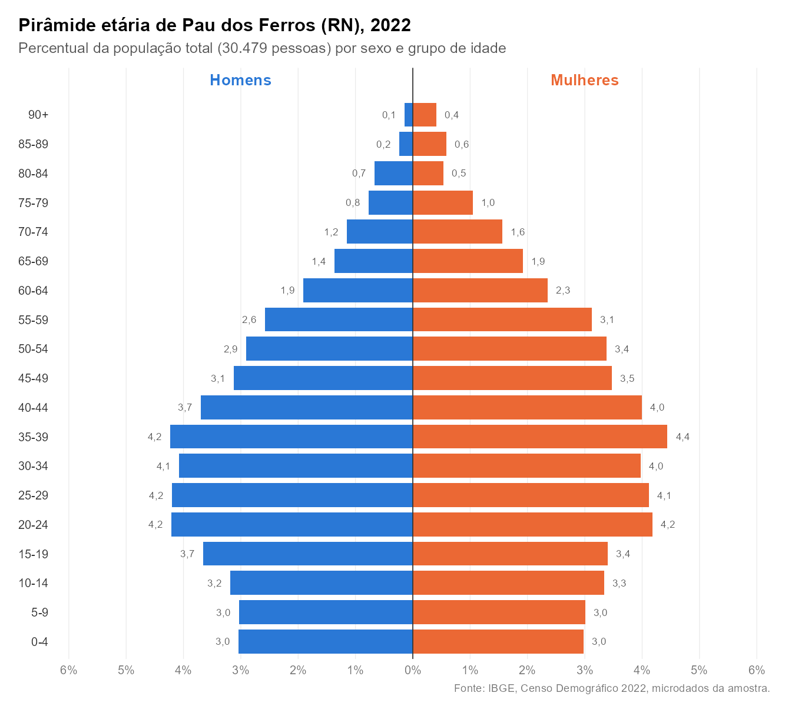

# Pau dos Ferros (RN)

Resultados do Censo Demográfico 2022 (microdados da amostra). Gerado por `R/05_readmes.R`; veja a [página dos municípios](../README.md) e o [README principal](../../../../README.md).

População: **30.479** pessoas (2.952 registros na amostra).

## Estrutura etária

| Indicador | Pau dos Ferros | RN |
|---|--:|--:|
| Razão de dependência jovem | 26,1 | 28,5 |
| Razão de dependência idosa | 14,6 | 15,1 |
| Razão de dependência total | 40,8 | 43,6 |
| Índice de envelhecimento | 55,9 | 52,9 |

Valores por 100 pessoas.

## Migração

Chegadas e saídas: mudanças de município nos últimos 10 anos.

| Indicador | Valor |
|---|--:|
| Nascidos no próprio município | 60,8% |
| Nascidos em outro município do Rio Grande do Norte | 27,0% |
| Nascidos em outra UF | 12,2% |
| Nascidos no exterior | 0,0% |
| Chegaram de outro município do Rio Grande do Norte | 3.580 |
| Chegaram de outra UF | 1.783 |
| Saíram para outro município da UF | 3.689 |
| Saíram para outra UF | 1.995 |
| Saldo migratório | -320 |
| Saldo por 1.000 habitantes | -10,5 |
| Chegaram do exterior | 7 |

Principais origens de quem chegou e destinos de quem saiu:

| Origem | Chegaram | Destino | Saíram |
|---|--:|---|--:|
| Natal (RN) | 482 | Natal (RN) | 698 |
| Mossoró (RN) | 427 | Mossoró (RN) | 458 |
| São Paulo (SP) | 332 | Rafael Fernandes (RN) | 282 |
| Marcelino Vieira (RN) | 233 | São Paulo (SP) | 280 |
| São Miguel (RN) | 233 | Parnamirim (RN) | 255 |

## Mortalidade

Óbitos de agosto de 2021 a julho de 2022 informados no Censo.

| Indicador | Pau dos Ferros | RN |
|---|--:|--:|
| Óbitos no período | 255 | 22.488 |
| Registros de óbito na amostra | 22 |  |
| Taxa bruta de mortalidade (por mil) | 8,4 | 6,8 |
| Taxa padronizada por idade (por mil) | 8,5 | 6,8 |

Com poucos óbitos na amostra, as taxas deste município variam muito por acaso; por isso não há tábua de vida. Sem correção do sub-registro de óbitos do Censo.
