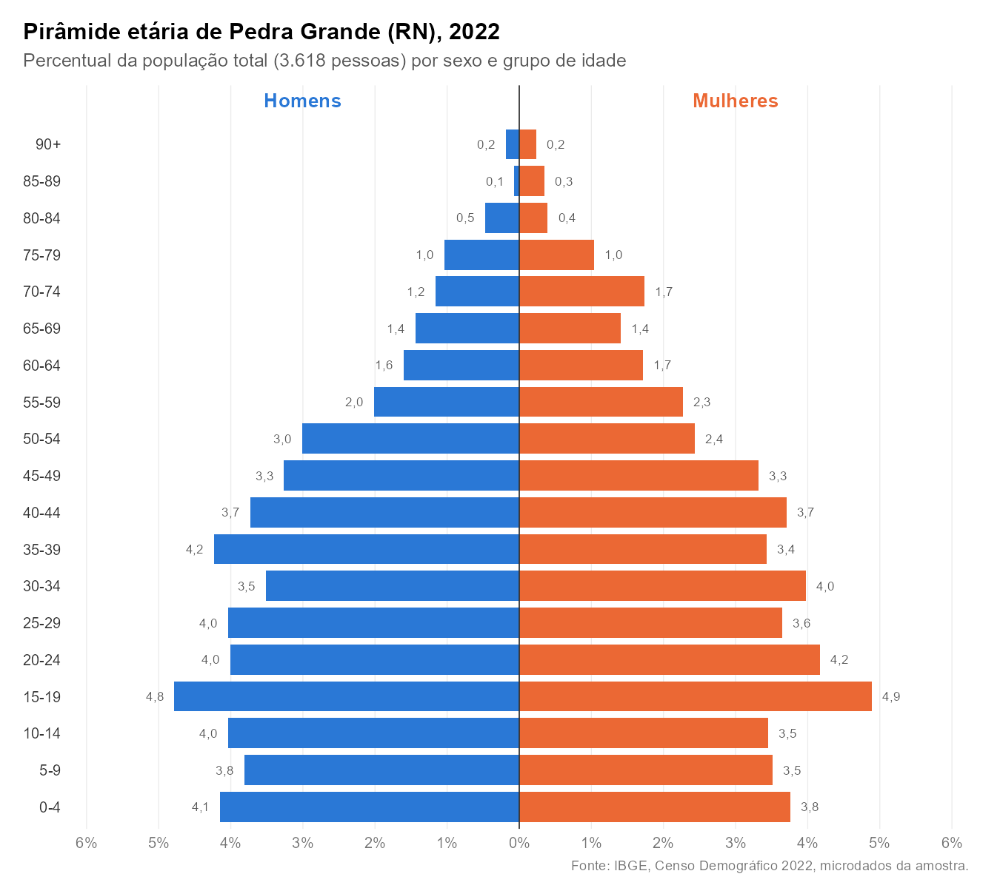

# Pedra Grande (RN)

Resultados do Censo Demográfico 2022 (microdados da amostra). Gerado por `R/05_readmes.R`; veja a [página dos municípios](../README.md) e o [README principal](../../../../README.md).

População: **3.618** pessoas (1.192 registros na amostra).

## Estrutura etária

| Indicador | Pedra Grande | RN |
|---|--:|--:|
| Razão de dependência jovem | 33,5 | 28,5 |
| Razão de dependência idosa | 14,1 | 15,1 |
| Razão de dependência total | 47,6 | 43,6 |
| Índice de envelhecimento | 42,0 | 52,9 |

Valores por 100 pessoas.

## Migração

Chegadas e saídas: mudanças de município nos últimos 10 anos.

| Indicador | Valor |
|---|--:|
| Nascidos no próprio município | 58,8% |
| Nascidos em outro município do Rio Grande do Norte | 39,4% |
| Nascidos em outra UF | 1,8% |
| Nascidos no exterior | 0,0% |
| Chegaram de outro município do Rio Grande do Norte | 553 |
| Chegaram de outra UF | 30 |
| Saíram para outro município da UF | 339 |
| Saíram para outra UF | 91 |
| Saldo migratório | +153 |
| Saldo por 1.000 habitantes | +42,3 |
| Chegaram do exterior | 0 |

Principais origens de quem chegou e destinos de quem saiu:

| Origem | Chegaram | Destino | Saíram |
|---|--:|---|--:|
| Natal (RN) | 229 | Natal (RN) | 111 |
| Parazinho (RN) | 60 | São Gonçalo do Amarante (RN) | 102 |
| São Miguel do Gostoso (RN) | 34 | Cajamar (SP) | 37 |
| João Câmara (RN) | 30 | Parazinho (RN) | 34 |
| Caiçara do Norte (RN) | 23 | São Gonçalo (RJ) | 21 |

## Mortalidade

Óbitos de agosto de 2021 a julho de 2022 informados no Censo.

| Indicador | Pedra Grande | RN |
|---|--:|--:|
| Óbitos no período | 22 | 22.488 |
| Registros de óbito na amostra | 7 |  |
| Taxa bruta de mortalidade (por mil) | 6,1 | 6,8 |
| Taxa padronizada por idade (por mil) | 7,1 | 6,8 |

Com poucos óbitos na amostra, as taxas deste município variam muito por acaso; por isso não há tábua de vida. Sem correção do sub-registro de óbitos do Censo.
