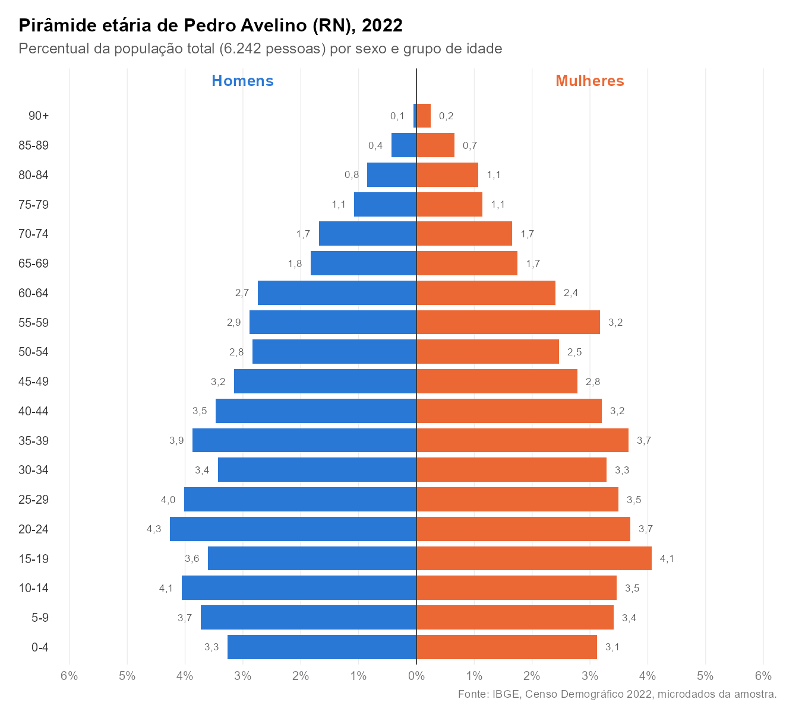

# Pedro Avelino (RN)

Resultados do Censo Demográfico 2022 (microdados da amostra). Gerado por `R/05_readmes.R`; veja a [página dos municípios](../README.md) e o [README principal](../../../../README.md).

População: **6.242** pessoas (2.100 registros na amostra).

## Estrutura etária

| Indicador | Pedro Avelino | RN |
|---|--:|--:|
| Razão de dependência jovem | 31,6 | 28,5 |
| Razão de dependência idosa | 18,7 | 15,1 |
| Razão de dependência total | 50,3 | 43,6 |
| Índice de envelhecimento | 59,0 | 52,9 |

Valores por 100 pessoas.

## Migração

Chegadas e saídas: mudanças de município nos últimos 10 anos.

| Indicador | Valor |
|---|--:|
| Nascidos no próprio município | 79,7% |
| Nascidos em outro município do Rio Grande do Norte | 19,6% |
| Nascidos em outra UF | 0,6% |
| Nascidos no exterior | 0,0% |
| Chegaram de outro município do Rio Grande do Norte | 823 |
| Chegaram de outra UF | 39 |
| Saíram para outro município da UF | 783 |
| Saíram para outra UF | 31 |
| Saldo migratório | +49 |
| Saldo por 1.000 habitantes | +7,8 |
| Chegaram do exterior | 0 |

Principais origens de quem chegou e destinos de quem saiu:

| Origem | Chegaram | Destino | Saíram |
|---|--:|---|--:|
| Natal (RN) | 318 | Guamaré (RN) | 196 |
| Guamaré (RN) | 113 | Natal (RN) | 144 |
| Afonso Bezerra (RN) | 91 | Afonso Bezerra (RN) | 88 |
| Macau (RN) | 42 | São Gonçalo do Amarante (RN) | 76 |
| Parnamirim (RN) | 29 | Parnamirim (RN) | 61 |

## Mortalidade

Óbitos de agosto de 2021 a julho de 2022 informados no Censo.

| Indicador | Pedro Avelino | RN |
|---|--:|--:|
| Óbitos no período | 56 | 22.488 |
| Registros de óbito na amostra | 19 |  |
| Taxa bruta de mortalidade (por mil) | 9,0 | 6,8 |
| Taxa padronizada por idade (por mil) | 8,8 | 6,8 |

Com poucos óbitos na amostra, as taxas deste município variam muito por acaso; por isso não há tábua de vida. Sem correção do sub-registro de óbitos do Censo.
