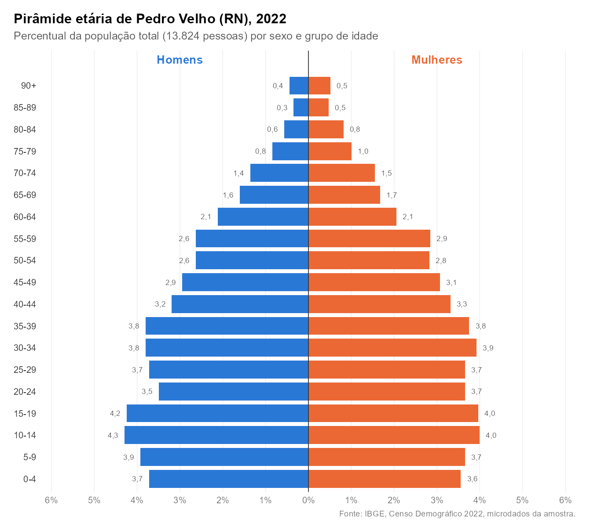

# Pedro Velho (RN)

Resultados do Censo Demográfico 2022 (microdados da amostra). Gerado por `R/05_readmes.R`; veja a [página dos municípios](../README.md) e o [README principal](../../../../README.md).

População: **13.824** pessoas (2.756 registros na amostra).

## Estrutura etária

| Indicador | Pedro Velho | RN |
|---|--:|--:|
| Razão de dependência jovem | 35,3 | 28,5 |
| Razão de dependência idosa | 17,1 | 15,1 |
| Razão de dependência total | 52,3 | 43,6 |
| Índice de envelhecimento | 48,4 | 52,9 |

Valores por 100 pessoas.

## Migração

Chegadas e saídas: mudanças de município nos últimos 10 anos.

| Indicador | Valor |
|---|--:|
| Nascidos no próprio município | 78,4% |
| Nascidos em outro município do Rio Grande do Norte | 13,9% |
| Nascidos em outra UF | 7,7% |
| Nascidos no exterior | 0,0% |
| Chegaram de outro município do Rio Grande do Norte | 1.047 |
| Chegaram de outra UF | 366 |
| Saíram para outro município da UF | 975 |
| Saíram para outra UF | 415 |
| Saldo migratório | +24 |
| Saldo por 1.000 habitantes | +1,7 |
| Chegaram do exterior | 3 |

Principais origens de quem chegou e destinos de quem saiu:

| Origem | Chegaram | Destino | Saíram |
|---|--:|---|--:|
| Natal (RN) | 293 | Natal (RN) | 217 |
| Canguaretama (RN) | 230 | Canguaretama (RN) | 205 |
| Montanhas (RN) | 146 | Parnamirim (RN) | 147 |
| Rio de Janeiro (RJ) | 95 | Montanhas (RN) | 96 |
| Nova Cruz (RN) | 94 | Goianinha (RN) | 66 |

## Mortalidade

Óbitos de agosto de 2021 a julho de 2022 informados no Censo.

| Indicador | Pedro Velho | RN |
|---|--:|--:|
| Óbitos no período | 135 | 22.488 |
| Registros de óbito na amostra | 27 |  |
| Taxa bruta de mortalidade (por mil) | 9,8 | 6,8 |
| Taxa padronizada por idade (por mil) | 8,2 | 6,8 |

Com poucos óbitos na amostra, as taxas deste município variam muito por acaso; por isso não há tábua de vida. Sem correção do sub-registro de óbitos do Censo.
