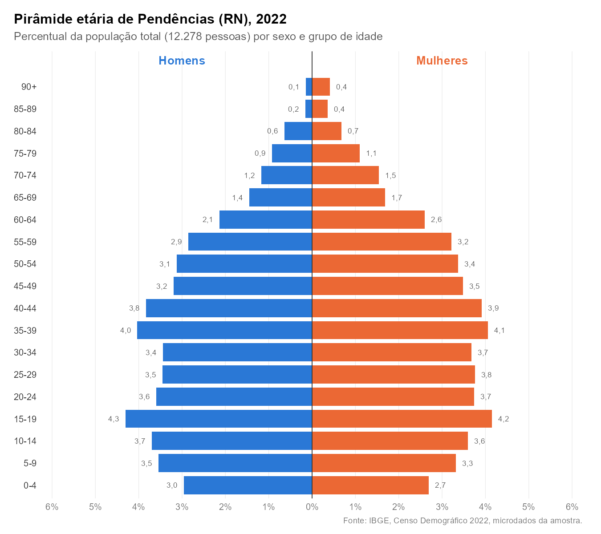

# Pendências (RN)

Resultados do Censo Demográfico 2022 (microdados da amostra). Gerado por `R/05_readmes.R`; veja a [página dos municípios](../README.md) e o [README principal](../../../../README.md).

População: **12.278** pessoas (2.421 registros na amostra).

## Estrutura etária

| Indicador | Pendências | RN |
|---|--:|--:|
| Razão de dependência jovem | 28,3 | 28,5 |
| Razão de dependência idosa | 14,7 | 15,1 |
| Razão de dependência total | 43,0 | 43,6 |
| Índice de envelhecimento | 51,8 | 52,9 |

Valores por 100 pessoas.

## Migração

Chegadas e saídas: mudanças de município nos últimos 10 anos.

| Indicador | Valor |
|---|--:|
| Nascidos no próprio município | 57,2% |
| Nascidos em outro município do Rio Grande do Norte | 40,1% |
| Nascidos em outra UF | 2,6% |
| Nascidos no exterior | 0,0% |
| Chegaram de outro município do Rio Grande do Norte | 1.029 |
| Chegaram de outra UF | 166 |
| Saíram para outro município da UF | 1.186 |
| Saíram para outra UF | 132 |
| Saldo migratório | -123 |
| Saldo por 1.000 habitantes | -10,1 |
| Chegaram do exterior | 0 |

Principais origens de quem chegou e destinos de quem saiu:

| Origem | Chegaram | Destino | Saíram |
|---|--:|---|--:|
| Natal (RN) | 255 | Alto do Rodrigues (RN) | 200 |
| Macau (RN) | 145 | Macau (RN) | 131 |
| Alto do Rodrigues (RN) | 114 | Natal (RN) | 122 |
| Mossoró (RN) | 94 | Mossoró (RN) | 105 |
| Ipanguaçu (RN) | 61 | Afonso Bezerra (RN) | 85 |

## Mortalidade

Óbitos de agosto de 2021 a julho de 2022 informados no Censo.

| Indicador | Pendências | RN |
|---|--:|--:|
| Óbitos no período | 98 | 22.488 |
| Registros de óbito na amostra | 19 |  |
| Taxa bruta de mortalidade (por mil) | 8,0 | 6,8 |
| Taxa padronizada por idade (por mil) | 7,8 | 6,8 |

Com poucos óbitos na amostra, as taxas deste município variam muito por acaso; por isso não há tábua de vida. Sem correção do sub-registro de óbitos do Censo.
